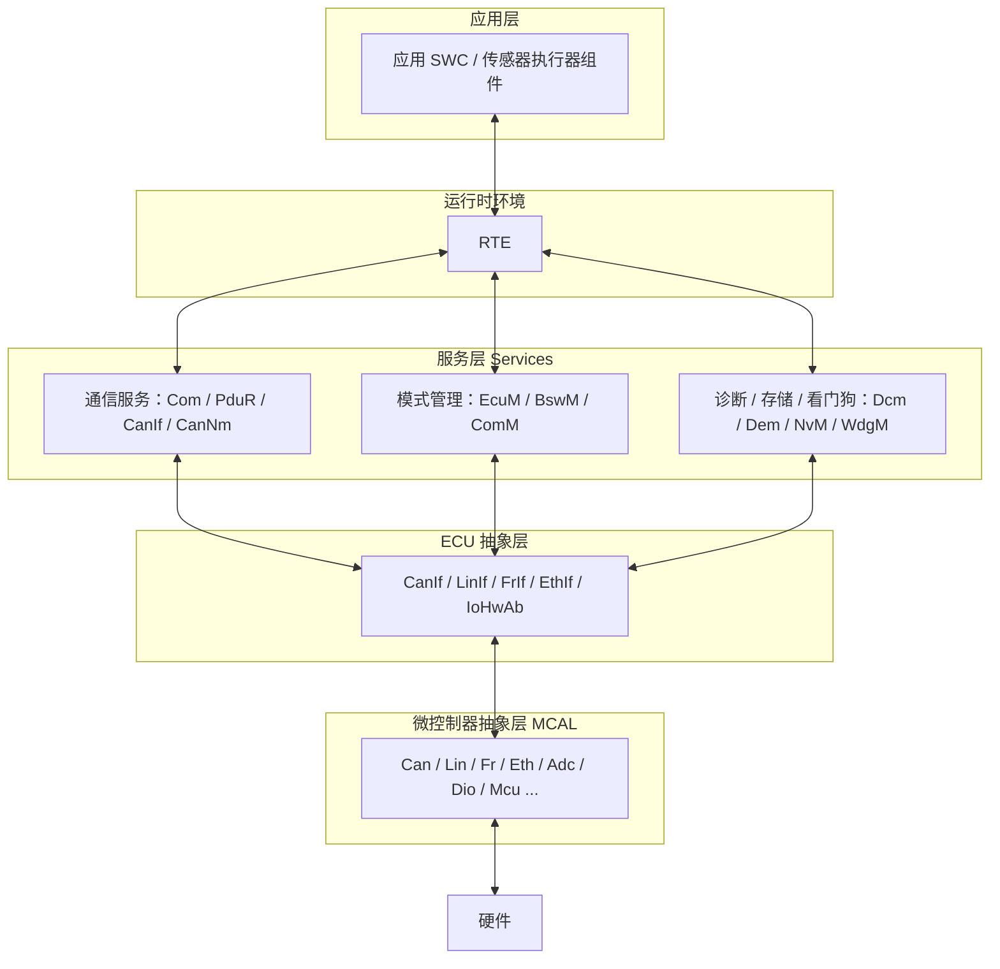

# AUTOSAR 学习总览

> [!info] 导航
> 规范：[[README]] ｜ 学习路线：[[AUTOSAR_Classic_模块学习路线]]
> 本页是整库唯一的总入口：**AUTOSAR 总体 → 模块 → 主题 → 细节**。

## 1. AUTOSAR 总体

AUTOSAR（AUTomotive Open System ARchitecture）是汽车电子的分层软件架构标准：应用软件与底层硬件解耦，通过 RTE 通信，BSW 提供通信/诊断/存储/模式管理等基础服务。

> 说明：本库以 **Classic Platform（CP）R21-11** 为学习基准，模块入口都在下方模块地图中。

## 2. 模块地图

| 模块 | 状态 | 入口 | 备注 |
|---|---|---|---|
| CanNm | ✅ v3 | [[CanNm]] | 通信服务：CAN 网络管理 |
| BswM | ✅ v3 | [[BswM]] | 模式管理：模式仲裁 + 模式控制 |
| Com / EcuM / NvM / Dcm / Dem / Os … | ⬜ 未开始 | — | 按 [[README]] 模板新建 |

## 3. 按主题索引

| 主题 | 涉及模块 | 说明 |
|---|---|---|
| 通信 | CanIf、CanNm、PduR、Com、ComM | 报文收发、网络管理、路由、通信模式 |
| 模式管理 | EcuM、BswM、ComM | ECU 启动/运行/休眠、模式仲裁 |
| 诊断 | Dcm、Dem、CanTp | 诊断服务、故障码、分段传输 |
| 存储 | NvM、Fee、Fls、Ea | 掉电存储链路 |
| 安全与监控 | E2E、Crc、SecOC、WdgM | 校验、加密、程序流监控 |

## 4. 学习资源

- 规范：[[README]]（7 项交付物、引用与导航规范）
- 路线：[[AUTOSAR_Classic_模块学习路线]]
- 工具：`_工具/autosar_docs.py`（官方文档下载 + 文本提取）
- 说明：`AUTOSAR/` 子目录与 `AUTOSAT使用NEUSAR生成的代码/` 为个人实战目录，本总览保持独立、不接入引用结构。

## 5. 更新记录

| 日期 | 内容 |
|---|---|
| 2026-10-21 | 建立 L0 总览；接入 CanNm 模块（v3 引用结构） |
