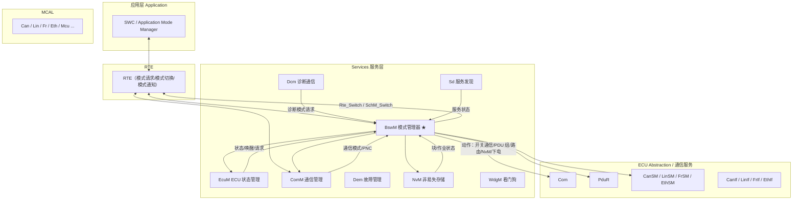

# BswM 模块作用与架构定位

> [!info] 导航
> 上级：[[BswM]] ｜ 依赖：[[BswM_D3_规则仲裁调用逻辑]]、[[BswM_D4_动作列表与动作执行调用逻辑]] ｜ 依据：[[BswM_AUTOSAR标准需求表_R21-11#SWS_BswM_000xx|需求表]]

> 适用版本：AUTOSAR CP R21-11　依据文档：AUTOSAR_SWS_BSWModeManager（Document ID 313）、AUTOSAR_EXP_ModeManagementGuide（Document ID 440）
> 最后更新：2026-10-17

## 1. 一句话定位

**BswM（BSW Mode Manager，基础软件模式管理器）是 BSW 中"按规则仲裁模式请求、并执行模式动作"的模块。**
它本身几乎不含业务逻辑，行为完全由配置决定：把来自 SWC、EcuM、ComM、Dcm、各总线状态管理器等的模式请求/指示，用**布尔规则**归并成"该进入什么模式"，再通过**动作列表（Action List）**去调用其他 BSW 模块的 API，完成通信开关、PDU 组切换、NvM 读写、RTE 模式切换、下电等动作。

一句话：**BswM = 模式仲裁（Mode Arbitration） + 模式控制（Mode Control）**。

> SWS 第 1 章原文：*"arbitrate mode requests from application layer SW-Cs or other BSW modules based on simple rules, and perform actions based on the arbitration result."*

## 2. 在 AUTOSAR CP 分层架构中的位置

要点：

- BswM 位于 **Services 层**，是"服务组件（Service Component）"，既可通过 RTE 的端口与 SWC 交互，也可通过 C-API 与其他 BSW 模块交互（SWS 7.6）。
- 它**不直接操作硬件**，所有实际动作都委托给 Com / PduR / ComM / EcuM / NvM / 各 SM / RTE 等模块。
- 与 EcuM 的分工：EcuM 负责**启动/关机流程、唤醒源、驱动初始化**；BswM 负责**运行期间的 ECU/应用/通信模式仲裁**。R21-11 中 EcuM 只把状态告知 BswM，由 BswM 决策（ECU Mode Handling，见 EXP 3.3.1）。
- 与 ComM 的分工：ComM 管理**通信通道状态机**（NO/SILENT/FULL COMMUNICATION），BswM 决定**何时允许/请求通信**（BswMComMAllowCom / BswMComMModeSwitch），并把通信模式变化通知应用。

## 3. 模式管理概念体系（理解 BswM 的前提）

| 概念 | 含义 | BswM 中的体现 |
|---|---|---|
| Mode / ModeDeclarationGroup | 一组互斥的枚举模式（如 `ECU_RUN`、`COMM_FULL_COMMUNICATION`） | 配置中引用 `ModeDeclarationGroup` |
| Mode Request | 请求方"希望进入某模式"（SWC 经 RTE，BSW 经 C-API） | `BswMModeRequestPort` + `BswMModeRequestSource` |
| Mode Indication | 其他模块"告知当前状态"（CanSM、ComM、EcuM…） | 同样是 `BswMModeRequestPort`，BswM 统一对待 |
| Event Request | 只表示事件发生（SET/CLEAR），没有模式值 | `BswMEventRequestPort`（如 ComM 请求复位） |
| Mode Switch | 模式管理器真正切换模式并通知使用者 | `BswMSwitchPort` → `Rte_Switch_*` / `SchM_Switch_*` |
| Mode User | 订阅模式变化的使用者 | SWC 的 R-Port、其他 BSW 的模式通知端口 |
| Mode Condition | 对某个请求端口的判断：EQUAL / NOT_EQUAL / EVENT_IS_SET / EVENT_IS_CLEARED | `BswMModeCondition` |
| Rule | 由条件组成的逻辑表达式，结果为 True/False | `BswMRule`（AND/OR/XOR/NOT/NAND） |
| Action List | 规则命中后按序号执行的动作集合 | `BswMActionList` + `BswMActionListItem` |
| Action | 对某个 BSW 模块的具体 API 调用 | `BswMAvailableActions` 下的各动作容器 |

> 关键理解：**BswM 内部没有"状态机代码"，只有"规则求值 + 动作执行"两段通用逻辑**。所有业务差异都在配置里（SWS 7 章开头："should be seen as a mode management framework module in which behavior is completely defined by its configuration"）。

## 4. 两大核心机制

### 4.1 Mode Arbitration（模式仲裁）

- 规则 = 若干 Mode Condition 的布尔组合（SWS 7.1.2）。
- 触发时机：
  - **IMMEDIATE**：收到请求的上下文里立刻求值（`BswMRequestProcessing = BSWM_IMMEDIATE`）；
  - **DEFERRED**：等到 `BswM_MainFunction` 周期求值（`BSWM_DEFERRED`）。
- 规则只允许引用"条件"，**不允许引用其他规则的结果**（SWS_BswM_00117），避免环状依赖。
- 求值结果变化 → 触发对应 True/False 动作列表；动作列表执行方式分 **TRIGGER**（仅结果变化时执行）与 **CONDITION**（每次求值都执行）。
- 初始化后首次求值行为由 `BswMRuleInitState`（UNDEFINED/TRUE/FALSE）决定（SWS 7.2.5 表 7.1）。
- 未定义初值且尚未收到过请求的端口，其条件视为"未定义"，**含未定义条件的规则不参与仲裁**（SWS_BswM_00064 / 00241）。

### 4.2 Mode Control（模式控制）

- 动作列表是**有序**的（按 `BswMActionListItemIndex` 升序），列表项可以是：
  1. 原子动作（调用其他 BSW 的 API）；
  2. 引用另一个动作列表（级联，最多 7 层，SWS_BswM_00037）；
  3. 引用一条规则（在当前列表执行上下文中再求值，形成规则层级）。
- 顶层列表可配优先级 `BswMActionListPriority`（0~255，越大越先执行，SWS_BswM_00275）。
- 动作失败（返回 E_NOT_OK）时，若该项 `BswMAbortOnFail=true` 则中止本列表（SWS_BswM_00055），并可上报 Det Runtime Error。
- 动作的具体 API 由配置决定，例如 `Com_IpduGroupStart/Stop`、`ComM_RequestComMode`、`Nm_EnableCommunication`、`NvM_ReadAll/WriteAll`（通过 UserCallout）、`EcuM_GoDownHaltPoll`、`Rte_Switch_*`、`SchM_Switch_*`、`PduR_EnableRouting/DisableRouting`、`EthIf_StartAllPorts` 等。

## 5. 为什么需要 BswM（工程视角）

1. **集中化**：过去分散在 EcuM、ComM、应用里的"什么时候开通信/关通信/进诊断/休眠"逻辑，统一收拢到 BswM 的规则表里，可读、可评审、可裁剪。
2. **可配置**：不同车型/配置通过改规则和动作列表实现，不改代码。
3. **与 RTE 解耦**：应用只发"模式请求"、收"模式通知"，不直接调用 BSW API。
4. **模式冲突仲裁**：多个请求方（诊断禁用通信 vs 应用要求通信）冲突时，由规则给出确定结果。
5. **启动/关机流程可视化**：R21-11 推荐把启动各阶段（STARTUP → RUN → POST_RUN → SHUTDOWN → SLEEP）建模成 BswM 规则和动作列表，形成一条可追踪的启动链。

## 6. 模块边界：输入与输出

| 方向 | 来源/去向 | 典型接口 |
|---|---|---|
| 输入 | EcuM | `BswM_EcuM_CurrentState`、`BswM_EcuM_CurrentWakeup`、`BswM_EcuM_RequestedState` |
| 输入 | ComM | `BswM_ComM_CurrentMode`、`BswM_ComM_CurrentPNCMode`、`BswM_ComM_InitiateReset` |
| 输入 | Dcm | `BswM_Dcm_CommunicationMode_CurrentState`、`BswM_Dcm_ApplicationUpdated` |
| 输入 | 总线 SM | `BswM_CanSM_CurrentState`、`BswM_LinSM_CurrentState`、`BswM_FrSM_CurrentState`、`BswM_EthSM_CurrentState` |
| 输入 | NvM | `BswM_NvM_CurrentBlockMode`、`BswM_NvM_CurrentJobMode` |
| 输入 | Nm / Sd / SoAd / J1939 / EthIf | `BswM_Nm_*`、`BswM_Sd_*`、`BswM_SoAd_SoConModeChg`、`BswM_J1939*`、`BswM_EthIf_PortGroupLinkStateChg` |
| 输入 | SWC（经 RTE） | `BswM_RequestMode`（通用请求）/ `BswMSwcModeRequest` R-Port / `BswMSwcModeNotification` 模式通知 |
| 输入 | 内部定时器 | `BswMTimer`（只能由 `BswMTimerControl` 动作控制） |
| 输出 | RTE / SWC | `Rte_Switch_*`（模式切换）、`BswMSwitchPort` P-Port |
| 输出 | SchM | `SchM_Switch_*`（BSW 调度器模式） |
| 输出 | Com | `Com_IpduGroupStart/Stop`、`Com_Enable/DisableReceptionDM`、`Com_TriggerIPDUSend`、`Com_SwitchIpduTxMode` |
| 输出 | PduR | `PduR_EnableRouting/DisableRouting` |
| 输出 | ComM | `ComM_RequestComMode`、`ComM_AllowCom`、模式限制 |
| 输出 | EcuM | `EcuM_GoDownHaltPoll`、`EcuM_SelectShutdownTarget`、`EcuM_StateSwitch`、驱动初始化列表 |
| 输出 | Nm | `Nm_EnableCommunication/DisableCommunication` |
| 输出 | 其他 | `LinSM_ScheduleRequest`、`EthIf_StartAllPorts`、`J1939Dcm_SetState`、`J1939Rm_SetState`、`FrSM_SetEcuPassive` 等 |

## 7. 关键类型与常量（写代码/看生成代码必备）

| 名称 | 作用 |
|---|---|
| `BswM_ConfigType` | `BswM_Init` 的配置结构体（支持 post-build 配置） |
| `BswM_ModeType` | 模式值类型（对应 ModeDeclarationGroup 的数值） |
| `BswM_UserType` | 通用请求者 ID（`BswM_RequestMode` 的第一个参数） |
| `BSWM_IMMEDIATE` / `BSWM_DEFERRED` | 请求处理时机 |
| `BSWM_TRIGGER` / `BSWM_CONDITION` | 动作列表执行方式 |
| `BSWM_UNDEFINED` / `BSWM_TRUE` / `BSWM_FALSE` | 规则初始化"上次结果" |
| `BSWM_EQUALS` / `BSWM_EQUALS_NOT` / `BSWM_EVENT_IS_SET` / `BSWM_EVENT_IS_CLEARED` | 条件类型 |
| `BSWM_AND/NAND/NOT/OR/XOR` | 逻辑表达式运算符 |
| `BSWM_TIMER_STOPPED/STARTED/EXPIRED` | BswMTimer 状态 |

## 8. R21-11 版本要点（相对老版本）

- 新增 `BswM_SoAd_SoConModeChg`（SoAd 套接字连接模式变化请求）。
- `BswM_WdgM_RequestPartitionReset` 及配置被标记 **obsolete**（WdgM 分区复位走其他机制）。
- 支持以太网交换机端口组切换（`BswMEthIfSwitchPortGroupRequestMode`、`BswM_EthIf_PortGroupLinkStateChg`，SWS 7.7）。
- 恢复 EcuM↔BswM 的 `BswM_EcuM_CurrentState` / `BswM_EcuM_RequestedState`（R19-11 曾删除）。
- 新增 `BswMNmStateChangeNotification`、`BswMSwitchAckNotification` 及动作优先级 `BswMActionListPriority`。
- 不再支持 pretended networking。做存量项目对比时注意版本差异。

## 9. 常见误区

1. **把 BswM 当 EcuM 用**：它不做唤醒源校验、不做驱动初始化，那是 EcuM 的职责。
2. **以为有隐式状态机**：除 BswMTimer 外没有"状态"，状态都来自外部请求端口的值。
3. **在规则里引用规则结果**：标准禁止（SWS_BswM_00117）；需要层级就把规则放进动作列表。
4. **忽略初始化未定义条件**：上电后某些端口还没收到指示，相关规则会被跳过，这是很多"上电后通信不开"问题的根因。
5. **动作列表顺序写错**：开通信前先开 PDU 组、关通信后再关 NM，顺序敏感。
6. **IMEDIATE 里做重活**：immediate 在调用者上下文（可能是中断）执行，重动作会破坏时序。

## 10. 对应官方文档章节

| 主题 | 章节 |
|---|---|
| 功能概述 | SWS 第 1 章 |
| 与其他模块依赖 | SWS 第 5 章 |
| 仲裁规则/即时与延迟 | SWS 7.1、7.1.3.1 |
| 模式控制/动作列表 | SWS 7.2、7.2.2~7.2.5 |
| 定时器 | SWS 7.3 |
| 多分区 | SWS 7.4 |
| 接口与端口 | SWS 7.6 |
| API 列表 | SWS 8.3、8.5、8.6 |
| 时序图 | SWS 第 9 章 |
| 配置参数 | SWS 第 10 章 |
| 配置流程与示例 | EXP_ModeManagementGuide 第 3 章、第 4 章 |
