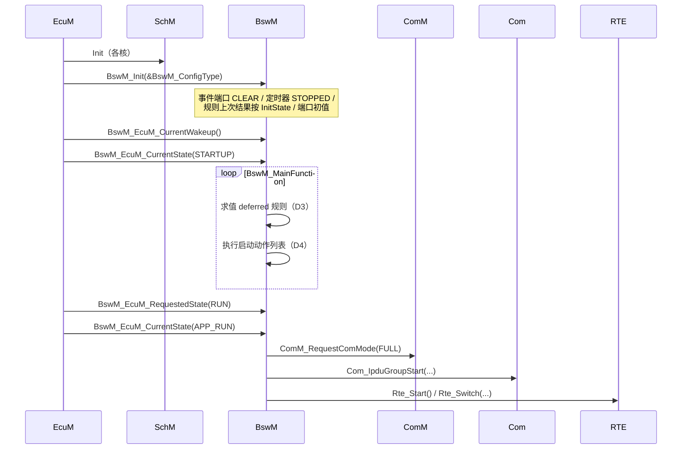

# BswM D1：初始化与启动调用逻辑

> [!info] 导航
> 上级：[[BswM_调用逻辑总览]] ｜ 依赖：[[BswM_D3_规则仲裁调用逻辑]]、[[BswM_D5_状态转换表#初始化阶段]] ｜ 依据：[[BswM_AUTOSAR标准需求表_R21-11#SWS_BswM_000xx|需求表]]

> 适用版本：AUTOSAR CP R21-11　依据：SWS_BswM 7.1.4、8.3.16、SWS_EcuM 7.9
> 最后更新：2026-10-21

## 1. 场景

ECU 上电 → EcuM 完成 OS/SchM 初始化 → 调用 `BswM_Init` → BswM 进入可仲裁状态 → 启动阶段 EcuM 依次上报状态/唤醒/请求 → 规则命中 → 启动动作列表执行（开通信、启动 RTE、读 NvM 等）。

## 2. 调用链（从上到下）

```text
【初始化】
EcuM StartPostOS
  └─ BswM_Init(&BswM_ConfigType)                    [SWS_BswM_00002/00043]
      ├─ 选择配置集（post-build 指针）
      ├─ DevErrorDetect：校验配置边界（失败报 BSWM_E_PARAM_CONFIG）
      ├─ 初始化模块全局变量（00044）
      ├─ 所有 BswMEventRequestPort → CLEAR（00251）
      ├─ 所有 BswMTimer → STOPPED（00261）
      ├─ 规则"上次结果"按 BswMRuleInitState 置初值（00066）
      └─ 配置了 BswMModeInitValue 的端口置初始模式值（00203）
          未配置初值且未收到请求的端口 = 未定义（00064）

【启动阶段输入】
EcuM → BswM_EcuM_CurrentWakeup(src, VALIDATED/...)
EcuM → BswM_EcuM_CurrentState(STARTUP / APP_RUN ...)
EcuM → BswM_EcuM_RequestedState(RUN/POST_RUN)

【周期处理】
SchM → BswM_MainFunction()
  ├─ D3：仲裁 deferred 规则
  └─ D4：执行启动动作列表
      ├─ BswMRteStart 动作 → Rte_Start()
      ├─ BswMComMModeSwitch → ComM_RequestComMode(FULL)
      ├─ BswMNMControl → Nm_EnableCommunication()
      ├─ BswMPduGroupSwitch → Com_IpduGroupStart()
      ├─ BswMRteSwitch → Rte_Switch_...（ECU 模式通知应用）
      └─ BswMUserCallout → NvM_ReadAll()（配置决定）
```

## 3. 关键时序



## 4. 状态与数据变化

| 数据 | 初始化后 | 依据 |
|---|---|---|
| 模块状态 | 未初始化 → 已初始化（可仲裁） | 00043 |
| 事件端口 | 全部 CLEAR | 00251 |
| 定时器 | 全部 STOPPED | 00261 |
| 规则上次结果 | 由 `BswMRuleInitState` 决定（UNDEFINED/TRUE/FALSE） | 00066 |
| 端口初值 | 配了 `BswMModeInitValue` 才有值，否则"未定义" | 00203、00064 |
| 动作执行 | `BswM_Init` 只初始化；启动动作由主函数按规则执行 | 7.2 |

## 5. 输出

- 启动动作列表：`Rte_Start`、`ComM_RequestComMode`、`Nm_EnableCommunication`、`Com_IpduGroupStart`、`Rte_Switch`；
- 可选：`EcuM_AL_DriverInitBswM_*`（驱动初始化列表）、`NvM_ReadAll`（UserCallout）；
- 模式切换通知：`Rte_Switch_*` / `SchM_Switch_*`。

## 6. 需求依据

SWS_BswM_00002、00043、00044、00045、00064、00066、00118、00120、00203、00251、00261；SWS_EcuM_04014（EcuM 调用 BswM_Init）。

## 7. 观测点 / 排障

1. `BswM_Init` 是否在 SchM/OS 初始化之后调用（只依赖 OS/SchM）；
2. 启动后规则不生效：先查端口是否"未定义"（没配初值且还没收到指示）；
3. 启动阶段动作顺序：由动作列表 ItemIndex 决定，开通信前应先启动发送链路；
4. 若 `BswM_Deinit` 已调用，后续所有模式处理停止（00120）。
