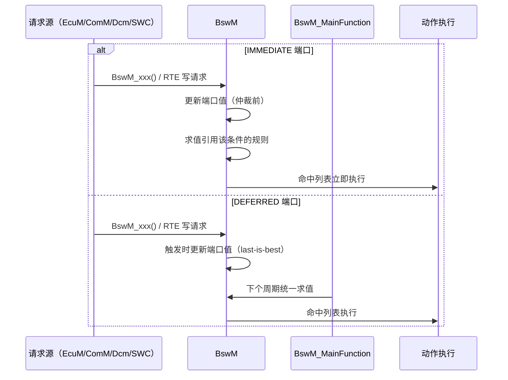

# BswM D2：模式请求与事件输入调用逻辑

> [!info] 导航
> 上级：[[BswM_调用逻辑总览]] ｜ 依赖：[[BswM_D3_规则仲裁调用逻辑]]、[[BswM_D5_状态转换表#规则求值状态]] ｜ 依据：[[BswM_AUTOSAR标准需求表_R21-11#SWS_BswM_000xx|需求表]]

> 适用版本：AUTOSAR CP R21-11　依据：SWS_BswM 7.1.2、7.1.3、7.6
> 最后更新：2026-10-21

## 1. 场景

BswM 的输入统一表现为"端口值"：模式请求/指示写入 `BswMModeRequestPort`，事件写入 `BswMEventRequestPort`。本方向说明输入从哪里来、IMMEDIATE/DEFERRED 如何决定处理时机。

## 2. 输入来源（谁调用 BswM）

| 来源 | 典型接口 | 对应配置 |
|---|---|---|
| EcuM | `BswM_EcuM_CurrentState` / `CurrentWakeup` / `RequestedState` | `BswMEcuMIndication` / `BswMEcuMWakeupSource` / `BswMEcuMRUNRequestIndication` |
| ComM | `BswM_ComM_CurrentMode` / `CurrentPNCMode` / `InitiateReset` | `BswMComMIndication` / `BswMComMPncRequest` / 事件 `BswMComMInitiateReset` |
| Dcm | `BswM_Dcm_CommunicationMode_CurrentState` / `ApplicationUpdated` | `BswMDcmComModeRequest` / 事件 |
| 总线 SM | CanSM/LinSM/FrSM/EthSM/EthIf 的 `BswM_*_CurrentState` | 对应 `BswM*Indication` |
| NvM | `BswM_NvM_CurrentBlockMode` / `CurrentJobMode` | `BswMNvMRequest` / `BswMNvMJobModeIndication` |
| Nm/Sd/SoAd/J1939 | `BswM_Nm_*` / `BswM_Sd_*` / `BswM_SoAd_SoConModeChg` / `BswM_J1939*` | 对应端口 |
| SWC（RTE） | `BswM_RequestMode` 或 R-Port（`BswMSwcModeRequest`） | 通用请求 / 模式请求端口 |
| RTE/SchM 模式通知 | `Rte_Mode` / `SchM_Mode` 读值 | `BswMSwcModeNotification` / `BswMBswModeNotification` |
| 事件 | ComM Reset、Dcm 应用更新、Nm CarWakeup、分区重启、Switch Ack | `BswMEventRequestPort` |

## 3. IMMEDIATE 与 DEFERRED

```text
收到请求（API / RTE 接收事件）
  ├─ 端口配置 BswMRequestProcessing = BSWM_IMMEDIATE
  │    ├─ 请求上下文内触发相关规则求值（只求值用到该 immediate 条件的规则）
  │    └─ 命中动作列表立即执行（调用上下文可能是任务或中断）
  └─ 端口配置 BswMRequestProcessing = BSWM_DEFERRED
       ├─ 端口值在"收到时"更新
       └─ 等待 BswM_MainFunction 统一求值/执行
```

关键规则：

| 规则 | 依据 |
|---|---|
| IMMEDIATE 端口的值在**仲裁前**才更新；DEFERRED 端口在**触发时**更新 | 00281、00282 |
| 同一规则可混用 immediate/deferred 条件 | 00061 |
| immediate 请求只求值引用该条件的规则 | 00059 |
| 有至少一个 deferred 条件的规则每次主函数都求值 | 00060 |
| 主函数执行中到达的请求挂起：immediate 退出前处理，deferred 下一周期 | 00068 |
| immediate 请求处理中到达的请求同理挂起 | 00069 |

## 4. 事件端口（Event Request Port）

- 事件只有 SET/CLEAR 两态：API 调用把它置 SET（00254）；
- 动作 `BswMClearEventRequest` 把它清 CLEAR（00255）；
- 条件类型 `BSWM_EVENT_IS_SET` / `BSWM_EVENT_IS_CLEARED` 对事件端口求值（00252、00253）；
- 事件处理同样分 IMMEDIATE/DEFERRED（`BswMEventRequestProcessing`，00257、00258）。

## 5. 时序



## 6. 状态与数据变化

| 数据 | 变化 | 依据 |
|---|---|---|
| 端口值 | 被请求/指示覆盖（不排队，后写覆盖先写） | 7.1.3、EXP 3.2.3 |
| 事件端口 | SET（API）→ CLEAR（ClearEventRequest 动作） | 00254、00255 |
| 规则求值 | 由主函数/请求上下文触发 | D3 |
| 挂起请求 | 执行期间暂存 | 00068、00069 |

## 7. 输出

- 无直接外部输出；输入驱动 D3 仲裁，最终由 D4/D7 执行动作；
- 初始化失败或参数非法时：DET 上报（各 API 的 DevError 检查）。

## 8. 需求依据

SWS_BswM_00009、00013、00014、00035、00059、00060、00061、00068、00069、00147、00189、00251~00258、00278、00281、00282。

## 9. 观测点 / 排障

1. 请求"没反应"：确认端口是 IMMEDIATE 还是 DEFERRED（延迟 0~1 周期是正常的）；
2. 上电初期规则被跳过：端口未定义（00064/00241）；
3. 事件端口一直 SET：检查是否执行了 `BswMClearEventRequest`；
4. 中断上下文调用：IMMEDIATE 动作在调用者上下文执行，避免重动作。
