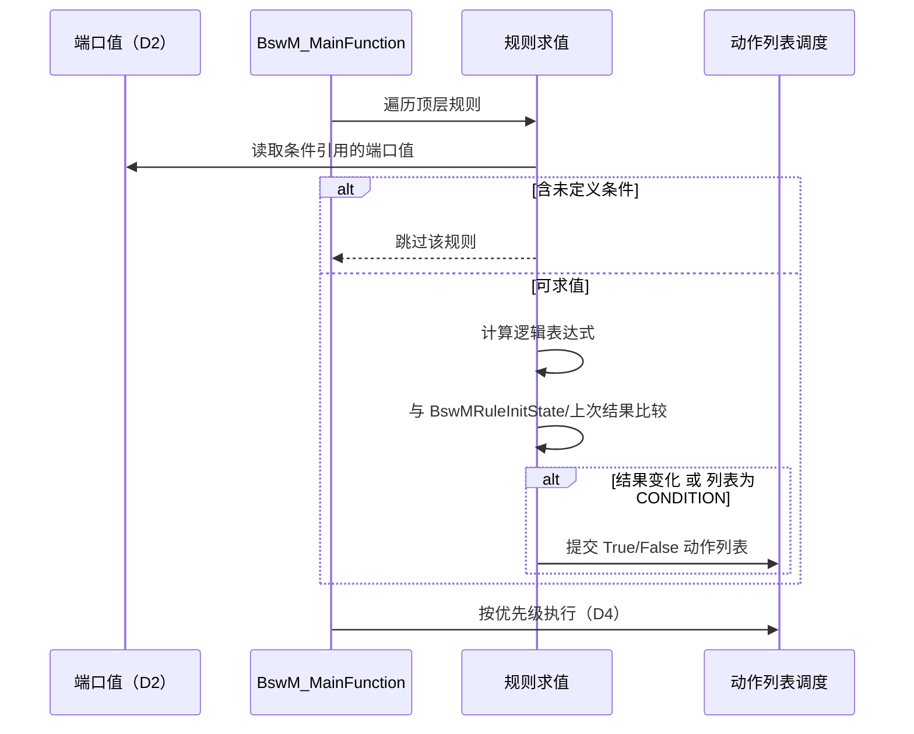

# BswM D3：规则仲裁调用逻辑

> [!info] 导航
> 上级：[[BswM_调用逻辑总览]] ｜ 依赖：[[BswM_D2_模式请求与事件输入调用逻辑]]、[[BswM_D4_动作列表与动作执行调用逻辑]]、[[BswM_D5_状态转换表#规则求值状态]] ｜ 依据：[[BswM_AUTOSAR标准需求表_R21-11#SWS_BswM_000xx|需求表]]

> 适用版本：AUTOSAR CP R21-11　依据：SWS_BswM 7.1、7.2.2、7.2.5
> 最后更新：2026-10-21

## 1. 场景

把"端口值"变成"该执行哪个动作列表"：条件（Condition）→ 逻辑表达式（Logical Expression）→ 规则（Rule）→ True/False 动作列表。

## 2. 调用链（从上到下）

```text
触发源
├─ IMMEDIATE 请求（D2）
│   └─ 求值"引用该 immediate 条件"的规则            [SWS_BswM_00059]
└─ BswM_MainFunction（DEFERRED）
    └─ 遍历所有顶层规则（BswMNestedExecutionOnly = FALSE）[00060/00075]
        ├─ 检查未定义条件：有则整条规则跳过           [00064/00241]
        ├─ 求值逻辑表达式
        │   ├─ BswMModeCondition：
        │   │   ├─ BSWM_EQUALS / BSWM_EQUALS_NOT（模式端口）
        │   │   └─ BSWM_EVENT_IS_SET / BSWM_EVENT_IS_CLEARED（事件端口）[00252/00253]
        │   └─ BswMLogicalExpression：AND / OR / XOR / NOT / NAND [00244~00248]
        ├─ 与"上次结果"比较（BswMRuleInitState 决定初值）[00066]
        ├─ 结果变化 → 选 True/False 动作列表
        │    └─ 列表执行方式：TRIGGER（仅变化）/ CONDITION（每次）[00011/00023/00115/00116]
        └─ 交给 D4 执行（同一顶层列表只触发一次）[00223]
```

## 3. 条件与表达式

| 元素 | 取值/含义 | 依据 |
|---|---|---|
| 条件类型 | `BSWM_EQUALS` / `BSWM_EQUALS_NOT`（模式端口）；`BSWM_EVENT_IS_SET` / `BSWM_EVENT_IS_CLEARED`（事件端口） | 00252、00253 |
| 逻辑运算符 | AND（全真）、OR（有真）、XOR（奇数真）、NOT（取反，1 参数）、NAND（全真则假，2 参数） | 00244~00248 |
| 参数约束 | NAND 必须 2 个参数；NOT 必须 1 个参数 | 00242、00243 |
| 求值顺序 | 标准不定义（不要依赖短路顺序写副作用） | 7.1.2 |

## 4. 规则

| 属性 | 说明 | 依据 |
|---|---|---|
| 表达式引用 | 一条规则引用一个逻辑表达式（或单个条件） | 7.2 |
| True/False 列表 | 结果对应两个可选动作列表 | 00015 |
| 初始化上次结果 | `BswMRuleInitState` = UNDEFINED / TRUE / FALSE | 00066 |
| 嵌套执行 | `BswMNestedExecutionOnly=TRUE` 的子规则只在被列表引用时求值 | 10.2.49 |
| 禁止引用规则结果 | 规则输入只能是条件，不能是其他规则结果 | 00117 |
| 触发/条件执行 | `BswMActionListExecution` 决定列表是"变化时"还是"每次"执行 | 00011、00023、00115、00116 |

## 5. 初始化后首次求值行为（SWS 表 7.1）

| RuleInitState | ActionListExecution | 规则首次为 True | 规则首次为 False |
|---|---|---|---|
| UNDEFINED | TRIGGER | 执行 True 列表 | 执行 False 列表 |
| TRUE | TRIGGER | 不执行 | 执行 False 列表 |
| FALSE | TRIGGER | 执行 True 列表 | 不执行 |
| 任意 | CONDITION | 执行 True 列表 | 执行 False 列表 |

## 6. 时序（deferred 仲裁）



## 7. 状态与数据变化

| 数据 | 变化 | 依据 |
|---|---|---|
| 端口值 | 只读（由 D2 更新） | 7.1.3 |
| 规则上次结果 | 每次求值后更新 | 7.2.5 |
| 待执行列表集合 | 命中规则后加入，去重 | 00223 |
| 事件端口 | 不在此清除（由 ClearEventRequest 动作清） | 00254/00255 |

## 8. 输出

- 命中规则对应的 True/False 动作列表 → 交给 D4 调度；
- 无外部 API 调用（动作执行在 D4/D7）。

## 9. 需求依据

SWS_BswM_00009、00010、00011、00012、00015、00023、00035、00059、00060、00061、00064、00066、00115、00116、00117、00147、00189、00223、00241~00248、00252~00255、00278、00281、00282。

## 10. 观测点 / 排障

1. 规则"永不命中"：条件引用的端口从未收到值（未定义 → 规则被跳过）；
2. 规则频繁触发：条件抖动，考虑 TRIGGER + 定时器去抖（D6）；
3. 首次行为不符预期：检查 `BswMRuleInitState` 与 `BswMActionListExecution` 组合（表 7.1）；
4. 逻辑结果不对：注意 NAND/NOT 参数个数约束、求值顺序不定义。
