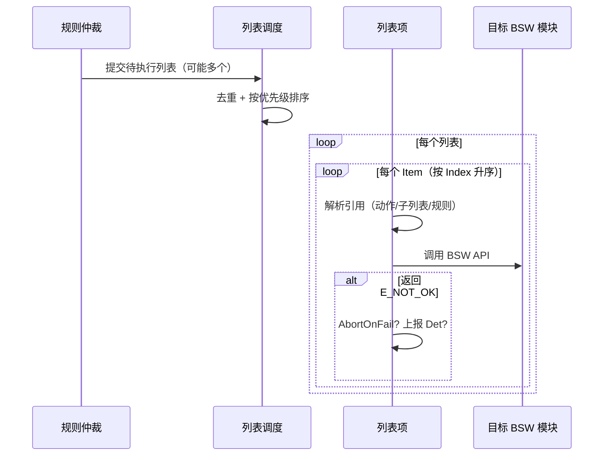

# BswM D4：动作列表与动作执行调用逻辑

> [!info] 导航
> 上级：[[BswM_调用逻辑总览]] ｜ 依赖：[[BswM_D3_规则仲裁调用逻辑]]、[[BswM_D7_输出动作与BSW交互]] ｜ 依据：[[BswM_AUTOSAR标准需求表_R21-11#SWS_BswM_000xx|需求表]]

> 适用版本：AUTOSAR CP R21-11　依据：SWS_BswM 7.2、7.3、7.5.2
> 最后更新：2026-10-21

## 1. 场景

规则命中后，按配置执行动作列表：列表是有序的动作集合，可级联子列表、嵌套规则；每个动作最终调用一个 BSW API。

## 2. 调用链（从上到下）

```text
D3 输出待执行动作列表（可能多个）
  └─ BswM_MainFunction 控制段
      ├─ 去重：同一顶层列表被多条规则触发只执行一次        [SWS_BswM_00223]
      ├─ 排序：按 BswMActionListPriority 从高到低（默认 0）[00275/00277]
      └─ 逐列表执行 BswM_ExecuteActionList()
          ├─ 取 Items：按 BswMActionListItemIndex 升序     [00260]
          │   （序号可跳号，不要求连续）
          ├─ 按 BswMActionListItemRef 分派：
          │   ├─ 原子动作 BswMAction → BswMAvailableActions → 调用 BSW API（D7）
          │   ├─ 子列表 BswMActionList → 递归执行（最多 7 层）[00037]
          │   └─ 嵌套规则 BswMRule → 在当前上下文先求值，命中后先执行其结果列表 [00019/00067]
          ├─ 失败处理：
          │   ├─ 动作返回 E_NOT_OK 且 BswMAbortOnFail=TRUE → 中止本列表 [00055]
          │   └─ 配了 BswMReportFailRuntimeErrorId → Det 上报 BSWM_E_ACTION_FAILED [00239/00240]
          └─ 列表执行完毕 → 下一个列表
```

## 3. 动作列表属性

| 属性 | 取值 | 作用 | 依据 |
|---|---|---|---|
| `BswMActionListExecution` | `BSWM_TRIGGER` / `BSWM_CONDITION` | 仅在规则结果变化时执行 / 每次满足都执行 | 00011、00023、00115、00116 |
| `BswMActionListPriority` | 0..255，默认 0 | 多个顶层列表的执行顺序（大先执行） | 00275、00277 |
| `BswMActionListItemIndex` | 0..255，唯一 | 列表内执行顺序（升序，可跳号） | 00260、CONSTR_00001 |
| 嵌套深度 | ≤ 7 层 | 防止配置失控 | 00037 |
| 嵌套列表的 Execution | 无意义 | 父列表执行时子列表总被执行 | 7.2.3 |

## 4. 动作类型

| 类型 | 说明 | 依据 |
|---|---|---|
| 预定义动作 | `BswMAvailableActions` 下配置（PDU 组、ComM、Nm、Rte、EcuM、NvM Callout…） | 00038、7.2.4 |
| 任意 BSW 函数 | 标准允许调用 BswM 未预定义的 BSW 函数 | 00039 |
| 用户函数 | `BswMUserCallout`，参数在配置期固定 | 00040、00054 |

> 动作清单与目标 API 对照见 [[BswM_D7_输出动作与BSW交互]]。

## 5. 时序



## 6. 执行上下文

| 触发来源 | 执行上下文 | 依据 |
|---|---|---|
| 规则在 MainFunction 求值命中 | 主函数任务 | 00075 |
| 规则在 IMMEDIATE 请求上下文求值命中 | 请求调用者上下文（可能中断） | 00062、00059 |
| 嵌套规则 | 当前列表执行上下文 | 00067 |

## 7. 状态与数据变化

| 数据 | 变化 |
|---|---|
| 列表/项执行位置 | 执行期间临时状态（是否已触发/完成） |
| 目标模块状态 | 由被调用 API 改变（Com/ComM/Nm/EcuM/RTE…） |
| 失败标志 | 按 AbortOnFail/Det 配置处理；BswM 不保存动作返回值 |

## 8. 输出

- 直接调用目标 BSW API（见 D7）；
- 失败时 Det 上报运行时错误；
- 无返回值给规则（规则只关心条件端口）。

## 9. 需求依据

SWS_BswM_00015~00019、00037、00038、00039、00040、00054、00055、00062、00067、00223、00239、00240、00260、00275、00276、00277、CONSTR_00001。

## 10. 观测点 / 排障

1. 动作顺序不对：看 `BswMActionListItemIndex`（不是配置树顺序）；
2. 多列表执行顺序不对：看 `BswMActionListPriority`；
3. 级联过深：检查是否超过 7 层；
4. 动作失败被静默：确认 `BswMAbortOnFail` / `BswMReportFailRuntimeErrorId` 配置；
5. 嵌套规则结果不符合预期：注意它在父列表执行时求值，且先执行命中结果再继续父列表。
