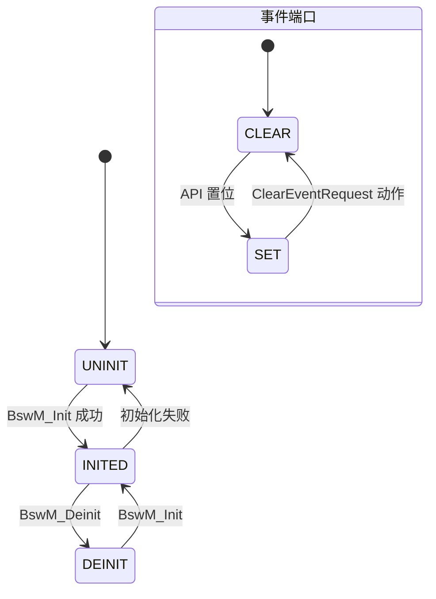

# BswM D5：状态转换表

> [!info] 导航
> 上级：[[BswM_调用逻辑总览]] ｜ 依赖：[[BswM_D3_规则仲裁调用逻辑]]、[[BswM_D2_模式请求与事件输入调用逻辑]] ｜ 依据：[[BswM_AUTOSAR标准需求表_R21-11#SWS_BswM_000xx|需求表]]

> 适用版本：AUTOSAR CP R21-11　依据：SWS_BswM 7.1.4、7.2.5、7.3、8.3
> 最后更新：2026-10-21

> 说明：BswM 没有 NM 那样的业务状态机；这里的"状态"指 **模块生命周期、规则求值结果、定时器状态、事件端口状态**四类框架状态，是排查 BswM 行为的关键。

## 1. 状态清单

### 状态定义：模块生命周期

| 编号 | 状态 | 含义 | 入口 | 出口 |
|---|---|---|---|---|
| L0 | UNINIT | 未初始化（只能调 `BswM_GetVersionInfo`） | 上电 | `BswM_Init` |
| L1 | INITED | 已初始化，可仲裁/执行动作 | `BswM_Init` 成功 | `BswM_Deinit` |
| L2 | DEINIT | 已反初始化，不再处理任何模式 | `BswM_Deinit` | 重新 `BswM_Init` |

### 状态定义：规则求值状态

| 编号 | 状态 | 含义 |
|---|---|---|
| R0 | UNDEFINED | 初始化后"上次结果"未知（`BswMRuleInitState=UNDEFINED`） |
| R1 | TRUE | 上次求值为 True |
| R2 | FALSE | 上次求值为 False |

### 状态定义：定时器状态

| 编号 | 状态 | 含义 |
|---|---|---|
| T0 | BSWM_TIMER_STOPPED | 未运行（初始化默认） |
| T1 | BSWM_TIMER_STARTED | 运行中，主函数每周期递减 |
| T2 | BSWM_TIMER_EXPIRED | 到期，参与仲裁，不会自动回 STOPPED |

### 状态定义：事件端口状态

| 编号 | 状态 | 含义 |
|---|---|---|
| E0 | CLEAR | 未触发（初始化默认） |
| E1 | SET | 事件已触发（API 调用置位） |

## 2. 状态转换表

### 初始化阶段

| 编号 | 当前 | 触发 | 下一 | 动作 | 需求号 |
|---|---|---|---|---|---|
| L-01 | UNINIT | `BswM_Init` 成功 | INITED | 初始化全局变量；事件端口 CLEAR；定时器 STOPPED；规则初值按 `BswMRuleInitState`；端口初值按 `BswMModeInitValue` | 00043、00044、00251、00261、00066、00203 |
| L-02 | UNINIT | `BswM_Init` 校验失败（DevError） | UNINIT | DET 上报 `BSWM_E_PARAM_CONFIG`，不完成初始化 | 00045 |
| L-03 | INITED | `BswM_Deinit` | DEINIT | 停止模式处理（主函数与请求均不再处理） | 00119、00120 |
| L-04 | DEINIT | `BswM_Init` | INITED | 重新初始化 | 00043 |

### 规则求值状态

| 编号 | 当前 | 触发 | 下一 | 动作 | 需求号 |
|---|---|---|---|---|---|
| R-01 | UNDEFINED | 首次求值 True | TRUE | 按表 7.1 执行 True 列表 | 00066 |
| R-02 | UNDEFINED | 首次求值 False | FALSE | 按表 7.1 执行 False 列表 | 00066 |
| R-03 | TRUE | 求值变化为 False | FALSE | TRIGGER 列表：执行 False 列表 | 00023 |
| R-04 | FALSE | 求值变化为 True | TRUE | TRIGGER 列表：执行 True 列表 | 00011 |
| R-05 | TRUE/FALSE | 结果不变且列表为 CONDITION | 不变 | 每次求值都执行对应列表 | 00115、00116 |
| R-06 | 任意 | 规则含未定义条件 | 不变（跳过） | 不参与仲裁 | 00064、00241 |

### 定时器状态

| 编号 | 当前 | 触发 | 下一 | 动作 | 需求号 |
|---|---|---|---|---|---|
| T-01 | STOPPED | 动作 `BswMTimerControl` = START | STARTED | 装载 `BswMTimerValue` | 00262 |
| T-02 | STARTED | 主函数递减到 0 | EXPIRED | 同一周期内参与仲裁 | 00263、00264 |
| T-03 | STARTED | 动作 `BswMTimerControl` = STOP | STOPPED | 立即停止 | 00265 |
| T-04 | EXPIRED | 无动作出队 | EXPIRED | 持续按到期状态参与仲裁（需配置动作迁出） | 7.3 Note |

### 事件端口迁移

| 编号 | 当前 | 触发 | 下一 | 动作 | 需求号 |
|---|---|---|---|---|---|
| E-01 | CLEAR | 对应 BswM API 调用 | SET | 事件端口置 SET | 00254 |
| E-02 | SET | 动作 `BswMClearEventRequest` | CLEAR | 事件端口清 CLEAR | 00255 |

## 3. 状态图（模块生命周期 + 事件端口）

## 4. 与代码/配置的对应

| 状态 | 代码表示（实现相关） | 关联配置 |
|---|---|---|
| 生命周期 | 模块级初始化标志（如 `BswM_Initialized`） | — |
| 规则结果 | 每条规则一个"上次结果"存储 | `BswMRuleInitState` |
| 定时器 | 定时器数组（状态 + 剩余值） | `BswMTimer`、`BswMTimerValue` |
| 事件端口 | 端口状态数组（CLEAR/SET） | `BswMEventRequestPort` |
| 列表执行 | 待执行列表/触发标志 | `BswMActionListPriority`、ItemIndex |

## 5. 特殊说明

- `BswM_Init` 只依赖 OS 与 SchM 已初始化（00118）；初始化前其他 API 报 `BSWM_E_UNINIT`。
- 未配置 `BswMModeInitValue` 的端口视为未定义；含未定义条件的规则跳过（00064、00241）。
- `BswM_Deinit` 后即使主函数被调用也不处理（00120）。
- 定时器不会自动重装/自动停止，EXPIRED 需要动作迁出（7.3 Note）。

## 6. 需求依据

SWS_BswM_00043~00045、00064、00066、00118~00120、00203、00241、00251、00254、00255、00261~00265。
