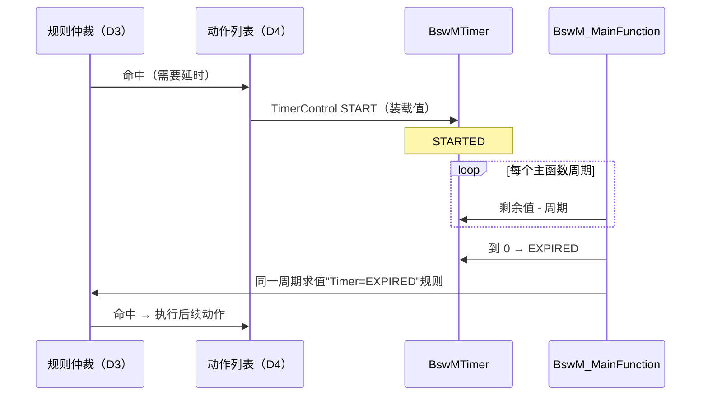

# BswM D6：定时器与延迟动作调用逻辑

> [!info] 导航
> 上级：[[BswM_调用逻辑总览]] ｜ 依赖：[[BswM_D3_规则仲裁调用逻辑]]、[[BswM_D5_状态转换表#定时器状态]] ｜ 依据：[[BswM_AUTOSAR标准需求表_R21-11#SWS_BswM_000xx|需求表]]

> 适用版本：AUTOSAR CP R21-11　依据：SWS_BswM 7.3
> 最后更新：2026-10-21

## 1. 场景

需要"延时执行/等待确认/超时处理"时（例如"等 100ms 再关通信""模式稳定 N 个周期后再动作"），用 `BswMTimer` 实现。定时器只能由动作控制，没有外部 API。

## 2. 调用链（从上到下）

```text
动作列表（D4）执行到 BswMTimerControl 动作
  ├─ BswMTimerAction = BSWM_TIMER_START
  │    └─ 以 BswMTimerValue 装载 BswMTimer，状态 → STARTED   [SWS_BswM_00262]
  └─ BswMTimerAction = BSWM_TIMER_STOP
       └─ 立即停止，状态 → STOPPED                            [00265]

BswM_MainFunction（D1/D3 主循环）
  └─ 遍历 BswMTimer：
      ├─ STARTED → 剩余值 -= BswMMainFunctionPeriod           [00263]
      └─ 到 0 → 状态 = EXPIRED，并在同一周期参与仲裁           [00264]
          └─ 引用该 BswMTimer 的规则被求值（D3）→ 动作（D4）
```

## 3. 关键约束

| 约束 | 说明 | 依据 |
|---|---|---|
| 只由动作控制 | 没有外部 API，配置在 `BswMTimerControl` | 7.3 |
| 处理模式固定 DEFERRED | `BswMRequestProcessing` 对定时器无效，恒在主函数仲裁 | 00220 |
| 精度 | 分辨率 = `BswMMainFunctionPeriod` 的整数倍 | 00263 Note |
| 不自动重装 | 到期后不会自动重新装载 | 7.3 Note |
| 不回 STOPPED | EXPIRED 需配置动作迁出，否则持续按到期参与仲裁 | 7.3 Note |
| 初始化 | 全部 STOPPED | 00261 |

## 4. 典型用法

```text
规则：EcuM 状态 = SHUTDOWN 且 通信已关闭
  → True 列表：
      [10] BswMTimerControl(START, Timer_100ms)
      [20] ...
规则：BswMTimer(Timer_100ms) = EXPIRED
  → True 列表：
      [10] BswMEcuMSelectShutdownTarget(SLEEP)
      [20] BswMEcuMGoDownHaltPoll()
```

## 5. 时序



## 6. 状态与数据变化

| 数据 | 变化 | 依据 |
|---|---|---|
| 定时器状态 | STOPPED → STARTED → EXPIRED →（动作）STOPPED | 00261~00265 |
| 剩余时间 | 每主函数递减一个周期 | 00263 |
| 规则输入 | 定时器状态作为 mode request source 参与条件 | 7.3 |

## 7. 输出

- 无直接外部调用；通过规则触发后续动作列表；
- 典型：延时关通信、延时休眠、超时故障处理。

## 8. 需求依据

SWS_BswM_00220、00261、00262、00263、00264、00265、7.3。

## 9. 观测点 / 排障

1. 延时不准：核对 `BswMMainFunctionPeriod` 与任务周期；
2. 定时器一直 EXPIRED 不恢复：没配迁出动作（7.3 Note）；
3. 定时器没启动：检查 `BswMTimerControl` 是否在动作列表中被执行到；
4. 定时器被停：`BswMTimerAction = STOP` 被提前执行。
