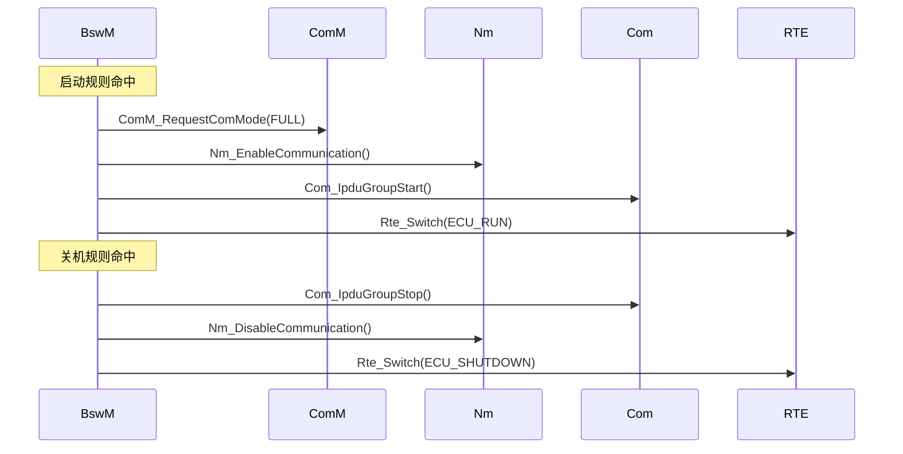

# BswM D7：输出动作与 BSW 交互

> [!info] 导航
> 上级：[[BswM_调用逻辑总览]] ｜ 依赖：[[BswM_D4_动作列表与动作执行调用逻辑]] ｜ 依据：[[BswM_AUTOSAR标准需求表_R21-11#SWS_BswM_000xx|需求表]]

> 适用版本：AUTOSAR CP R21-11　依据：SWS_BswM 7.2.4、10.2（各 Action 容器）
> 最后更新：2026-10-21

## 1. 场景

动作列表中的原子动作最终落到对某个 BSW 模块 API 的调用。本方向按"输出目标"归类，便于从现象反查配置。

## 2. 调用链

```text
BswM_ExecuteActionList()（D4）
  └─ BswMAction → BswMAvailableActions（choice）
      └─ 具体动作容器（如 BswMPduGroupSwitch）
          └─ 目标 BSW API（如 Com_IpduGroupStart）
```

## 3. 动作 → API 对照（按目标分类）

### 通信控制

| 动作 | 目标 API | 作用 | 需求/依据 |
|---|---|---|---|
| `BswMPduGroupSwitch` | `Com_IpduGroupStart/Stop` | 启停 PDU 组 | 00273 |
| `BswMDeadlineMonitoringControl` | `Com_Enable/DisableReceptionDM` | 开关接收超时监控 | 00274 |
| `BswMTriggerIPduSend` | `Com_TriggerIPDUSend` | 立即发送一帧 | 10.2.84 |
| `BswMSwitchIPduMode` | `Com_SwitchIpduTxMode` | 切发送模式 | 10.2.82 |
| `BswMComMAllowCom` | `ComM_CommunicationAllowed` | 允许/禁止通道通信 | 10.2.55 |
| `BswMComMModeSwitch` | `ComM_RequestComMode` | 请求 FULL/NO COMMUNICATION | 10.2.57 |
| `BswMComMModeLimitation` | `ComM_LimitChannelToNoComMode` | 限制通道 | 10.2.56 |
| `BswMNMControl` | `Nm_Enable/DisableCommunication` | 开关 NM 通信 | 10.2.70 |
| `BswMPduRouterControl` | `PduR_Enable/DisableRouting` | 开关路由组 | 10.2.72 |

### 总线/网络状态

| 动作 | 目标 API | 作用 |
|---|---|---|
| `BswMLinScheduleSwitch` | `LinSM_ScheduleRequest` | 切 LIN 调度表 |
| `BswMEthIfStartAllPorts` | `EthIf_StartAllPorts` | 启动所有以太网端口（00286） |
| `BswMEthIfSwitchPortGroupRequestMode` | `EthIf_SwitchPortGroupRequestMode` | 交换机端口组切换 |
| `BswMFrSMAllSlots` | `FrSM_AllSlots` | 退出 FlexRay KeySlotOnly |
| `BswMJ1939DcmStateSwitch` | `J1939Dcm_SetState` | J1939 诊断状态 |
| `BswMJ1939RmStateSwitch` | `J1939Rm_SetState` | J1939 请求管理状态 |
| `BswMSd*ModeRequest` | `Sd_*SetState` | 服务发现状态控制 |
| `BswMSdServiceGroupSwitch` | `Sd_ServiceGroupStart/Stop` | 服务组开关（00280） |

### 电源/启动

| 动作 | 目标 API | 作用 |
|---|---|---|
| `BswMRteStart` / `BswMRteStop` | `Rte_Start` / `Rte_Stop` | 启停 RTE（00271/00272） |
| `BswMEcuMStateSwitch` | `EcuM_StateSwitch` | 切 EcuM 状态 |
| `BswMEcuMGoDownHaltPoll` | `EcuM_GoDownHaltPoll` | 下电/休眠 |
| `BswMEcuMSelectShutdownTarget` | `EcuM_SelectShutdownTarget` | 选择关机目标 |
| `BswMEcuMDriverInitListBswM` | `EcuM_AL_DriverInitBswM_*` | 驱动初始化列表（00269） |

### 模式通知/调度

| 动作 | 目标 API | 作用 |
|---|---|---|
| `BswMRteSwitch` | `Rte_Switch_<p>_<o>` | 通知应用模式切换 |
| `BswMSchMSwitch` | `SchM_Switch_<p>_<o>` | 通知 BSW 模式切换 |
| `BswMRteModeRequest` | `Rte_Write_<p>_<o>` | 向 SWC 模式管理器发请求 |

### 内部/扩展

| 动作 | 目标 | 作用 |
|---|---|---|
| `BswMTimerControl` | 内部定时器 | 启动/停止定时器（D6） |
| `BswMClearEventRequest` | 内部事件端口 | 清事件（D2） |
| `BswMUserCallout` | 任意用户函数 | `NvM_ReadAll/WriteAll`、自定义动作（00269 之外） |
| `BswMCoreHaltMode` | OS Core Halt | 多核 HALT |

> 动作名在前，具体 API 以"动作容器 → 目标函数"为准；完整容器参数见 [[BswM_配置参数表_R21-11]] 的 Actions 部分。

## 4. 典型输出时序



## 5. 约束

- 动作只能在动作列表中被调用（00147）；
- 标准允许调用任意 BSW 函数（00039）与用户函数（00040、00054）；
- BswM 不保存动作返回值，仅按失败配置处理（D4）；
- 各动作在 DaVinci 中的参数见 [[BswM_DaVinci配置项]]。

## 6. 需求依据

SWS_BswM_00038、00039、00040、00054、00147、00269、00271、00272、00273、00274、00280、00286、91005（SoAd）。
