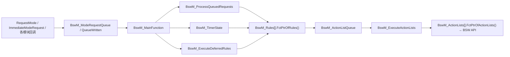

# BswM 全局变量说明（基于本项目生成代码）

> [!info] 导航
> 上级：[[BswM_调用逻辑总览]]

> 适用文档：AUTOSAR CP R21-11　**实现基线**：AUTOSAR 4.2.2 / NeuSAR BswM 3.14.0（Neusoft Reach）
> 代码：`AUTOSAR/AUTOSAT使用NEUSAR生成的代码/002_BSW/Bsw_Src/Autosar_Src/src_BswM/Source/`
> 最后更新：2026-10-21

> 说明：R21-11 文档只描述概念（模式请求端口/事件/规则/动作列表），不规定变量名。本页以 `BswM_Cfg.h` + `BswM_Lcfg.c` 的实际定义去对应，**之前找不到的名字按本表映射**。

## 0. 代码基线

| 项目 | 值 | 来源 |
|---|---|---|
| 版本 | BswM 3.14.0 / AUTOSAR 4.2.2 | `BswM.h` L231~238 |
| 分区 | 单分区（`BSWM_MULTIPARTITION=STD_OFF`） | `BswM_Cfg.h` L184 |
| 配置集 | `BSWM_BSWMCONFIG_SIZE=1` | `BswM_Cfg.h` L154 |
| 动作列表 | 27（`BSWM_SIZE_ACTIONLIST`） | L156 |
| 规则 / 规则索引 | 26 / 45 | L178/L179 |
| 延迟规则 | 20（`BSWM_SIZE_DEFERRED_RULE`） | L163 |
| 立即请求队列 | 4（`BSWM_SIZE_IMMEDIATE_USER`） | L170 |
| 定时器 | 2（`BSWM_SIZE_TIMER`） | L181 |
| 端口规模 | ComM 7、Dcm 7、Generic 5、LinSM schedule 1、LinSM channel 1；CanSM/EthSM/PNC/NvM/EcuM/Sd/FrSM/LinTp/J1939/CanSMIcom 均为 0 | L157~177 |
| 功能开关 | IPDU 组控制 ON；SWC 模式请求更新 OFF；Mode 通知 OFF | L60/L182/L155 |

> 单分区 + 规模宏意味着：很多按 R21-11 写的“端口数组”在本项目**根本没有生成**（size 0 的数组不编译），找不到属于正常。

## 1. 运行状态变量（`BswM_Cfg.h` 声明、`BswM_Lcfg.c` 定义）

### 1.1 模块级队列/标志

| 变量 | 类型/维度 | 作用 | 写者 | 读者 |
|---|---|---|---|---|
| `BswM_Initialized[1]` | `BswM_InitState_st` | 是否已初始化（含 PartitionId） | `BswM_Init` / `BswM_Deinit` | 所有 API、主函数 |
| `BswM_ActionListQueue[27]` | `BswM_ActionListState_st` | 动作列表执行状态：`BSWM_ACTIONLIST_IDLE/PENDING/BLOCKED` | `BswM_ProcessQueuedRequests`、`BswM_ExecuteActionLists` | 仲裁/执行 |
| `BswM_ModeRequestQueue[4]` | `BswM_ModeRequest_st` | IMMEDIATE 请求队列：`IDLE/QUEUED/PROCESSED/PENDING/RELEASE` | `BswM_ImmediateModeRequest`、`BswM_ReleaseQueue` | 主函数队列处理 |
| `BswM_TimerState[2]` | `BswM_TimerValue_st` | 定时器状态（`STOPPED/STARTED/EXPIRED`）+ 剩余值 | 定时器动作、`BswM_DecreaseTimer` | 规则函数 |

### 1.2 各模块状态数组（仅非 0 规模才编译）

| 变量 | 类型/维度 | 含义 |
|---|---|---|
| `BswM_ComMChannelState[7]` | `uint8[7]` | ComM 通道当前模式（端口初值来自 `BswM_ComMChannelMapping[].InitValue`） |
| `BswM_DcmChannelState[7]` | `uint8[7]` | Dcm 通信模式 |
| `BswM_GenericState[5]` | `uint16[5]` | 通用模式请求端口 |
| `BswM_LinSMScheduleState[1]` | `uint8[1]` | LinSM 当前调度表 |
| `BswM_LinSMChannelState[1]` | `uint8[1]` | LinSM 通道状态 |

> CanSM、CanSMIcom、EthSM、ComMPnc、NvM Job/Block、EcuM Channel/Wakeup、Sd 三种、FrSM、LinTp、J1939Dcm/Nm 的 size 均为 0，对应数组不生成。

## 2. 文件内静态/全局变量（`BswM.c`）

| 变量 | 类型/维度 | 位置 | 作用 |
|---|---|---|---|
| `BswM_QueueSemaphore[1]` | `uint8` | `BswM.c` L474 | 队列信号量：`BSWM_REQUEST_SEMAPHORE_UNLOCKED/LOCKED`，保护队列处理 |
| `BswM_QueueWritten[1]` | `boolean` | L476 | 队列是否有新请求；主函数/立即请求用它判断是否再处理一轮 |
| `BswM_ProcessingState[1]` | `BswM_ProcessingState_st` | L480 | 分区处理状态（`BSWM_INITPROCESSING`/`BSWM_PERIODPROCESSING`）；**仅多分区编译**，本项 OFF |

## 3. 配置常量（`BswM_Lcfg.c`，ROM）

| 常量 | 类型/维度 | 作用 |
|---|---|---|
| `BswM_ActionLists[27]` | `BswM_ActionListsType` | 每个动作列表一个函数指针（`FctPtrOfActionLists`），实际列表函数 `BswM_ActionList_AL_*` |
| `BswM_Rules[26]` | `BswM_RulesType` | 每条规则一个函数指针（`FctPtrOfRules`），返回要执行的动作列表 ID |
| `BswM_RulesInd[45]` | `uint8` | ImmediateUser → 规则的 0:n 索引 |
| `BswM_DeferredRules[20]` | `BswM_DeferredRulesType` | 延迟规则（引用规则 ID + 分区） |
| `BswM_ImmediateUser[4]` | `BswM_ImmediateUserType` | 立即请求用户：规则索引范围 + 掩码 |
| `BswM_*ChannelMapping[]` | 结构数组 | 外部 ID → 状态数组索引/分区/初值（ComM/Dcm/LinSM 等） |
| `BswM_GenericMapping[5]` | `BswM_GenericMappingType` | 通用请求用户 → 分区/索引/初值 |
| `BswM_PCConfigType` | 空结构 | `BswM_ConfigType` 实际为空，`BswM_Init` 的 `ConfigPtr` 未使用 |

动作列表命名反映了项目行为：`AL_InitToRun`、`AL_RunToPostRun`、`AL_PostRunToRun`、`AL_RunToShutdown`、`AL_RunToSoft/Boot/HardReset`、`AL_CANSM_IpduStart/Stop_*`、`AL_COMM_NM_FullCOMM/NoCOMM`、`AL_VOL_COM_ON/OFF` 等（见 `BswM_Cfg.h` L100~130）。

## 4. 关键结构体

| 结构 | 成员 | 说明 |
|---|---|---|
| `BswM_InitState_st` | `PartitionId`、`Initialized` | 初始化状态 |
| `BswM_ActionListState_st` | `PartitionId`、`ActionListState` | 动作列表状态 |
| `BswM_ModeRequest_st` | `PartitionId`、`RequestMode` | 立即请求状态 |
| `BswM_TimerValue_st` | `PartitionId`、`Timestate`、`Timevalue` | 定时器 |
| `BswM_ProcessingState_st` | `ProcessingState`、`PartitionId`、`RootPartitionId`、`RootApplicationId` | 分区处理状态（多分区） |

## 5. 状态常量

| 类别 | 值 |
|---|---|
| 立即请求 | `BSWM_REQUEST_IDLE(0)`、`QUEUED(1)`、`PROCESSED(2)`、`PENDING(3)`、`QUEUE_RELEASE(4)` |
| 动作列表 | `BSWM_ACTIONLIST_IDLE(0)`、`PENDING(1)`、`BLOCKED(0xFF)` |
| 定时器 | `BSWM_TIMER_STOPPED(0)`、`STARTED(1)`、`EXPIRED(2)` |
| 处理状态 | `BSWM_INITPROCESSING`、`BSWM_PERIODPROCESSING` |
| 信号量 | `BSWM_REQUEST_SEMAPHORE_UNLOCKED/LOCKED` |

## 6. 谁写谁读

## 7. 旧概念名 → 实际变量

| R21-11/旧文档说法 | 本项目实际 |
|---|---|
| 模式请求端口值数组 | `BswM_ComMChannelState[7]` / `BswM_DcmChannelState[7]` / `BswM_GenericState[5]` / `BswM_LinSM*State[1]` |
| 事件端口状态 | 本实现不使用独立事件数组，事件动作走 `BswM_ImmediateModeRequest` / 回调 |
| 规则上次结果 | 不存在独立数组；由生成规则函数内部静态变量/表达式函数返回 |
| 待执行动作列表集合 | `BswM_ActionListQueue[27].ActionListState` |
| 挂起请求队列 | `BswM_ModeRequestQueue[4].RequestMode` + `BswM_QueueWritten[1]` |
| 模块初始化标志 | `BswM_Initialized[0].Initialized` |
| 定时器数组 | `BswM_TimerState[2]` |
| `BswM_ConfigPtr` | **不存在**；`BswM_Init` 的 `ConfigPtr` 被 `BSWM_DUMMY_STATEMENT` 忽略，配置直接引用 `BswM_Lcfg.c` 常量 |
| `BswM_PBcfg.c` | **不存在**；只有 `BswM_Lcfg.c`（链接期配置） |

## 8. 与 R21-11 的差异提示

- 本代码为 **BswM 3.14.0 / AUTOSAR 4.2.2**，不是 R21-11；R21-11 新增的 ActionList 触发方式、CanSM/EthSM 扩展端口在本项未生成（size=0）。
- 单分区：`BswM_ProcessingState` 不编译，所有分区索引固定 0。
- 没有 `BswM_PBcfg.c`/post-build 配置选择，`ConfigType` 为空结构。
- 大量端口规模为 0，**按文档找 CanSM/NvM/EcuM/Sd 端口变量会找不到**，这是配置裁剪而非代码缺失。

## 9. 观察建议

1. 初始化：`BswM_Initialized[0].Initialized`、`BswM_QueueSemaphore[0]`；
2. 请求：`BswM_ModeRequestQueue[0..3].RequestMode`、`BswM_QueueWritten[0]`；
3. 仲裁/动作：`BswM_ActionListQueue[i].ActionListState`，再进对应 `BswM_ActionList_AL_*`；
4. 定时器：`BswM_TimerState[0..1]`；
5. 端口值：按大小看 `BswM_ComMChannelState[0..6]`、`BswM_DcmChannelState[0..6]`、`BswM_GenericState[0..4]`。
