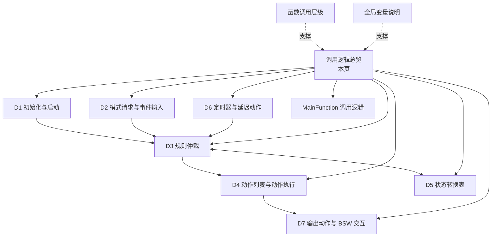
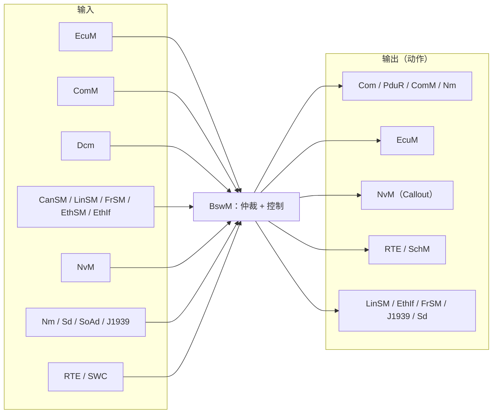

# BswM 调用逻辑总览

> [!info] 导航
> 上级：[[BswM]] ｜ 下级：[[BswM_D1_初始化与启动调用逻辑]]、[[BswM_D2_模式请求与事件输入调用逻辑]]、[[BswM_D3_规则仲裁调用逻辑]]、[[BswM_D4_动作列表与动作执行调用逻辑]]、[[BswM_D5_状态转换表]]、[[BswM_D6_定时器与延迟动作调用逻辑]]、[[BswM_D7_输出动作与BSW交互]]

> 适用版本：AUTOSAR CP R21-11　依据：AUTOSAR_SWS_BSWModeManager（Document ID 313）
> 最后更新：2026-10-21

## 1. 方向清单

| 编号 | 方向 | 回答的问题 | 主要入口 | 详细文档 |
|---|---|---|---|---|
| D1 | 初始化与启动 | EcuM 调用 `BswM_Init` 后，规则/事件端口/定时器如何就绪，启动阶段动作如何被执行 | `BswM_Init`、`BswM_EcuM_CurrentState` 等 | [[BswM_D1_初始化与启动调用逻辑]] |
| D2 | 模式请求与事件输入 | 各来源的请求/指示如何进入 BswM，IMMEDIATE 与 DEFERRED 有何区别 | 各 `BswM_*` API / RTE 端口 | [[BswM_D2_模式请求与事件输入调用逻辑]] |
| D3 | 规则仲裁 | 条件 → 逻辑表达式 → 规则，结果如何与上次比较并选出动作列表 | `BswM_MainFunction` 仲裁段 | [[BswM_D3_规则仲裁调用逻辑]] |
| D4 | 动作列表与动作执行 | 动作列表如何按优先级/序号执行子列表、嵌套规则、失败处理 | `BswM_MainFunction` 控制段 | [[BswM_D4_动作列表与动作执行调用逻辑]] |
| D5 | 状态转换表 | 模块生命周期/规则结果/定时器状态如何迁移（查表用） | — | [[BswM_D5_状态转换表]] |
| D6 | 定时器与延迟动作 | `BswMTimer` 如何启动/停止/到期仲裁，用于延时与超时 | `BswMTimerControl` + 主函数 | [[BswM_D6_定时器与延迟动作调用逻辑]] |
| D7 | 输出动作与 BSW 交互 | 动作最终调用哪些 BSW API（通信/模式/电源/调度） | 动作执行段 | [[BswM_D7_输出动作与BSW交互]] |

配套文档：

- 函数层级：[[BswM_函数调用层级]]
- 全局变量：[[BswM_全局变量说明]]
- 主函数调用逻辑：[[BswM_MainFunction调用逻辑]]
- 标准需求：[[BswM_AUTOSAR标准需求表_R21-11]]
- 配置项：[[BswM_DaVinci配置项]]

## 2. 调用逻辑层级（L2）

- **输入（D1/D2）→ 仲裁（D3/D5）→ 控制（D4/D7）→ 执行层（MainFunction）**；
- 定时器 D6 是仲裁的额外触发源；函数层级与全局变量为所有方向提供支撑。

## 3. 全局视角

## 4. 阅读顺序

1. 本文件（方向图）
2. [[BswM_D1_初始化与启动调用逻辑]]、[[BswM_D2_模式请求与事件输入调用逻辑]]
3. [[BswM_D3_规则仲裁调用逻辑]] + [[BswM_D4_动作列表与动作执行调用逻辑]]
4. [[BswM_D5_状态转换表]]、[[BswM_D6_定时器与延迟动作调用逻辑]]
5. [[BswM_D7_输出动作与BSW交互]]
6. [[BswM_函数调用层级]]、[[BswM_全局变量说明]]
7. [[BswM_MainFunction调用逻辑]]

## 5. 本文档的结构约定

- 每条主线：**触发 → 调用链（从上到下）→ 状态/数据变化 → 输出 → 依据需求号**；
- 内部函数用"逻辑名 +（实现相关）"标注；
- 需求号形如 `SWS_BswM_xxxxx`，与 [[BswM_AUTOSAR标准需求表_R21-11]] 对应。
