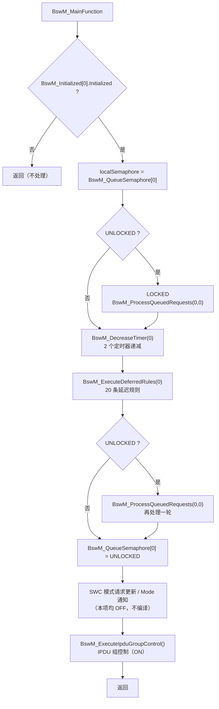

# BswM_MainFunction 调用逻辑（基于本项目生成代码）

> [!info] 导航
> 上级：[[BswM]]

> 适用文档：AUTOSAR CP R21-11　**实现基线**：AUTOSAR 4.2.2 / NeuSAR BswM 3.14.0
> 代码：`BswM.c` 的 `BswM_MainFunction`（L3374~3429）
> 最后更新：2026-10-22

## 1. 调度与配置

| 项目 | 内容 |
|---|---|
| 调度者 | SchM/OS 周期任务（`SchM_BswM.h`） |
| 函数 | `BswM_MainFunction(void)`（L3374），不可重入 |
| 周期 | 由集成任务决定；生成宏 `BSWM_MAINFUNCTIONPERIOD=5U`（`BswM_Cfg.h` L50），代码未直接引用，实际任务周期需在 SchM/OS 集成配置确认 |
| 上下文 | 任务 |
| 前置 | `BswM_Init` 已执行，`BswM_Initialized[0].Initialized == TRUE` |
| 分区 | 单分区（`BSWM_MULTIPARTITION=STD_OFF`），partitionIdx/partitionId 固定 0 |
| 规模 | 27 动作列表 / 26 规则 / 20 延迟规则 / 4 立即请求 / 2 定时器 |

> **时间单位**：`BswM_TimerState[].Timevalue` 由动作写入，`BswM_DecreaseTimer` 每个主函数周期减 1，因此是**主函数周期数**；实际时间 = 周期数 × 实际任务周期。

## 2. 实际执行顺序（L3374~3429）



## 3. 分步解析

### 3.1 初始化检查
`BswM_Initialized[0].Initialized` 为 FALSE 时主函数直接返回，不做任何队列/定时器/规则处理。

### 3.2 队列与信号量
- `BswM_QueueSemaphore[0]` 是队列重入保护：
  - `UNLOCKED`：主函数先置 `LOCKED`，调用 `BswM_ProcessQueuedRequests(0,0)` 处理挂起立即请求；
  - `LOCKED`（例如立即请求正在执行）：主函数本轮不处理队列，只做定时器/延迟规则。
- 主函数末尾若仍为 `UNLOCKED`，再调用一次 `BswM_ProcessQueuedRequests` 并解锁，用于处理本轮执行动作期间新产生的请求。

### 3.3 定时器（`BswM_DecreaseTimer`，L723）
- 遍历 `BswM_TimerState[0..1]`，对 `STARTED` 的定时器 `Timevalue--`；
- 到 0 置 `BSWM_TIMER_EXPIRED`，供规则函数读取；
- 定时器启停由动作里的定时器动作完成（`BswM_UpdateTimer`，`BswM_Lcfg.c` L802）。

### 3.4 延迟规则（`BswM_ExecuteDeferredRules`，L802）
- 遍历 `BswM_DeferredRules[0..19]`，调用 `BswM_Rules[BswM_DeferredRules[i].RulesIdxOfDeferredRules].FctPtrOfRules()`；
- 返回值即动作列表 ID；若 `< 27` 且队列 IDLE → 置 `BSWM_ACTIONLIST_PENDING`；
- 有命中后调用 `BswM_ExecuteActionLists(BSWM_ACTIONLIST_PENDING, 0)` 执行。

### 3.5 立即请求（`BswM_ProcessQueuedRequests`，L555）
- 只处理 `BswM_ModeRequestQueue[].RequestMode == BSWM_REQUEST_QUEUED` 的项；
- 对每个立即用户，遍历 `BswM_ImmediateUser[i].RulesIndStartIdx..EndIdx`，用 `BswM_RulesInd[]` 索引规则函数；
- 规则返回动作列表 ID 后置 `BSWM_ACTIONLIST_PENDING`，再执行动作列表；
- 处理完后 `BswM_ReleaseQueue` 把 `PROCESSED→IDLE`、`PENDING→QUEUED`。

### 3.6 动作执行（`BswM_ExecuteActionLists`，L762）
- 遍历 `BswM_ActionListQueue[0..26]`；
- 状态等于 `executionLevel`（通常 `BSWM_ACTIONLIST_PENDING`）时：
  1. 置 `BLOCKED`（防重入）；
  2. 调 `BswM_ActionLists[i].FctPtrOfActionLists()`（实际函数 `BswM_ActionList_AL_*`）；
  3. 执行完置 `IDLE`。

### 3.7 IPDU 组控制
`BSWM_IPDU_GROUP_CONTROL=STD_ON` 时，主函数末尾调用 `BswM_ExecuteIpduGroupControl()`，把配置的 IPDU 组状态下发到 Com。

## 4. 伪代码（按实际函数）

```c
void BswM_MainFunction(void)
{
    uint8 localSemaphore;
    uint8 partitionIdx = 0, partitionId = 0;

    if (BswM_Initialized[partitionIdx].Initialized == TRUE) {
        localSemaphore = BswM_QueueSemaphore[partitionIdx];
        if (localSemaphore == BSWM_REQUEST_SEMAPHORE_UNLOCKED) {
            BswM_QueueSemaphore[partitionIdx] = BSWM_REQUEST_SEMAPHORE_LOCKED;
            BswM_ProcessQueuedRequests(partitionIdx, partitionId);
        }

        BswM_DecreaseTimer(partitionId);            /* 2 个定时器 */
        BswM_ExecuteDeferredRules(partitionId);     /* 20 条延迟规则 */

        if (localSemaphore == BSWM_REQUEST_SEMAPHORE_UNLOCKED) {
            BswM_ProcessQueuedRequests(partitionIdx, partitionId);
            BswM_QueueSemaphore[partitionIdx] = BSWM_REQUEST_SEMAPHORE_UNLOCKED;
        }

        BswM_ExecuteIpduGroupControl();             /* IPDU_GROUP_CONTROL=ON */
    }
}
```

## 5. 函数逐级拆解（深度 3，代码注释版）

> 保留 C 代码风格，只在关键判断后加 `/* 判断：... */` 备注；与本判断无关的语句用 `...` 省略。
> 深度：**L1 主函数 → L2 主函数直接调用 → L3 规则/动作函数**；行号对应 `BswM.c` / `BswM_Lcfg.c`。

### 5.1 调用树（L1 → L2 → L3）

```text
BswM_MainFunction（L1，L3374）
├─ 初始化检查 / 信号量判断（L1）
├─ BswM_ProcessQueuedRequests（L2，L555）
│  ├─ BswM_ImmediateUser[] + BswM_RulesInd[]（输入映射）
│  ├─ BswM_Rules[i].FctPtrOfRules()（L3，生成规则函数）
│  ├─ BswM_ActionListQueue[i] = PENDING
│  └─ BswM_ExecuteActionLists（L2，L762）
│     └─ BswM_ActionLists[i].FctPtrOfActionLists()（L3，生成动作函数）
├─ BswM_DecreaseTimer（L2，L723）
│  └─ BswM_TimerState[0..1] → EXPIRED
├─ BswM_ExecuteDeferredRules（L2，L802）
│  ├─ BswM_DeferredRules[0..19]
│  └─ BswM_Rules[i].FctPtrOfRules()（L3）→ ExecuteActionLists
├─ BswM_ExecuteIpduGroupControl（L2，BswM_Lcfg.c L838）
│  └─ Com_IpduGroupControl / Com_ReceptionDMControl
└─ 可选：BswM_SwcModeRequestUpdateFunc / BswM_ModeNotificationFunc（本项 OFF）
```

### 5.2 L1：`BswM_MainFunction`（L3374）

> **函数作用**：BswM 的周期调度入口：检查初始化与队列锁，处理立即请求、递减定时器、执行延迟规则，最后下发 IPDU 组控制。

```c
FUNC(void, BSWM_CODE) BswM_MainFunction(void)
{
    uint8 localSemaphore;
    uint8 partitionIdx = BSWM_ZERO;
    uint8 partitionId = BSWM_ZERO;

    if (BswM_Initialized[partitionIdx].Initialized == TRUE) {   /* 判断：未初始化直接不处理 */
        localSemaphore = BswM_QueueSemaphore[partitionIdx];

        if (BSWM_REQUEST_SEMAPHORE_UNLOCKED == localSemaphore) { /* 判断：队列锁空闲才处理请求 */
            BswM_QueueSemaphore[partitionIdx] = BSWM_REQUEST_SEMAPHORE_LOCKED;
            BswM_ProcessQueuedRequests(partitionIdx, partitionId); /* 处理挂起立即请求 */
        }

        BswM_DecreaseTimer(partitionId);                     /* 判断：定时器到期 → EXPIRED，供规则读取 */
        BswM_ExecuteDeferredRules(partitionId);              /* 判断：延迟规则命中 → 排队动作 */

        if (BSWM_REQUEST_SEMAPHORE_UNLOCKED == localSemaphore) { /* 判断：锁仍空闲则再处理一轮 */
            BswM_ProcessQueuedRequests(partitionIdx, partitionId);
            BswM_QueueSemaphore[partitionIdx] = BSWM_REQUEST_SEMAPHORE_UNLOCKED;
        }

        /* 可选 Hook：SWC 模式更新 / Mode 通知（本项 OFF，不编译） */
        BswM_ExecuteIpduGroupControl();                       /* 判断：IPDU 组控制开启才调用 */
    }
}
```

> **全局变量**：==BswM_Initialized==、==BswM_QueueSemaphore==、==BswM_QueueWritten==　**代码跳转**：[BswM.c:3374](vscode://file/C:/Users/11401/Desktop/学习/AUTOSAR/AUTOSAT使用NEUSAR生成的代码/002_BSW/Bsw_Src/Autosar_Src/src_BswM/Source/BswM.c:3374)

### 5.3 L2：主函数直接调用的函数

#### 5.3.1 `BswM_ProcessQueuedRequests`（L555）

> **函数作用**：消费立即请求队列：把 `QUEUED` 的请求经 `BswM_ImmediateUser`/`BswM_RulesInd` 找到对应规则，规则返回动作列表 ID 后置 `PENDING`，再执行动作列表。

```c
static FUNC(void, BSWM_CODE) BswM_ProcessQueuedRequests(uint8 partitionIdx, uint8 partitionId)
{
    uint8 immediateUserIndex;
    uint8 ruleIndex;
    uint8 actionListIndex;
    boolean executeActionLists = TRUE;
    uint8 queueState = BSWM_REQUEST_IDLE;

    while ((TRUE == executeActionLists) && (TRUE == BswM_QueueWritten[partitionIdx])) {
        BswM_QueueWritten[partitionIdx] = FALSE;             /* 判断：先清标志，避免循环不退出 */
        executeActionLists = FALSE;

        for (immediateUserIndex = BSWM_ZERO; immediateUserIndex < BSWM_SIZE_IMMEDIATE_USER; immediateUserIndex++) {
            if (BSWM_REQUEST_QUEUED == BswM_ModeRequestQueue[immediateUserIndex].RequestMode) { /* 判断：只处理已排队请求 */
                for (ruleIndex = BswM_ImmediateUser[immediateUserIndex].RulesIndStartIdx;
                     ruleIndex <= BswM_ImmediateUser[immediateUserIndex].RulesIndEndIdx; ruleIndex++) {
                    actionListIndex = BswM_Rules[BswM_RulesInd[ruleIndex]].FctPtrOfRules(); /* L3：规则求值 */
                    if ((actionListIndex < BSWM_SIZE_ACTIONLIST) &&
                        (BSWM_ACTIONLIST_IDLE == BswM_ActionListQueue[actionListIndex].ActionListState)) { /* 判断：命中且队列空闲 */
                        BswM_ActionListQueue[actionListIndex].ActionListState = BSWM_ACTIONLIST_PENDING;
                        queueState = BSWM_REQUEST_PROCESSED;
                        executeActionLists = TRUE;
                    }
                }
                if (BSWM_REQUEST_PROCESSED == queueState) {      /* 判断：本轮有动作 → 请求标记已处理 */
                    BswM_ModeRequestQueue[immediateUserIndex].RequestMode = BSWM_REQUEST_PROCESSED;
                    queueState = BSWM_REQUEST_QUEUE_RELEASE;
                } else {
                    BswM_ModeRequestQueue[immediateUserIndex].RequestMode = BSWM_REQUEST_IDLE; /* 无动作 → 清请求 */
                }
            }
        }

        if (TRUE == executeActionLists) {
            BswM_ExecuteActionLists(BSWM_ACTIONLIST_PENDING, partitionId); /* 执行本轮命中的动作列表 */
        }
    }

    if (BSWM_REQUEST_QUEUE_RELEASE == queueState) {
        BswM_ReleaseQueue(partitionIdx, partitionId);            /* 处理完释放/重挂队列 */
    }
}
```

> **全局变量**：==BswM_QueueWritten==、==BswM_ModeRequestQueue==、==BswM_ActionListQueue==、==BswM_QueueSemaphore==　**代码跳转**：[BswM.c:555](vscode://file/C:/Users/11401/Desktop/学习/AUTOSAR/AUTOSAT使用NEUSAR生成的代码/002_BSW/Bsw_Src/Autosar_Src/src_BswM/Source/BswM.c:555)

#### 5.3.2 `BswM_ReleaseQueue`（L506）

> **函数作用**：请求处理结束后释放队列：`PROCESSED` 回 `IDLE`；`PENDING` 重新变 `QUEUED` 并置 `QueueWritten`，让下一轮继续处理。

```c
LOCAL_INLINE FUNC(void, BSWM_CODE) BswM_ReleaseQueue(uint8 partitionIdx, uint8 partitionId)
{
    uint8 queueIndex;

    for (queueIndex = BSWM_ZERO; queueIndex < BSWM_SIZE_IMMEDIATE_USER; queueIndex++) {
        if (BSWM_REQUEST_PROCESSED == BswM_ModeRequestQueue[queueIndex].RequestMode) { /* 判断：已处理 → 空闲 */
            BswM_ModeRequestQueue[queueIndex].RequestMode = BSWM_REQUEST_IDLE;
        } else if (BSWM_REQUEST_PENDING == BswM_ModeRequestQueue[queueIndex].RequestMode) { /* 判断：处理中又来了请求 → 重挂 */
            BswM_QueueWritten[partitionIdx] = TRUE;
            BswM_ModeRequestQueue[queueIndex].RequestMode = BSWM_REQUEST_QUEUED;
        }
    }
}
```

> **全局变量**：==BswM_ModeRequestQueue==、==BswM_QueueWritten==　**代码跳转**：[BswM.c:506](vscode://file/C:/Users/11401/Desktop/学习/AUTOSAR/AUTOSAT使用NEUSAR生成的代码/002_BSW/Bsw_Src/Autosar_Src/src_BswM/Source/BswM.c:506)

#### 5.3.3 `BswM_DecreaseTimer`（L723）

> **函数作用**：每个主函数周期递减所有 `STARTED` 定时器，到 0 置 `EXPIRED`，供规则函数读取（不会自动触发动作）。

```c
LOCAL_INLINE FUNC(void, BSWM_CODE) BswM_DecreaseTimer(uint8 partitionId)
{
    uint8 timerIndex = BSWM_ZERO;

    for (timerIndex = BSWM_ZERO; timerIndex < BSWM_SIZE_TIMER; timerIndex++) {
        if ((BswM_TimerState[timerIndex].Timevalue > BSWM_ZERO) &&
            (BSWM_TIMER_STARTED == BswM_TimerState[timerIndex].Timestate)) { /* 判断：运行中的定时器才递减 */
            BswM_TimerState[timerIndex].Timevalue--;
            if (BSWM_ZERO == BswM_TimerState[timerIndex].Timevalue) {        /* 判断：到 0 → 到期 */
                BswM_TimerState[timerIndex].Timestate = BSWM_TIMER_EXPIRED;
            }
        }
    }
}
```

> **全局变量**：==BswM_TimerState==　**代码跳转**：[BswM.c:723](vscode://file/C:/Users/11401/Desktop/学习/AUTOSAR/AUTOSAT使用NEUSAR生成的代码/002_BSW/Bsw_Src/Autosar_Src/src_BswM/Source/BswM.c:723)

#### 5.3.4 `BswM_ExecuteDeferredRules`（L802）

> **函数作用**：每周期遍历 20 条延迟规则，命中则把动作列表置 `PENDING` 并执行；延迟规则是“定时器到期/条件变化”触发动作的主要路径。

```c
LOCAL_INLINE FUNC(void, BSWM_CODE) BswM_ExecuteDeferredRules(uint8 partitionId)
{
    uint8 ruleIndex;
    uint8 actionListIndex;
    uint8 deferredRuleIdx;
    boolean executeActionLists = FALSE;

    for (ruleIndex = BSWM_ZERO; ruleIndex < BSWM_SIZE_DEFERRED_RULE; ruleIndex++) {
        deferredRuleIdx = BswM_DeferredRules[ruleIndex].RulesIdxOfDeferredRules;
        actionListIndex = BswM_Rules[deferredRuleIdx].FctPtrOfRules();        /* L3：延迟规则求值 */

        if ((actionListIndex < BSWM_SIZE_ACTIONLIST) &&
            (BSWM_ACTIONLIST_IDLE == BswM_ActionListQueue[actionListIndex].ActionListState)) { /* 判断：命中且队列空闲 */
            executeActionLists = TRUE;
            BswM_ActionListQueue[actionListIndex].ActionListState = BSWM_ACTIONLIST_PENDING;
        }
    }

    if (TRUE == executeActionLists) {
        BswM_ExecuteActionLists(BSWM_ACTIONLIST_PENDING, partitionId);       /* 执行命中的动作列表 */
    }
}
```

> **全局变量**：==BswM_DeferredRules==、==BswM_ActionListQueue==　**代码跳转**：[BswM.c:802](vscode://file/C:/Users/11401/Desktop/学习/AUTOSAR/AUTOSAT使用NEUSAR生成的代码/002_BSW/Bsw_Src/Autosar_Src/src_BswM/Source/BswM.c:802)

#### 5.3.5 `BswM_ExecuteActionLists`（L762）

> **函数作用**：执行指定状态的动作列表：命中的列表先置 `BLOCKED` 防重入，再调用生成的动作函数，完成后回 `IDLE`。

```c
LOCAL_INLINE FUNC(void, BSWM_CODE) BswM_ExecuteActionLists(uint8 executionLevel, uint8 partitionId)
{
    uint8 actionListIndex;

    for (actionListIndex = BSWM_ZERO; actionListIndex < BSWM_SIZE_ACTIONLIST; actionListIndex++) {
        if (BswM_ActionListQueue[actionListIndex].ActionListState == executionLevel) { /* 判断：只执行目标状态 */
            BswM_ActionListQueue[actionListIndex].ActionListState = BSWM_ACTIONLIST_BLOCKED; /* 防重入 */
            (void)BswM_ActionLists[actionListIndex].FctPtrOfActionLists();                   /* L3：生成动作函数 */
            BswM_ActionListQueue[actionListIndex].ActionListState = BSWM_ACTIONLIST_IDLE;
        }
    }
}
```

> **全局变量**：==BswM_ActionListQueue==、==BswM_ActionLists==　**代码跳转**：[BswM.c:762](vscode://file/C:/Users/11401/Desktop/学习/AUTOSAR/AUTOSAT使用NEUSAR生成的代码/002_BSW/Bsw_Src/Autosar_Src/src_BswM/Source/BswM.c:762)

#### 5.3.6 `BswM_ExecuteIpduGroupControl`（`BswM_Lcfg.c` L838）

> **函数作用**：把动作标记的 IPDU 组控制请求（NORMAL/DM）下发到 Com：`Com_IpduGroupControl` / `Com_ReceptionDMControl`，每周期最多处理一次。

```c
FUNC(void, BSWM_CODE) BswM_ExecuteIpduGroupControl(void)
{
    Com_IpduGroupVector ipduGroupState;
    Com_IpduGroupVector dmState;
    uint8 controlInvocation = BSWM_GROUPCONTROL_IDLE;

    if (BswM_PduGroupControlInvocation != BSWM_GROUPCONTROL_IDLE) { /* 判断：有动作标记才处理 */
        if ((BswM_PduGroupControlInvocation & BSWM_GROUPCONTROL_NORMAL) != 0u) {
            /* 拷贝 Com 组状态快照 */
        }
        if ((BswM_PduGroupControlInvocation & BSWM_GROUPCONTROL_DM) != 0u) {
            /* 拷贝接收 DM 状态快照 */
        }
        controlInvocation = BswM_PduGroupControlInvocation;
        BswM_PduGroupControlInvocation = BSWM_GROUPCONTROL_IDLE;     /* 清标记 */
    }

    if (controlInvocation != BSWM_GROUPCONTROL_IDLE) {
        if ((controlInvocation & BSWM_GROUPCONTROL_NORMAL) != 0u) {
            Com_IpduGroupControl(ipduGroupState, FALSE);             /* 下发 IPDU 组 */
        }
        if ((controlInvocation & BSWM_GROUPCONTROL_DM) != 0u) {
            Com_ReceptionDMControl(dmState);                         /* 下发接收 DM */
        }
    }
}
```

> **全局变量**：==BswM_PduGroupControlInvocation==、==BswM_ComIPduGroupState==、==BswM_ComRxIPduGroupDMState==　**代码跳转**：[BswM_Lcfg.c:838](vscode://file/C:/Users/11401/Desktop/学习/AUTOSAR/AUTOSAT使用NEUSAR生成的代码/002_BSW/Bsw_Src/Autosar_Src/src_BswM/Source/BswM_Lcfg.c:838)

### 5.4 L3：规则/动作/定时器函数

#### 5.4.1 规则函数 `BswM_Rules[i].FctPtrOfRules()`

> **函数作用**：对规则条件求值，返回要执行的动作列表 ID（`uint8`）；`< BSWM_SIZE_ACTIONLIST` 才有效，否则表示无动作。

```c
/* BswM_Lcfg.c 中为每条规则生成函数，返回动作列表 ID */
static FUNC(uint8, BSWM_CODE) BswM_Rule_RL_InitToRun(void)
{
    uint8 retVal = BSWM_NO_ACTIONLIST;                    /* 默认：无动作 */

    if (BswM_GenericState[0] == BSWM_GENERICVALUE_STATE_Init) { /* 规则条件：通用请求 = Init */
        retVal = BSWM_ID_AL_AL_InitToRun;                  /* 命中：返回动作列表 ID */
    }
    return retVal;
}
```

> **全局变量**：==BswM_TimerState==、==BswM_ComMChannelState==　**代码跳转**：[BswM_Lcfg.c:473](vscode://file/C:/Users/11401/Desktop/学习/AUTOSAR/AUTOSAT使用NEUSAR生成的代码/002_BSW/Bsw_Src/Autosar_Src/src_BswM/Source/BswM_Lcfg.c:473)

#### 5.4.2 动作列表函数 `BswM_ActionLists[i].FctPtrOfActionLists()`

> **函数作用**：执行动作列表内配置的 BSW 动作（ComM/Com/EcuM/Dem/复位等）；本项目动作列表由 `BswM_ActionList_AL_*` 生成。

```c
static FUNC(Std_ReturnType, BSWM_CODE) BswM_ActionList_AL_InitToRun(void)
{
    BswM_InitToRun_Action();                    /* 项目 Hook：初始化到运行 */
    ComM_CommunicationAllowed(0, TRUE);         /* 通信允许 */
    ...
    BswM_SetIpduGroup(0, TRUE);                 /* 置 IPDU 组请求 */
    BswM_MarkPduGroupControlInvocation(BSWM_GROUPCONTROL_NORMAL); /* 标记由主函数下发 */
    ...
    return E_OK;
}
```

> **全局变量**：==BswM_ActionLists==、==BswM_PduGroupControlInvocation==　**代码跳转**：[BswM_Lcfg.c:886](vscode://file/C:/Users/11401/Desktop/学习/AUTOSAR/AUTOSAT使用NEUSAR生成的代码/002_BSW/Bsw_Src/Autosar_Src/src_BswM/Source/BswM_Lcfg.c:886)

#### 5.4.3 定时器启动 `BswM_UpdateTimer`（`BswM_Lcfg.c` L802）

> **函数作用**：动作里的定时器启动/停止入口：写入 `Timevalue`，非 0 置 `STARTED`，0 置 `STOPPED`。

```c
LOCAL_INLINE FUNC(void, BSWM_CODE) BswM_UpdateTimer(uint8 timerId, uint32 value)
{
    if (timerId < BSWM_SIZE_TIMER) {                 /* 判断：定时器 ID 有效 */
        BswM_TimerState[timerId].Timevalue = value;
        if (BSWM_ZERO == value) {                    /* 判断：0 → 停止 */
            BswM_TimerState[timerId].Timestate = BSWM_TIMER_STOPPED;
        } else {                                     /* 非 0 → 启动 */
            BswM_TimerState[timerId].Timestate = BSWM_TIMER_STARTED;
        }
    }
}
```

> **全局变量**：==BswM_TimerState==　**代码跳转**：[BswM_Lcfg.c:802](vscode://file/C:/Users/11401/Desktop/学习/AUTOSAR/AUTOSAT使用NEUSAR生成的代码/002_BSW/Bsw_Src/Autosar_Src/src_BswM/Source/BswM_Lcfg.c:802)

### 5.5 代码文件入口

- `BswM.c`：`AUTOSAR/AUTOSAT使用NEUSAR生成的代码/002_BSW/Bsw_Src/Autosar_Src/src_BswM/Source/BswM.c`
- `BswM_Lcfg.c`：同目录
- 若 `vscode://` 未打开，可直接打开文件后按行号定位；时间单位说明见第 6 节。

## 6. 本项目配置对主函数的影响

> `BswM_TimerState[].Timevalue` 是**主函数周期数**，不是 ms；实际时间 = 值 × 实际任务周期。`BSWM_MAINFUNCTIONPERIOD=5U` 是生成参数，代码未引用，需在 SchM/OS 配置确认实际周期。

| 配置 | 值 | 主函数表现 |
|---|---|---|
| `BSWM_MULTIPARTITION` | OFF | 不调用分区查询；索引固定 0 |
| `BSWM_SIZE_ACTIONLIST` | 27 | `ExecuteActionLists` 遍历 27 项 |
| `BSWM_SIZE_DEFERRED_RULE` | 20 | `ExecuteDeferredRules` 遍历 20 项 |
| `BSWM_SIZE_TIMER` | 2 | `DecreaseTimer` 遍历 2 项 |
| `BSWM_SIZE_IMMEDIATE_USER` | 4 | `ProcessQueuedRequests` 处理 4 个队列槽 |
| `BSWM_IPDU_GROUP_CONTROL` | ON | 每周期调用 `BswM_ExecuteIpduGroupControl()` |
| `BSWM_SWCMODEREQUESTUPDATE_FUNC` | OFF | 不调用 `BswM_SwcModeRequestUpdateFunc` |
| `BSWM_MODENOTIFICATION_FUNC` | OFF | 不调用 `BswM_ModeNotificationFunc` |

## 7. 排障要点（结合代码）

1. **主函数无动作**：先看 `BswM_Initialized[0].Initialized` 与 `BswM_QueueSemaphore[0]` 是否卡在 `LOCKED`；
2. **请求没被处理**：看 `BswM_ModeRequestQueue[i].RequestMode` 是否 `QUEUED`、`BswM_QueueWritten[0]` 是否 TRUE；
3. **规则不命中**：断点进规则函数 `BswM_Rules[i].FctPtrOfRules()`，检查端口值数组（ComM 7 / Dcm 7 / Generic 5）；
4. **动作不执行**：看 `BswM_ActionListQueue[i].ActionListState` 是否被置为 PENDING/BLOCKED；
5. **定时器不动**：看 `BswM_TimerState[i].Timestate` 是否 STARTED，`BSWM_MAINFUNCTIONPERIOD` 与实际任务周期是否一致；
6. **IPDU 组不生效**：确认 `BswM_ExecuteIpduGroupControl()` 的组配置与 Com/PduR 侧一致。

## 8. 与旧文档的差异

| 旧内容 | 实际代码 |
|---|---|
| 主函数“遍历顶层规则” | 无显式遍历；规则在队列/延迟路径通过函数指针调用 |
| 主函数内“去重/排序/逐列表执行” | 动作列表状态机（PENDING/BLOCKED/IDLE）+ 生成函数直接执行，无排序器 |
| 通用 `BswM_ExecuteAction()` 原子动作 | 每个动作列表是 `BswM_ActionList_AL_*()`，内部直接调 BSW API |
| 主函数“挂起请求下周期处理” | 本周期退出前再处理一轮队列 |
