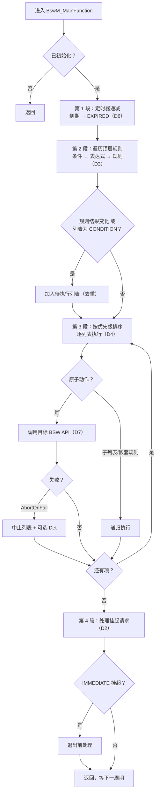

# BswM_MainFunction 调用逻辑

> [!info] 导航
> 上级：[[BswM]] ｜ 依赖：[[BswM_调用逻辑总览]] ｜ 依据：[[BswM_D5_状态转换表]]

> 适用版本：AUTOSAR CP R21-11　依据：SWS_BswM 7.1、7.2、7.3、8.5
> 最后更新：2026-10-21

## 1. 调度与配置

| 项目 | 内容 |
|---|---|
| 调度者 | SchM / OS 周期任务（`SchM_BswM.h`） |
| 函数 | `BswM_MainFunction(void)`，无参无返回、不可重入 |
| 周期 | `BswMGeneral/BswMMainFunctionPeriod`（秒），必须等于任务周期 |
| 上下文 | 任务上下文 |
| 前置 | `BswM_Init` 已执行；否则未初始化不处理 |
| 特性 | 只处理 **DEFERRED** 路径（00075） |

## 2. 方向 → 主函数处理段映射

| 方向 | 方向名称 | 主函数中的处理段 | 进入条件 | 输出 |
|---|---|---|---|---|
| D6 | 定时器与延迟 | 第 1 段：定时器递减/到期 | 有 STARTED 定时器 | 定时器 EXPIRED（参与仲裁） |
| D3 | 规则仲裁 | 第 2 段：遍历顶层规则求值 | 每周期 | 命中列表集合 |
| D4 | 动作列表与执行 | 第 3 段：去重/排序/执行 | 有待执行列表 | 调用 BSW API |
| D7 | 输出动作 | 第 3 段内的原子动作 | 列表执行中 | 目标模块 API |
| D2 | 挂起请求处理 | 第 4 段：处理执行期间挂起的请求 | 主函数期间收到请求 | 退出前处理 IMMEDIATE，DEFERRED 下周期 |
| D5 | 状态转换表 | 贯穿第 1~2 段的判定依据 | — | 生命周期/规则/定时器状态更新 |

## 3. 主流程



## 4. 分步解析

### 第 1 段：定时器（D6）

- STARTED 定时器减去一个 `BswMMainFunctionPeriod`；
- 到 0 → EXPIRED，**同一周期参与仲裁**（00264）；
- 不自动重装/停止（7.3 Note）。

### 第 2 段：规则仲裁（D3）

- 遍历 `BswMNestedExecutionOnly=FALSE` 的顶层规则；
- 含未定义条件的规则跳过（00241）；
- 结果与"上次结果"比较（`BswMRuleInitState` 定初值，00066）；
- 变化或 CONDITION 列表 → 收集，去重（00011/00023/00115/00116/00223）。

### 第 3 段：动作执行（D4/D7）

- 按 `BswMActionListPriority` 降序（00275）；
- 列表内按 `BswMActionListItemIndex` 升序（00260）；
- 项引用：原子动作 / 子列表（≤7 层，00037）/ 嵌套规则（00067）；
- 失败：`BswMAbortOnFail` 中止（00055）、`BswMReportFailRuntimeErrorId` 上报 Det（00239）。

### 第 4 段：挂起请求（D2）

- 主函数执行期间收到的请求：IMMEDIATE 在退出前处理，DEFERRED 留到下一周期（00068）；
- 避免动作列表执行被重入打断。

## 5. 伪代码

```c
void BswM_MainFunction(void)
{
    if (!BswM_Initialized) return;

    /* 第 1 段：定时器（D6） */
    BswM_UpdateTimers();

    /* 第 2 段：规则仲裁（D3） */
    BswM_ResetPendingLists();
    for (each rule where NestedExecutionOnly == FALSE) {
        if (rule.hasUndefinedCondition()) continue;
        bool now = BswM_EvaluateExpression(rule.expr);
        bool changed = (now != rule.lastResult);
        if (changed || rule.list.execution == BSWM_CONDITION)
            BswM_AddPendingList(now ? rule.trueList : rule.falseList); /* 去重 */
        rule.lastResult = now;
    }

    /* 第 3 段：动作执行（D4/D7） */
    BswM_SortByPriority();
    for (each list in pending) BswM_ExecuteActionList(list);

    /* 第 4 段：挂起请求（D2） */
    BswM_ProcessPostponedImmediateRequests();
}
```

## 6. 全局变量的变化

| 变量 | 何时写 | 影响 |
|---|---|---|
| 定时器状态/剩余 | 第 1 段 | 延时/超时行为 |
| 规则上次结果 | 第 2 段 | 下一轮触发判断 |
| 待执行列表集合 | 第 2 段 | 第 3 段执行 |
| 端口值 | 由输入 API/回调写（不在主函数写） | 仲裁输入 |
| 挂起请求标志 | 执行期间（回调写）/第 4 段清 | 请求不丢失 |

## 7. 输出与回调

| 输出 | 接口 | 条件 |
|---|---|---|
| 通信控制 | Com/ComM/Nm/PduR API | 对应动作执行 |
| 模式切换 | `Rte_Switch_*` / `SchM_Switch_*` | 模式通知动作 |
| 电源 | EcuM API | 关机/启动动作 |
| 错误 | `Det_ReportRuntimeError` | 动作失败且配置上报 |

## 8. 时序特性与排障

1. **周期精度**：所有定时器与 IMMEDIATE 的延迟都依赖主函数周期；
2. **执行耗时**：动作列表多/动作重会拖长主函数，挤占其他任务；用优先级拆分列表；
3. **规则抖动**：端口频繁变化 → 列表频繁触发；用 TRIGGER + 定时器（D6）去抖；
4. **动作顺序错误**：看 ItemIndex 与优先级，不要依赖配置树顺序；
5. **首次启动不执行**：检查 `BswMRuleInitState` 与端口初值（D5）。

## 9. 需求依据

SWS_BswM_00011、00023、00053、00055、00060、00066~00069、00075、00115、00116、00223、00239、00260、00264、00275、00281、00282。
