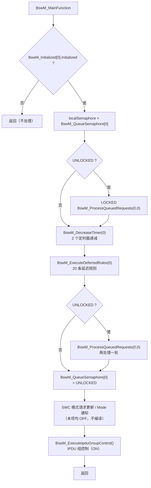

# BswM_MainFunction 调用逻辑（基于本项目生成代码）

> [!info] 导航
> 上级：[[BswM]]

> 适用文档：AUTOSAR CP R21-11　**实现基线**：AUTOSAR 4.2.2 / NeuSAR BswM 3.14.0
> 代码：`BswM.c` 的 `BswM_MainFunction`（L3374~3429）
> 最后更新：2026-10-21

## 1. 调度与配置

| 项目 | 内容 |
|---|---|
| 调度者 | SchM/OS 周期任务（`SchM_BswM.h`） |
| 函数 | `BswM_MainFunction(void)`（L3374），不可重入 |
| 周期 | 由集成任务决定（对应 `BswMMainFunctionPeriod`，代码内无该常量） |
| 上下文 | 任务 |
| 前置 | `BswM_Init` 已执行，`BswM_Initialized[0].Initialized == TRUE` |
| 分区 | 单分区（`BSWM_MULTIPARTITION=STD_OFF`），partitionIdx/partitionId 固定 0 |
| 规模 | 27 动作列表 / 26 规则 / 20 延迟规则 / 4 立即请求 / 2 定时器 |

## 2. 实际执行顺序（L3374~3429）



## 3. 分步解析

### 3.1 初始化检查
`BswM_Initialized[0].Initialized` 为 FALSE 时主函数直接返回，不做任何队列/定时器/规则处理。

### 3.2 队列与信号量
- `BswM_QueueSemaphore[0]` 是队列重入保护：
  - `UNLOCKED`：主函数先置 `LOCKED`，调用 `BswM_ProcessQueuedRequests(0,0)` 处理挂起立即请求；
  - `LOCKED`（例如立即请求正在执行）：主函数本轮不处理队列，只做定时器/延迟规则。
- 主函数末尾若仍为 `UNLOCKED`，再调用一次 `BswM_ProcessQueuedRequests` 并解锁，用于处理本轮执行动作期间新产生的请求。

### 3.3 定时器（`BswM_DecreaseTimer`，L723）
- 遍历 `BswM_TimerState[0..1]`，对 `STARTED` 的定时器 `Timevalue--`；
- 到 0 置 `BSWM_TIMER_EXPIRED`，供规则函数读取；
- 定时器启停由动作列表里的定时器动作完成（`BswM_TimerStart/Stop`）。

### 3.4 延迟规则（`BswM_ExecuteDeferredRules`，L802）
- 遍历 `BswM_DeferredRules[0..19]`，调用 `BswM_Rules[BswM_DeferredRules[i].RulesIdxOfDeferredRules].FctPtrOfRules()`；
- 返回值即动作列表 ID；若 `< 27` 且队列 IDLE → 置 `BSWM_ACTIONLIST_PENDING`；
- 有命中后调用 `BswM_ExecuteActionLists(BSWM_ACTIONLIST_PENDING, 0)` 执行。

### 3.5 立即请求（`BswM_ProcessQueuedRequests`，L555）
- 只处理 `BswM_ModeRequestQueue[].RequestMode == BSWM_REQUEST_QUEUED` 的项；
- 对每个立即用户，遍历 `BswM_ImmediateUser[i].RulesIndStartIdx..EndIdx`，用 `BswM_RulesInd[]` 索引规则函数；
- 规则返回动作列表 ID 后置 `BSWM_ACTIONLIST_PENDING`，再执行动作列表；
- 处理完后 `BswM_ReleaseQueue` 把 `PROCESSED→IDLE`、`PENDING→QUEUED`。

### 3.6 动作执行（`BswM_ExecuteActionLists`，L762）
- 遍历 `BswM_ActionListQueue[0..26]`；
- 状态等于 `executionLevel`（通常 `BSWM_ACTIONLIST_PENDING`）时：
  1. 置 `BLOCKED`（防重入）；
  2. 调 `BswM_ActionLists[i].FctPtrOfActionLists()`（实际函数 `BswM_ActionList_AL_*`）；
  3. 执行完置 `IDLE`。

### 3.7 IPDU 组控制
`BSWM_IPDU_GROUP_CONTROL=STD_ON` 时，主函数末尾调用 `BswM_ExecuteIpduGroupControl()`，把配置的 IPDU 组启停落到 Com/PduR。

## 4. 伪代码（按实际函数）

```c
void BswM_MainFunction(void)
{
    uint8 localSemaphore;
    uint8 partitionIdx = 0, partitionId = 0;

    if (BswM_Initialized[partitionIdx].Initialized == TRUE) {
        localSemaphore = BswM_QueueSemaphore[partitionIdx];
        if (localSemaphore == BSWM_REQUEST_SEMAPHORE_UNLOCKED) {
            BswM_QueueSemaphore[partitionIdx] = BSWM_REQUEST_SEMAPHORE_LOCKED;
            BswM_ProcessQueuedRequests(partitionIdx, partitionId);
        }

        BswM_DecreaseTimer(partitionId);            /* 2 个定时器 */
        BswM_ExecuteDeferredRules(partitionId);     /* 20 条延迟规则 */

        if (localSemaphore == BSWM_REQUEST_SEMAPHORE_UNLOCKED) {
            BswM_ProcessQueuedRequests(partitionIdx, partitionId);
            BswM_QueueSemaphore[partitionIdx] = BSWM_REQUEST_SEMAPHORE_UNLOCKED;
        }

        BswM_ExecuteIpduGroupControl();             /* IPDU_GROUP_CONTROL=ON */
    }
}
```

## 5. 本项目配置对主函数的影响

| 配置 | 值 | 主函数表现 |
|---|---|---|
| `BSWM_MULTIPARTITION` | OFF | 不调用分区查询；索引固定 0 |
| `BSWM_SIZE_ACTIONLIST` | 27 | `ExecuteActionLists` 遍历 27 项 |
| `BSWM_SIZE_DEFERRED_RULE` | 20 | `ExecuteDeferredRules` 遍历 20 项 |
| `BSWM_SIZE_TIMER` | 2 | `DecreaseTimer` 遍历 2 项 |
| `BSWM_SIZE_IMMEDIATE_USER` | 4 | `ProcessQueuedRequests` 处理 4 个队列槽 |
| `BSWM_IPDU_GROUP_CONTROL` | ON | 每周期调用 `BswM_ExecuteIpduGroupControl()` |
| `BSWM_SWCMODEREQUESTUPDATE_FUNC` | OFF | 不调用 `BswM_SwcModeRequestUpdateFunc` |
| `BSWM_MODENOTIFICATION_FUNC` | OFF | 不调用 `BswM_ModeNotificationFunc` |

## 6. 排障要点（结合代码）

1. **主函数无动作**：先看 `BswM_Initialized[0].Initialized` 与 `BswM_QueueSemaphore[0]` 是否卡在 `LOCKED`；
2. **请求没被处理**：看 `BswM_ModeRequestQueue[i].RequestMode` 是否 `QUEUED`、`BswM_QueueWritten[0]` 是否 TRUE；
3. **规则不命中**：断点进规则函数 `BswM_Rules[i].FctPtrOfRules()`，检查端口值数组（ComM 7 / Dcm 7 / Generic 5）；
4. **动作不执行**：看 `BswM_ActionListQueue[i].ActionListState` 是否被置为 PENDING/BLOCKED；
5. **定时器不动**：看 `BswM_TimerState[i].Timestate` 是否 STARTED，`BswMMainFunctionPeriod` 与任务周期是否一致；
6. **IPDU 组不生效**：确认 `BswM_ExecuteIpduGroupControl()` 的组配置与 Com/PduR 侧一致。

## 7. 与旧文档的差异

| 旧内容 | 实际代码 |
|---|---|
| 主函数“遍历顶层规则” | 无显式遍历；规则在队列/延迟路径通过函数指针调用 |
| 主函数内“去重/排序/逐列表执行” | 动作列表状态机（PENDING/BLOCKED/IDLE）+ 生成函数直接执行，无排序器 |
| 通用 `BswM_ExecuteAction()` 原子动作 | 每个动作列表是 `BswM_ActionList_AL_*()`，内部直接调 BSW API |
| 主函数“挂起请求下周期处理” | 本周期退出前再处理一轮队列 |
