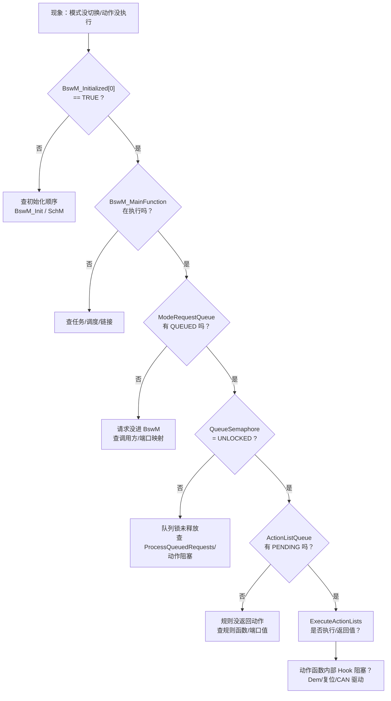

# BswM 快速问题定位（现场排查手册）

> [!info] 导航
> 上级：[[BswM]]

> 适用实现：NeuSAR BswM 3.14.0 / AUTOSAR 4.2.2，单分区，27 动作列表 / 26 规则 / 20 延迟规则 / 4 立即请求 / 2 定时器
> 代码：`AUTOSAR/AUTOSAT使用NEUSAR生成的代码/002_BSW/Bsw_Src/Autosar_Src/src_BswM/Source/`
> 最后更新：2026-10-22

> 定位原则：**先看请求有没有进队列，再看规则有没有返回动作列表，最后看动作函数有没有执行**；BswM 本身不做业务，问题多数在“输入没到 / 队列没跑 / 动作被阻塞”。

## 1. 第一时间看什么（按优先级）

| 优先级 | 看什么 | 怎么快速确认 | 异常范围 |
|---|---|---|---|
| P0 | 是否初始化 | `BswM_Initialized[0].Initialized == TRUE` | 未初始化 → 所有请求被丢弃/不处理 |
| P1 | 主函数是否在跑 | SchM/OS 任务里 `BswM_MainFunction` 是否有执行时间 | 不跑 → 队列/定时器/延迟规则全停 |
| P2 | 主函数周期 | `BSWM_MAINFUNCTIONPERIOD=5U` 对应的实际任务周期 | 周期错 → 定时器/延迟规则时间全错 |
| P3 | 队列锁 | `BswM_QueueSemaphore[0]` 是否为 `UNLOCKED` | 一直 `LOCKED` → 请求只排队不处理 |
| P4 | 请求队列 | `BswM_ModeRequestQueue[0..3].RequestMode` | 一直 `QUEUED/PENDING` → 队列处理没推进 |
| P5 | 动作列表状态 | `BswM_ActionListQueue[0..26].ActionListState` | 一直 `PENDING/BLOCKED` → 动作执行卡住 |
| P6 | 规则/动作函数 | `BswM_Rules[i].FctPtrOfRules()` 返回值、`BswM_ActionLists[i].FctPtrOfActionLists()` | 返回 `>=27` → 规则无动作；动作函数返回值异常 |
| P7 | 定时器 | `BswM_TimerState[0..1].Timestate/Timevalue` | 不递减/不 EXPIRED → 定时器动作或主函数 |
| P8 | 配置/映射 | 宏开关、`BSWM_SIZE_*`、动作列表 ID、外部 Hook | 配置错 → 规则/动作结果与预期不符 |

## 2. 先看什么：一张决策图

## 3. 现象 → 首先看什么

| 现象 | 第一时间看 | 快速判定 | 范围收敛 |
|---|---|---|---|
| 模式请求后无任何动作 | `BswM_ModeRequestQueue[].RequestMode`、`BswM_QueueSemaphore[0]` | 一直 IDLE → 请求没进队列；一直 QUEUED → 主函数/信号量；PROCESSED/PENDING → 动作执行 | 调用方 → 队列 → 规则 → 动作 |
| 规则结果与预期不符 | 端口值数组（ComM/Dcm/Generic）、`BswM_Rules[i].FctPtrOfRules()` 返回值 | 端口值没更新 → 输入回调/映射；返回值 `>=27` → 规则不命中 | 输入端口/规则函数 |
| 动作不执行/只执行一部分 | `BswM_ActionListQueue[].ActionListState`、动作函数返回值 | PENDING 长期不变 → `ExecuteActionLists` 未跑/被阻塞；BLOCKED → 上一动作未退出 | 队列/动作函数 |
| 初始化后规则不生效 | `BswM_Initialized[0]`、`BswM_ProcessingState`（多分区才有） | Init 未完成/重复 Init → ALREADY_INITIALIZED | BswM_Init / EcuM 序列 |
| 定时器不动作 | `BswM_TimerState[].Timestate/Timevalue` | 一直 STOPPED → `BswM_UpdateTimer` 未调用；STARTED 不递减 → 主函数 | 定时器动作/主函数周期 |
| 延迟规则不触发 | `BswM_DeferredRules` 索引、`BswM_ExecuteDeferredRules` | 规则函数返回值 `<27` 但队列没 PENDING → 队列状态/执行 | 延迟规则/动作队列 |
| 下电/复位动作不执行 | 动作列表 `AL_RunToPostRun`/`AL_PostRunToShutdown`/`AL_*Reset`、Callout Hook | 动作执行了但外部动作没做 → Hook 内部（Dem/复位/CAN 驱动） | BswM 动作 → 项目 Hook |
| IPDU 组控制不生效 | `BswM_ExecuteIpduGroupControl()` 调用、`BSWM_IPDU_GROUP_CONTROL` | 宏 OFF → 不执行；ON 但组状态不变 → Com/PduR 配置 | BswM → Com/PduR |
| 单分区配置却像多分区 | `BSWM_MULTIPARTITION=STD_OFF`、`BswM_ProcessingState` 不编译 | 按多分区排查会找不到变量 | 配置/文档 |
| 端口值一直不变 | `BswM_ComMChannelState[7]`、`BswM_DcmChannelState[7]`、`BswM_GenericState[5]` | 对应 size=0 的端口不存在；回调没写值 | 端口规模/回调 |

## 4. 重点观测变量

| 变量 | 正常/关键值 | 作用 | 异常提示 |
|---|---|---|---|
| `BswM_Initialized[0]` | `.Initialized == TRUE` | 初始化状态 | 非 TRUE → 所有 API/主函数不处理 |
| `BswM_QueueSemaphore[0]` | `BSWM_REQUEST_SEMAPHORE_UNLOCKED` | 队列重入保护 | 一直 LOCKED → 请求只排队 |
| `BswM_QueueWritten[0]` | FALSE（空闲）/ TRUE（有新请求） | 队列是否有新请求 | 一直 TRUE → 处理循环未退出/请求持续写入 |
| `BswM_ModeRequestQueue[0..3].RequestMode` | IDLE | 立即请求状态 | QUEUED/PENDING 长期不变 → 队列/动作卡住 |
| `BswM_ActionListQueue[0..26].ActionListState` | IDLE | 动作列表执行状态 | PENDING/BLOCKED 长期不变 → 执行未完成 |
| `BswM_TimerState[0..1].Timestate` | STOPPED/STARTED/EXPIRED | 定时器状态 | STARTED 不递减 → 主函数；EXPIRED 不消费 → 规则 |
| `BswM_TimerState[0..1].Timevalue` | 运行中递减 | 定时器剩余值 | 不变 → `BswM_DecreaseTimer` 未跑 |
| `BswM_ComMChannelState[0..6]` | 端口初值/当前模式 | ComM 模式输入 | 不更新 → ComM 回调/映射 |
| `BswM_DcmChannelState[0..6]` | 端口初值/当前模式 | Dcm 模式输入 | 不更新 → Dcm 回调/映射 |
| `BswM_GenericState[0..4]` | 端口初值/当前值 | 通用请求端口 | 不更新 → 请求方/映射 |
| `BswM_LinSMScheduleState[0]` / `LinSMChannelState[0]` | 当前调度/状态 | LinSM 输入 | 不更新 → LinSM 回调 |
| `BswM_Rules[i].FctPtrOfRules()` | 返回 `<27` | 规则结果 | 返回 `>=27` → 无动作 |
| `BswM_ActionLists[i].FctPtrOfActionLists()` | 返回 E_OK/E_NOT_OK | 动作执行 | 返回 E_NOT_OK → 动作失败/Abort |

## 5. 分层定位

| 层 | 先证明什么 | 手段 | 不通过时范围 |
|---|---|---|---|
| 调用方 | 模式请求/端口更新有没有调用 BswM | 断点 `BswM_RequestMode`/各回调 | EcuM/ComM/Dcm/CanSM 配置 |
| BswM 队列 | 请求是否进 `ModeRequestQueue` | watch 队列状态 | 映射/中断/信号量 |
| 规则 | 端口值是否正确、规则返回值 | 断点规则函数 | 端口数组/规则生成 |
| 动作列表 | 动作是否 PENDING/执行/失败 | watch `ActionListQueue` | 队列执行/动作函数 |
| 项目 Hook | 动作内部是否真正执行 | 断点 Callout Stubs | `BootReset_Action`/`Dem_Shutdown`/CAN 驱动 |
| 目标模块 | Com/ComM/EcuM 是否接受动作 | 目标模块状态/DET | 下游配置/时序 |

## 6. 断点与抓包

| 目的 | 位置 |
|---|---|
| 看主函数 | `BswM_MainFunction`（`BswM.c` L3374） |
| 看队列处理 | `BswM_ProcessQueuedRequests`（L555） |
| 看动作执行 | `BswM_ExecuteActionLists`（L762） |
| 看延迟规则 | `BswM_ExecuteDeferredRules`（L802） |
| 看定时器 | `BswM_DecreaseTimer`（L723）、`BswM_UpdateTimer`（`BswM_Lcfg.c` L802） |
| 看初始化 | `BswM_Init`（L1051） |
| 看项目动作 | `BswM_Callout_Stubs.c` 各 `*_Action` |
| 看 IPDU 组 | `BswM_ExecuteIpduGroupControl`（`BswM_Lcfg.c` L838） |

抓取/记录要点：

1. 请求时间戳（调用 `BswM_RequestMode` 或端口回调）与动作时间戳（Callout/目标 API）；
2. `BswM_MainFunction` 任务周期与抖动（OS Trace）；
3. 队列状态（ModeRequestQueue、ActionListQueue、QueueSemaphore）的快照；
4. 动作函数的返回值与 DET；
5. 下游模块（Com/ComM/EcuM/Dem）是否收到并执行。

## 7. 本项目配置坑

| 坑 | 说明 |
|---|---|
| 单分区 | `BSWM_MULTIPARTITION=STD_OFF`；`BswM_ProcessingState` 不编译，所有索引固定 0。 |
| 规模裁剪 | CanSM/EthSM/PNC/NvM/EcuM/Sd/FR/LinTp/J1939 端口 size=0，不存在对应状态数组；按端口名找不到变量是正常的。 |
| `ConfigPtr` | `BswM_ConfigType` 为空结构，`BswM_Init` 的 ConfigPtr 未使用；配置在 `BswM_Lcfg.c`。 |
| 定时器值 | `BswM_UpdateTimer` 写入的 value 由配置决定，`BswM_DecreaseTimer` 每个主函数周期减 1；值是周期数，不是直接 ms。 |
| `BSWM_MAINFUNCTIONPERIOD` | 生成宏为 `5U`，代码中未直接引用；实际任务周期需在 SchM/OS 集成配置确认。 |
| 动作列表 | 27 个动作列表是生成函数（`BswM_ActionList_AL_*`），不是通用解释器；改行为要改配置/生成。 |
| 项目 Hook | `BswM_Callout_Stubs.c` 的复位/上下电/CAN 驱动/Dem 关闭等是项目定制，不属于 SWS。 |
| IPDU 组控制 | `BSWM_IPDU_GROUP_CONTROL=STD_ON`，主函数每周期调用；组配置在 Com/PduR 侧。 |

## 8. 30 分钟范围锁定流程

1. **复现**：记录现象、请求时间、动作时间、软件版本、`BSWM_MAINFUNCTIONPERIOD` 对应任务周期；
2. **确认初始化与调度**：`BswM_Initialized[0]`、主函数是否执行；
3. **队列快照**：`QueueSemaphore`、`ModeRequestQueue`、`ActionListQueue`；
4. **规则/动作**：规则返回值、动作函数返回值、Callout Hook 是否阻塞；
5. **配置核对**：第 7 节逐项核对分区/规模/动作列表/定时器值；
6. **最小化**：单请求、单通道、关闭未用端口，再复现；
7. **结论**：层 + 变量证据 + 配置项 + 复现条件，写入 Q-xxx。

## 9. 提交证据清单

- 现象、复现条件、请求/动作时间戳；
- 队列状态快照（三个队列/信号量）；
- 规则返回值、动作函数返回值、DET；
- `BswM_MainFunction` 任务周期与抖动；
- 相关 Callout Hook 的执行情况（复位/Dem/CAN 驱动/电源标志）；
- 下游模块（Com/ComM/EcuM）状态。

> 时间类问题见同目录 `BSWM_时间类问题排查.md`；非标准实现见 `07_BSWM非标准问题实现/`。
