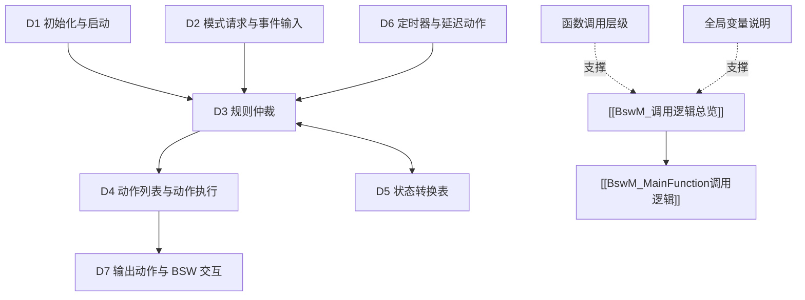

# BswM 模块总览

> [!info] 导航
> 上级：[[AUTOSAR]] ｜ 同级：[[AUTOSAR#2. 模块地图]]
> 本页是 BswM 的唯一入口：**模块 → 主题 → 方向 → 细节**。

## 1. 一句话定位

BswM（BSW Mode Manager）是 BSW 中的**模式仲裁 + 模式控制**框架：把来自 EcuM/ComM/Dcm/总线状态管理器/SWC 的模式请求与指示，用布尔规则仲裁成"当前应处于什么模式"，再通过动作列表调用其他 BSW 模块的 API（开关通信、切 PDU 组、NvM 读写、RTE 切换、下电等）。行为完全由配置决定。

- 适用版本：AUTOSAR CP R21-11（SWS_BSWModeManager，Document ID 313）
- 模块边界：Services 层；不做 EcuM 的启动/唤醒源管理，不直接操作硬件；动作委托给 Com/ComM/PduR/NvM/EcuM/RTE 等。

## 2. 快速入口（5 个主题）

| 主题 | 入口 | 包含内容 |
|---|---|---|
| 学习总结 | [[BswM_模块作用与架构定位]] | 架构定位、仲裁/控制机制、状态与定时器；另见 [[BswM_DaVinci配置项]]、[[BswM_一页纸复盘]] |
| 调用逻辑 | [[BswM_调用逻辑总览]] | D1 初始化与启动、D2 模式请求与事件输入、D3 规则仲裁、D4 动作列表与执行、D5 状态转换表、D6 定时器与延迟、D7 输出动作 |
| 主函数 | [[BswM_MainFunction调用逻辑]] | 调度、方向→处理段映射、伪代码、排障点 |
| 标准表格 | [[BswM_AUTOSAR标准需求表_R21-11]] | 181 条中文需求（按需求号分组锚点）；另见 [[BswM_配置参数表_R21-11]]、[[BswM_需求追溯与覆盖度]] |
| 问题排查 | [[BswM_问题排查记录]] | 非 AUTOSAR 标准问题，持续更新 |

## 3. 调用逻辑层次（L2 → L3）

- 入口：[[BswM_D1_初始化与启动调用逻辑]]、[[BswM_D2_模式请求与事件输入调用逻辑]]
- 核心：[[BswM_D3_规则仲裁调用逻辑]]（条件→表达式→规则）
- 执行：[[BswM_D4_动作列表与动作执行调用逻辑]]、[[BswM_D7_输出动作与BSW交互]]
- 辅助：[[BswM_D5_状态转换表]]、[[BswM_D6_定时器与延迟动作调用逻辑]]
- 支撑：[[BswM_函数调用层级]]、[[BswM_全局变量说明]]

## 4. 交付物状态

- [x] 官方文档：[[BswM_来源清单]]
- [x] 作用 / DaVinci 配置项 / 复盘
- [x] 调用逻辑（D1~D7 + 层级 + 全局变量 + 状态表）
- [x] MainFunction 调用逻辑
- [x] 标准需求表（181 需求 / 配置参数表 / 25 条追溯）
- [x] 问题排查记录（模板就绪）

## 5. 更新记录

| 日期 | 内容 |
|---|---|
| 2026-10-17 | 初版学习包 |
| 2026-10-21 | 升级 v3：L1 模块总览（本页）+ D1~D7 调用逻辑 + 标准需求表 + 问题排查 |
