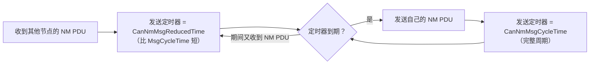

# CanNm_ChannelConfig[channel].BusLoadReductionActive 作用说明

> [!info] 导航
> 上级：[[CanNm]] ｜ 依赖：[[CanNm_D5_周期发送与降载调用逻辑]]、[[CanNm_D3_主状态转移逻辑]] ｜ 依据：[[CanNm_AUTOSAR标准需求表_R21-11#SWS_CanNm_000xx|需求表]]

> 适用版本：AUTOSAR CP R21-11　依据：AUTOSAR_SWS_CANNetworkManagement（Document ID 13）7.8、7.9.2、10.2（ECUC_CanNm_00042 / ECUC_CanNm_00040）、11.1
> 最后更新：2026-10-20

## 1. 一句话结论

`BusLoadReductionActive` 是 **CanNm 每个通道的"总线负载降低机制是否允许启用"开关**（生成代码中来自 ECUC 参数 `CanNmBusLoadReductionActive`）。
它为 TRUE 时，该 NM 通道在 **Normal Operation State** 下会启用"带总线负载降低的周期发送"算法：**收到 NM 帧后用 `CanNmMsgReducedTime` 重装发送周期定时器，自己发送后用 `CanNmMsgCycleTime` 重装**，从而把整条总线的 NM 帧负载压到"每个 `CanNmMsgCycleTime` 最多约 2 帧"，与集群节点数无关。

> 注意区分：`BusLoadReductionActive` 只是"允许/不允许"的配置位；**真正激活/退出算法**由状态机决定——进入 Normal Operation State 时激活、进入 Repeat Message State 时退出（SWS_CanNm_00156/00157）。

## 2. 生成代码里这个字段是什么

```c
/* 本项目实际代码：CanNm_Cfg.c L166~，CanNm_ConfigType 结构体（按位置初始化） */
CONST(CanNm_ConfigType, CANNM_CONFIG_DATA) CanNm_ChannelConfig[CANNM_NUMBER_OF_CANNM_CHANNELS] = {
    {
        380U,    /* TimeoutTime（ms） */
        401U,    /* WaitBusSleepTime（ms） */
        ...
        100U,    /* MsgCycleTime（ms） */
        ...
        FALSE,   /* BusLoadReductionActive ← 本项目为 FALSE */
        56U,     /* MsgReducedTime（ms） */
        ...
    },
    { /* 第二通道，同上 */ },
};
```

| 项目 | 说明 |
|---|---|
| 来源参数 | `CanNmBusLoadReductionActive`（ECUC_CanNm_00042，父容器 `CanNmChannelConfig`） |
| 类型 | boolean，每个 NM 通道一个 |
| 默认值 | 无默认，必须配置；依赖约束：`CanNmBusLoadReductionEnabled == FALSE` 时必须为 FALSE |
| 配置类别 | Pre-compile / Link-time（`VARIANT-PRE-COMPILE`、`VARIANT-LINK-TIME`），**不是运行时可写变量** |
| 生效范围 | 该通道（channel）；全局另有 `CanNmBusLoadReductionEnabled`（ECUC_CanNm_00040）作为模块级预编译开关 |

## 3. 两个开关的关系（最容易混淆的点）

| `CanNmBusLoadReductionEnabled`（全局，CanNmGlobalConfig） | `CanNmBusLoadReductionActive`（每通道） | 实际行为 |
|---|---|---|
| FALSE | 必须 FALSE | 关闭，所有节点每 `MsgCycleTime` 各发一帧 |
| TRUE | FALSE | 该通道不参与降低，仍按 `MsgCycleTime` 周期发送（例如该节点需要每周期发 user data） |
| TRUE | TRUE | 该通道启用降低算法（Normal Operation State 下） |

- `Enabled` 是**预编译开关**：FALSE 时相关代码可能被裁剪，改它要重新编译。
- `Active` 是**每通道配置**：同一 ECU 上不同 CAN 通道可以一个开、一个不开。
- 若 `CanNmPassiveModeEnabled == TRUE` 或 `CanNmGlobalPnSupport == TRUE`，`Enabled` 必须为 FALSE（标准约束）。

## 4. 算法怎么工作（SWS 7.8）

前提：`CanNmMsgCycleTime` 是全网统一的 NM 周期；`CanNmMsgReducedTime` 是**节点私有**的缩短周期。

规则只有两条：

1. **收到 NM PDU**（`CanNm_RxIndication`）→ Message Cycle Timer 用 `CanNmMsgReducedTime` 重装；
2. **自己发出 NM PDU** → Message Cycle Timer 用 `CanNmMsgCycleTime` 重装。



效果：

- `CanNmMsgReducedTime` 最小的两个节点会"轮流"发帧；一个停发后，下一个最小的接上。
- 总线上**每个 `CanNmMsgCycleTime` 最多约 2 帧 NM PDU**——节点数从 2 增加到 20，NM 负载基本不涨。
- 只剩一个节点需要通信时，退化为"每周期 1 帧"。

示例（SWS 11.1）：3 个节点都在 Normal Operation，Node1/Node2 的 `MsgReducedTime` 最小 → 交替发；Node1 进入 Ready Sleep 后 Node2/Node3 交替；只剩 Node3 时 Node3 每 `MsgCycleTime` 发一帧。

## 5. 什么时候激活、什么时候不激活

| 状态 | 是否使用降低算法 |
|---|---|
| Repeat Message State | ❌ 进入时执行 "Stop Bus Load Reduction"（SWS_CanNm_00156），所有节点按正常周期发，保证唤醒/首次通信可靠 |
| Normal Operation State | ✅ 进入时执行 "Start Bus Load Reduction"（SWS_CanNm_00157），但前提是 `Enabled=TRUE && Active=TRUE` |
| Ready Sleep State | ❌ 不发送 NM PDU（等待 NM-Timeout） |
| Prepare Bus-Sleep / Bus-Sleep | ❌ 不发送 |
| Passive Mode / PNC 全局支持 | ❌ 标准约束下不允许开启 |

## 6. 相关参数与约束（必须一起看）

| 参数 | 位置 | 作用 | 约束 |
|---|---|---|---|
| `CanNmMsgCycleTime` | CanNmChannelConfig | 全网统一的 NM 周期，也是发送后重装值 | 0.001~65.535 s；Passive 时无效 |
| `CanNmMsgReducedTime` | CanNmChannelConfig | 节点私有的缩短周期，收帧后重装值 | **0.5×MsgCycleTime ≤ ReducedTime < MsgCycleTime**；仅在 `Enabled && Active && !Passive` 时使用 |
| `CanNmBusLoadReductionEnabled` | CanNmGlobalConfig | 模块级预编译开关 | Passive/PNC 时必须 FALSE |
| `CanNmBusLoadReductionActive` | CanNmChannelConfig | 本通道是否允许降低 | Enabled=FALSE 时必须 FALSE |
| `CanNmMsgTimeoutTime` / `CanNmTimeoutTime` | CanNm | NM-Timeout 监控 | 必须大于 `MsgCycleTime`，否则降低后容易误判超时 |

## 7. 工程影响与注意事项

1. **NM user data / CBV 不会每周期都发**：SWS 7.9.2 明确指出，Normal Operation 下 user data 是否发送取决于 busload reduction 配置。若应用依赖 NM 用户数据（如车型配置、PNC 信息）每周期刷新，慎开或评估。
2. **"Active=TRUE" 不等于"一直降低"**：Repeat Message State 会临时关闭，所以刚唤醒的几帧仍是正常周期，属预期行为。
3. **两个开关都必须是 TRUE**：项目里最常见的错误是只把全局 `Enabled` 打开、通道 `Active` 仍为默认 FALSE，结果"配置了但没效果"；反之 `Active=TRUE` 而 `Enabled=FALSE` 会被 DaVinci 校验拒绝。
4. **`MsgReducedTime` 不能乱配**：太接近 `MsgCycleTime` → 降低效果不明显；小于 0.5×Cycle → 违反约束，可能让"最快的两个节点"频繁切换甚至超过 2 帧上限。
5. **不要把它当运行时可改参数**：`BusLoadReductionActive` 在生成代码里是常量表成员；运行期想动态开关只能通过重新生成配置/变体切换，标准没有提供对应 API。
6. **负载估算**：开启后 NM 负载 ≈ `2 × 帧长 / MsgCycleTime`；关闭时 ≈ `节点数 × 帧长 / MsgCycleTime`。用这个公式可以快速判断某个网络是否需要开启。
7. **排查方法**：抓总线看 NM 帧间隔——开启后应能看到"两帧靠得很近 + 一段静默"的交替图案；若所有节点仍等间隔发帧，先查 `CanNm_ChannelConfig[ch].BusLoadReductionActive` 生成值、`Enabled` 宏、以及当前是否还在 Repeat Message State。

## 8. 在 DaVinci 中的位置

```text
CanNm
├─ CanNmGlobalConfig
│  ├─ CanNmBusLoadReductionEnabled      ← 模块级开关（预编译）
│  └─ CanNmChannelConfig[*]             ← 每个 CAN 通道
│     ├─ CanNmMsgCycleTime
│     ├─ CanNmMsgReducedTime
│     └─ CanNmBusLoadReductionActive    ← 本字段
```

配置后重新生成 BSW，检查 `CanNm_Cfg.c` 中 `CanNm_ChannelConfig[channel].BusLoadReductionActive` 是否为期望值（本工程在 `src_CanNm/Source/CanNm_Cfg.c`）。

## 9. 依据章节

- 机制描述：SWS_CanNm 7.8（Bus Load Reduction Mechanism）
- 状态机动作：SWS_CanNm 7.18 状态图（entry / Start|Stop Bus Load Reduction）
- 参数定义：SWS_CanNm 10.2（ECUC_CanNm_00040、00042、00043）
- 示例：SWS_CanNm 11.1
- user data 影响：SWS_CanNm 7.9.2 Note
