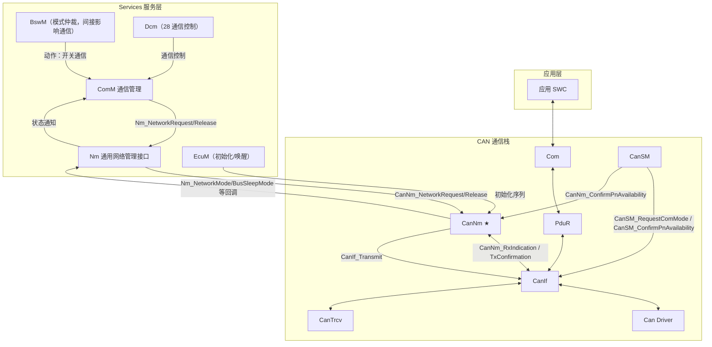
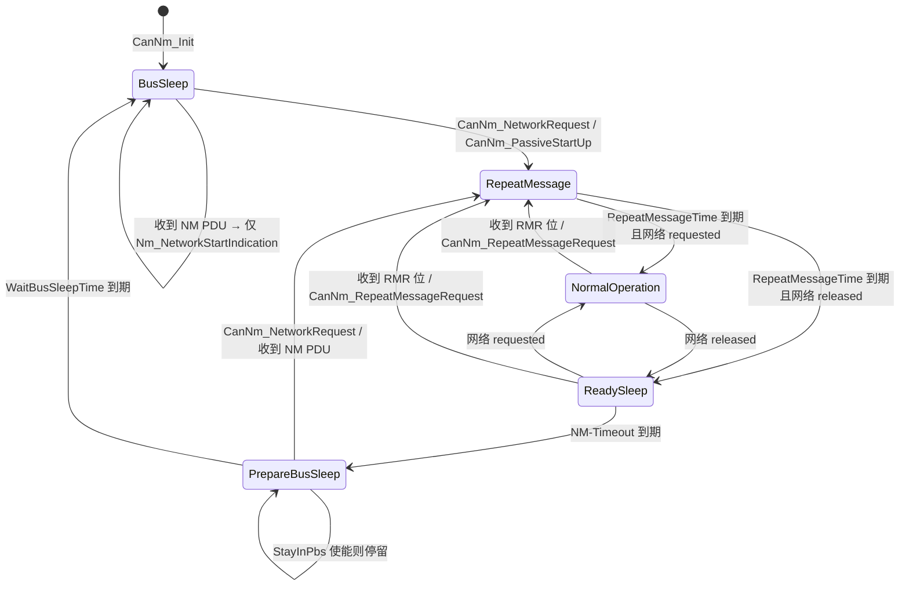

# CanNm 模块作用与架构定位

> [!info] 导航
> 上级：[[CanNm]] ｜ 依赖：[[CanNm_D3_主状态转移逻辑]]、[[CanNm_D4_状态转换表]] ｜ 依据：[[CanNm_AUTOSAR标准需求表_R21-11#SWS_CanNm_000xx|需求表]]

> 适用版本：AUTOSAR CP R21-11　依据：AUTOSAR_SWS_CANNetworkManagement（Document ID 13）、AUTOSAR_SWS_NetworkManagementInterface、AUTOSAR_SWS_CanIf/CanSM/ComM
> 最后更新：2026-10-20

## 1. 一句话定位

**CanNm（CAN Network Management）是 CAN 总线的网络管理协议实现：用周期性的 NM 报文协调"整个网络什么时候保持唤醒、什么时候一起进入总线休眠"，并在此基础上支持节点检测、远程睡眠检测、总线负载降低、NM 用户数据、被动模式、部分网络（PNC）、Car Wakeup 等功能。**

它位于 **Nm（通用网络管理接口）与 CanIf（CAN 接口）之间**，只负责"CAN 这一种总线"的 NM 协议；FrNm / LinNm / UdpNm 是其他总线的对应实现。

> SWS 第 1 章：*"hardware independent protocol ... its main purpose is to coordinate the transition between normal operation and bus-sleep mode of the network."*
> SWS 第 5 章：*"CanNm mainly uses services of CanIf and provides services to NmIf."*

## 2. 在 AUTOSAR 通信栈中的位置



要点：

- **唯一上层是 Nm**：CanNm 不直接和 ComM 打交道；ComM 的网络请求/释放经 Nm 翻译成 `CanNm_NetworkRequest/Release`，CanNm 的状态变化再经 `Nm_NetworkMode/Nm_PrepareBusSleepMode/Nm_BusSleepMode` 回调给 Nm，最终到 ComM。
- **唯一下层是 CanIf**：收帧走 `CanNm_RxIndication`，发帧调 `CanIf_Transmit`，发送确认走 `CanNm_TxConfirmation`；触发式发送（trigger transmit）时 CanIf 回调 `CanNm_TriggerTransmit`。
- 与 CanSM 的关系：CanSM 管 CAN 控制器/收发器的状态机（bus-off 恢复等），CanNm 只发 NM 报文；PN 可用性由 CanSM 调 `CanNm_ConfirmPnAvailability` 通知 CanNm；CanNm 检测到发送超时可通知 Nm/CanSM。
- 与功率管理的关系：CanNm 决定"网络还能不能睡"，EcuM/ComM/BswM 决定"ECU 能不能睡"，两者通过 Nm/ComM 协作。

## 3. 核心概念：分散式直接网络管理

CanNm 采用 **decentralized direct network management**（SWS 7.1）：

- 每个节点独立运行状态机，依据只有"收到/发出的 NM PDU"；
- 节点需要通信时周期性发 NM PDU（广播），表示"我要保持网络唤醒"；
- 某节点不需要通信了就**停止发送**，但**只要还能收到别人的 NM PDU**，就不睡；
- 当 `CanNmTimeoutTime` 内收不到任何 NM PDU，节点进入 Prepare Bus-Sleep，再等 `CanNmWaitBusSleepTime` 后进入 Bus-Sleep。

两条核心需求（SWS_CanNm_00087 / 00088）：

1. 需要总线通信时，周期发送 NM PDU；否则不发；
2. 通信释放且总线静默 `CanNmTimeoutTime + CanNmWaitBusSleepTime` 后，进入 Bus-Sleep。

## 4. 状态机：3 个模式 / 5 个状态



| 状态 | 发 NM 报文？ | 作用 |
|---|---|---|
| Repeat Message State | 是（除非 passive/通信被禁） | 让网络切换"可见"，保证最短停留时间，支持节点检测 |
| Normal Operation State | 是 | 节点需要通信，保持网络唤醒 |
| Ready Sleep State | 否 | 自己不要求通信，但等别人；NM-Timeout 到期才进 Prepare Bus-Sleep |
| Prepare Bus-Sleep Mode | 否 | 让总线安静下来、清空发送缓冲，等 `WaitBusSleepTime` |
| Bus-Sleep Mode | 否 | 低功耗；收到 NM 帧只上报 `Nm_NetworkStartIndication`，不自动唤醒 |

另外有一对**并行于状态机的网络状态**（SWS 7.3）：

- **requested**：有通信需求（`CanNm_NetworkRequest`）；
- **released**：无通信需求（`CanNm_NetworkRelease`）。
  "released" 不代表不发帧——只要别的节点还请求，本节点仍可能在 Normal Operation 发帧保持网络。

## 5. 关键定时参数（全网必须一致 vs 节点私有）

| 参数 | 含义 | 一致性 | 关系 |
|---|---|---|---|
| `CanNmMsgCycleTime` | NM 报文周期 | **全网一致** | 基础周期 |
| `CanNmTimeoutTime` | NM-Timeout：Ready Sleep 等多久没收到帧就进 Prepare Bus-Sleep | **全网一致** | > `MsgCycleTime` |
| `CanNmWaitBusSleepTime` | Prepare Bus-Sleep 停留时间（总线静默期） | **全网一致** | 足够清空 Tx buffer |
| `CanNmRepeatMessageTime` | Repeat Message 停留时间 | 通常全网一致 | 通常 = n × `MsgCycleTime` |
| `CanNmMsgCycleOffset` | 节点发送偏移，避免同时上电时的突发 | **节点私有** | < `MsgCycleTime` |
| `CanNmMsgReducedTime` | 总线负载降低模式下的缩短周期 | **节点私有** | `0.5×Cycle ≤ 它 < Cycle` |
| `CanNmRemoteSleepIndTime` | 多久收不到帧判定"其他节点都想睡" | 节点私有 | ≥ `MsgCycleTime` |
| `CanNmMainFunctionPeriod` | 主函数周期 | 节点私有 | 决定所有定时器精度 |

## 6. NM PDU 结构

```text
Byte 0: Source Node Identifier (SNI)   ← CanNmPduNidPosition 可配 Byte0/Byte1/Off
Byte 1: Control Bit Vector (CBV)       ← CanNmPduCbvPosition 可配 Byte0/Byte1/Off
Byte n: PNC 位向量（部分网络）           ← NmPncBitVectorOffset/Length
Byte m: 用户数据（NM User Data）         ← 剩余字节
```

CBV 位定义（SWS 7.6）：

| Bit | 名称 | 含义 |
|---|---|---|
| 0 | Repeat Message Request | 请求其他节点进入 Repeat Message State（节点检测） |
| 1 | PN Shutdown Request (PNSR) | 包含同步 PNC 关闭请求 |
| 3 | NM Coordinator Sleep | 主协调器请求开始同步关闭 |
| 4 | Active Wakeup | 本节点主动唤醒网络（区别于被动唤醒） |
| 5 | Partial Network Learning (PNL) | 请求 PNC 学习 |
| 6 | Partial Network Information (PNI) | 本帧包含 PNC 请求信息 |
| 2/7 | Reserved | 保留 |

SNI = `CanNmNodeId`（节点地址），是诊断/节点检测/PN 过滤的基础。

## 7. 主要功能特性（配置开关决定是否编译）

| 特性 | 关键配置 | 说明 |
|---|---|---|
| 周期发送 / 总线负载降低 | `CanNmBusLoadReductionEnabled/Active`、`CanNmMsgReducedTime` | 降低多节点网络的 NM 负载（详见专题笔记） |
| 节点检测 | `CanNmNodeDetectionEnabled`、`CanNmRepeatMsgIndEnabled` | 通过 RMR 位发现"网络上有谁" |
| 远程睡眠检测 | `CanNmRemoteSleepIndEnabled`、`CanNmRemoteSleepIndTime` | 网关判断"其他节点都 Ready Sleep"→ `Nm_RemoteSleepIndication` |
| NM 用户数据 | `CanNmUserDataEnabled` / `CanNmComUserDataSupport` | 随 NM 帧携带自定义数据（如 Car Wakeup 位） |
| 被动模式 | `CanNmPassiveModeEnabled` | 只收不发，用于监听/测试节点 |
| 部分网络 PNC | `CanNmGlobalPnSupport`、`CanNmPnEnabled` | 按 PNC 位向量唤醒/休眠部分网络（R21-11 重做） |
| Car Wakeup | `CanNmCarWakeUpRxEnabled` 等 | 识别"整车唤醒"位，配合网关过滤 |
| 通信控制 | `CanNmComControlEnabled` | 诊断 0x28 服务经 ComM/Nm 调 `CanNm_Disable/EnableCommunication` |
| 立即发送（唤醒突发） | `CanNmImmediateNmTransmissions/CycleTime` | 唤醒时连续快速发 N 帧，加快网络建立 |
| 协调器同步 | `CanNmCoordinatorSyncSupport` | 多网关协同关闭（CBV 协调器睡眠位） |
| 总线同步 | `CanNmBusSynchronizationEnabled` | 网关转发/同步 NM |
| 发送错误处理 | `CanNmMsgTimeoutTime`（PN） | 发送确认超时 → `Nm_TxTimeoutException` / `CanSM_TxTimeoutException` |

## 8. 与同类模块的关系

| 模块 | 关系 |
|---|---|
| Nm（通用接口） | 唯一上层；负责把 ComM 的请求分发到具体总线 NM，聚合多通道状态 |
| FrNm / LinNm / UdpNm | 同层兄弟，协议不同；CanNm 只管 CAN |
| ComM | 通过 Nm 间接控制 CanNm；同时收 CanNm 状态通知 |
| BswM | 通常不直接调 CanNm；通过 ComM 动作（RequestComMode/AllowCom）间接影响 |
| Dcm | 0x28 通信控制 → ComM → Nm → CanNm_Disable/EnableCommunication |
| CanSM | 管理 CAN 控制器状态；PN 可用性通知 CanNm；接收 CanNm 的发送超时异常 |
| CanIf | 收发 PDU 的通道 |
| Det | 开发/运行时错误上报 |
| EcuM | 初始化顺序（CanNm_Init 在 CanIf 之后）；唤醒源管理 |

## 9. R21-11 版本要点

- **Partial Networking 重构**：R21-11 对 PN 做了较大改写（R20-11 引入 PN 扩展），`CanNmPnInfo`、`CanNmPnFilterMaskByte`、`CanNmPnEiraCalcEnabled` 等标记 **obsolete**，PNC 位向量位置改由 Nm 的 `NmPncBitVectorOffset/Length` 配置。
- 新增 **同步 PNC 关闭**（`CanNmSynchronizedPncShutdownEnabled`、`CanNm_RequestSynchronizedPncShutdown`、PNSR 位、PN shutdown 报文重传），支持跨 PN 拓扑近似同步关闭。
- **动态 PNC-to-channel mapping**（draft）：`CanNmDynamicPncToChannelMappingSupport/Enabled`、`CanNm_PnLearningRequest`、PNL 位。
- 保留并明确 **Car Wakeup**（CWU 位/过滤）、**Reliable TX Confirmation**、**发送超时异常**。
- `CanNmStayInPbsEnabled` 支持"停在 Prepare Bus-Sleep 不自动进 Bus-Sleep"。

## 10. 常见误区

1. **以为 CanNm 负责唤醒 ECU**：它只负责"网络层"的唤醒协调；真正唤醒源检测、ECU 上电在 EcuM。
2. **以为收到 NM 帧会自动醒来**：Bus-Sleep 下只回调 `Nm_NetworkStartIndication`，是否唤醒由上层决定（SWS_CanNm_00127 Rationale）。
3. **把 TimeoutTime 当发送周期**：它是"收不到帧的容忍时间"，必须 > MsgCycleTime，且全网一致。
4. **混淆 requested/released 与状态**：released 后仍可能处于 Normal Operation 发帧（因为别人还请求）。
5. **忘了 CanNm_Init 必须在 CanIf 之后**：否则收发路径未就绪。
6. **忽略 MainFunction 周期精度**：所有定时器按 `CanNmMainFunctionPeriod` 递减，周期配错则协议时序整体偏移。
7. **把 Bus-Sleep 等同于 ECU 休眠**：网络睡了不代表 ECU 睡了（还可能有本地任务）。
8. **passive 模式下配置了发送相关参数**：标准要求 passive 时 `BusLoadReductionEnabled=false`、无 `Import` 等（见配置约束），DaVinci 会报错。

## 11. 对应官方文档章节

| 主题 | 章节 |
|---|---|
| 概述 | SWS 第 1 章 |
| 依赖关系 | SWS 第 5 章 |
| 协调算法 | SWS 7.1 |
| 状态机（5 状态） | SWS 7.2、7.18 |
| 网络状态 requested/released | SWS 7.3 |
| 初始化 | SWS 7.4 |
| 定时参数 | SWS 7.5.2、7.17 |
| PDU 结构 / CBV | SWS 7.6 |
| 发送/接收调度 | SWS 7.7 |
| 总线负载降低 | SWS 7.8 |
| 用户数据/被动/PNC/CarWakeup | SWS 7.9、7.10、7.11 |
| 发送错误处理 | SWS 7.12 |
| API / 回调 / 主函数 | SWS 8 |
| 时序图 | SWS 9 |
| 配置参数 | SWS 10 |

## 13. 代码实现基线（本项目）

| 项目 | 内容 |
|---|---|
| 实现 | NeuSAR（东软睿驰）CanNm 3.14.0，AUTOSAR 4.2.2 |
| 代码 | `AUTOSAR/AUTOSAT使用NEUSAR生成的代码/002_BSW/Bsw_Src/Autosar_Src/src_CanNm/Source/` |
| 通道 | 2 个 NM 通道（ChannelId 6/2，NodeId 39/35） |
| 与文档差异 | 文档基准 R21-11；实现为 4.2.2，PN/同步 PNC/SoAd 等 R21-11 新特性不可用；变量为“按通道数组 + 访问宏”，详见 [[CanNm_全局变量说明]] |
| 关键函数 | 见 [[CanNm_函数调用层级]]；主函数执行顺序见 [[CanNm_MainFunction调用逻辑]] |

## 14. 关联文档

- 调用主线：[[CanNm_调用逻辑总览]]
- 变量/宏：[[CanNm_全局变量说明]]、[[CanNm_函数调用层级]]
- 需求：[[CanNm_AUTOSAR标准需求表_R21-11]]
- 代码问题：[[CanNm_问题排查记录]]
