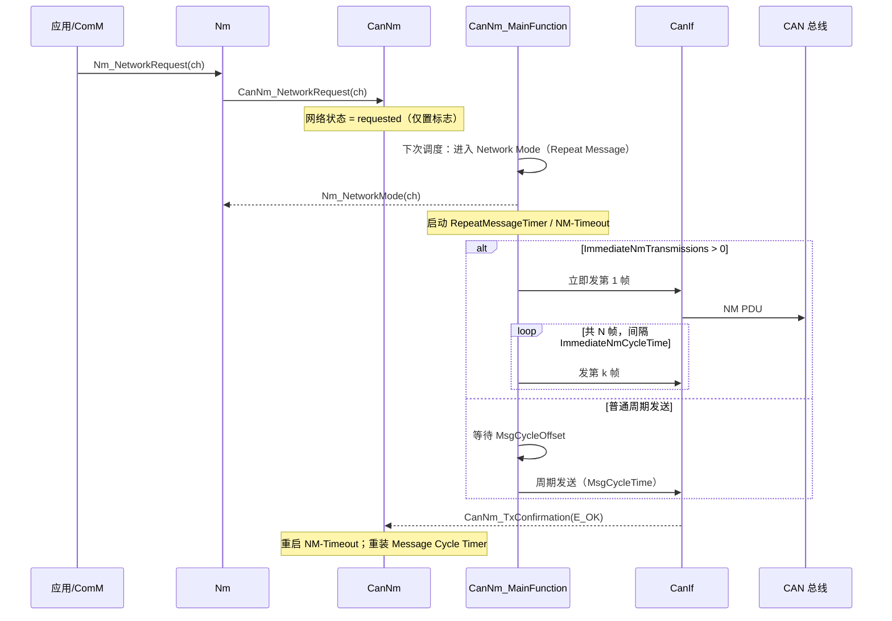

# CanNm D1：主动唤醒调用逻辑

> [!info] 导航
> 上级：[[CanNm_调用逻辑总览]] ｜ 依赖：[[CanNm_D3_主状态转移逻辑]]、[[CanNm_D4_状态转换表#从 Bus-Sleep 出发]] ｜ 依据：[[CanNm_AUTOSAR标准需求表_R21-11#SWS_CanNm_001xx|需求表]]

> 适用版本：AUTOSAR CP R21-11　依据：SWS_CanNm 7.2.1、7.2.3、7.3、7.7.1、8.3.4
> 最后更新：2026-10-21　关联：[[CanNm_调用逻辑总览]]、[[CanNm_D3_主状态转移逻辑]]、[[CanNm_D5_周期发送与降载调用逻辑]]

## 1. 场景

ECU 本地有通信需求（应用要发信号、诊断会话、网络管理请求），由 ComM 发起网络请求，最终调用 `CanNm_NetworkRequest`。这是"主动唤醒"——本节点主动把网络叫醒并保持唤醒。

## 2. 调用链（从上到下）

```text
【应用层】
App/SWC → ComM_RequestComMode(user, FULL_COMMUNICATION)
    └─ ComM 状态机：NO_COMMUNICATION → FULL_COMMUNICATION（内部先 SILENT）
        └─ Nm_NetworkRequest(networkHandle)                     [Nm 通用接口]
            └─ CanNm_NetworkRequest(nmChannelHandle)            [CanNm API, 异步]
                │  动作：网络状态 = requested
                │  （不再直接跳状态；状态迁移在主函数里完成）
                └─ CanNm_MainFunction()                          [周期任务]
                    ├─ 状态机处理：Bus-Sleep / Prepare Bus-Sleep → Network Mode
                    │    └─ 默认进入 Repeat Message State
                    │         ├─ 启动 Repeat Message Timer（CanNmRepeatMessageTime）
                    │         ├─ 启动 NM-Timeout Timer（CanNmTimeoutTime）
                    │         └─ 回调 Nm_NetworkMode() → ComM_Nm_NetworkMode()
                    └─ 发送处理：
                         ├─ 若 CanNmImmediateNmTransmissions > 0 且由 NetworkRequest 主动唤醒
                         │    → 立即发第 1 帧，随后按 CanNmImmediateNmCycleTime 连发 N 帧
                         └─ 否则等待 CanNmMsgCycleOffset 后按 CanNmMsgCycleTime 周期发
                              └─ CanNm_BuildPdu()（SNI + CBV + PNC + UserData）
                                   └─ CanIf_Transmit(TxPduId, &PduInfo)   [CanIf]
                                        └─ Can Driver → CAN 总线
```

## 3. 关键时序



## 4. 状态与数据变化

| 数据 | 变化 | 依据 |
|---|---|---|
| 网络状态 | `released` → `requested` | SWS_CanNm_00104、00255 |
| 状态机 | Bus-Sleep/Prepare Bus-Sleep → Network Mode（默认 Repeat Message） | SWS_CanNm_00123、00129、00314、00315 |
| Repeat Message Timer | 启动（进入时） | SWS_CanNm_00102 |
| NM-Timeout Timer | 进入 Network Mode 时启动 | SWS_CanNm_00096 |
| Message Cycle Timer | 进入 Repeat Message 后按发送规则启动；若 `ImmediateNmTransmissions=0` 或非 NetworkRequest 进入则先延迟 `MsgCycleOffset` | SWS_CanNm_00005、00334 |
| CBV Active Wakeup 位 | `CanNmActiveWakeupBitEnabled=TRUE` 且主动唤醒时置 1 | SWS_CanNm_00401 |
| 回调 | `Nm_NetworkMode` 通知上层 | SWS_CanNm_00097 |

## 5. 输出

- `CanIf_Transmit` 发送 NM PDU（首帧立即或偏移后周期）；
- `Nm_NetworkMode` 通知 Nm → ComM 进入 FULL COMMUNICATION；
- 后续由周期发送维持唤醒（见 [[CanNm_D5_周期发送与降载调用逻辑]]）。

## 6. 需求依据

SWS_CanNm_00087（需要通信就发帧）、00096、00097、00100、00102、00104、00122、00123、00129、00213、00255、00314、00315、00334、00335、00401、00454（`PnHandleMultipleNetworkRequests` 时再次进入 Repeat Message）。

## 7. 观测点 / 排障

1. 断点：`CanNm_NetworkRequest` 是否被调用（ComM→Nm 链路是否通）；
2. 读 `CanNm_GetState`：是否进入 Network Mode / Repeat Message；
3. 抓总线：首帧是否出现、间隔是否符合 `MsgCycleOffset` / `ImmediateNmCycleTime`；
4. 跟踪 `Nm_NetworkMode` 是否回调（ComM 是否进入 FULL COMMUNICATION）；
5. 若"请求了但一直不发帧"：先查 passive 模式、通信是否被 0x28 禁用（见 [[CanNm_D6_通信控制调用逻辑]]）。

## 实现对应（代码）

- `CanNm_NetworkRequest`（`CanNm.c` L2146）→ `CanNm_CommState = COMM_NORMAL_OPERATION`、置 `NetworkRestartFlag`；
- 主函数检测 `NetworkRestartFlag != CANNM_NO_RESTART` → `CanNm_StateTransition(ch, NM_STATE_REPEAT_MESSAGE)`（L3664~3667）；
- 首帧/周期帧：`CanNm_MessageTimerHandling`（L1137）→ `CanNm_TriggerTransmission`（L1611）→ `CanIf_Transmit`；
- 关键变量：`CanNm_CommState`、`CanNm_NetworkRestartFlag`、`CanNm_MsgTimer`、`CanNm_TxMessageData`（见 [[CanNm_全局变量说明]]）。
