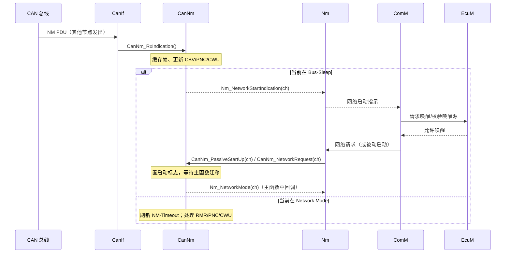

# CanNm D2：被动唤醒调用逻辑

> [!info] 导航
> 上级：[[CanNm_调用逻辑总览]] ｜ 依赖：[[CanNm_D3_主状态转移逻辑]]、[[CanNm_D4_状态转换表#从 Bus-Sleep 出发]] ｜ 依据：[[CanNm_AUTOSAR标准需求表_R21-11#SWS_CanNm_001xx|需求表]]

> 适用版本：AUTOSAR CP R21-11　依据：SWS_CanNm 7.2.3、7.3、7.7.2、7.9.3、7.10、8.3.3、8.4.2
> 最后更新：2026-10-21　关联：[[CanNm_调用逻辑总览]]、[[CanNm_D1_主动唤醒调用逻辑]]、[[CanNm_D3_主状态转移逻辑]]

## 1. 场景

ECU 处于 Bus-Sleep（或刚上电），**总线上先有人发 NM 帧**。本节点不是发起者，需要：
1. 在接收回调里"看到"总线上有人想通信（`CanNm_RxIndication`）；
2. 通知上层（`Nm_NetworkStartIndication`），由 EcuM/ComM 决定是否唤醒；
3. 上层决策后调用 `CanNm_PassiveStartUp`（或 `CanNm_NetworkRequest`）让 CanNm 进入 Network Mode。

> 注意：CanNm 在 Bus-Sleep 收到帧**不会自动进入 Network Mode**，这是与很多人的直觉相反的点（SWS_CanNm_00127 的 Rationale：避免与 EcuM 关机/启动流程竞态）。

## 2. 调用链（从上到下）

```text
【接收路径（中断或轮询上下文）】
CAN 控制器 → CanIf_RxIndication
    └─ CanNm_RxIndication(RxPduId, PduInfoPtr)                   [CanIf 回调]
        ├─ 校验 PduId / 长度
        ├─ 拷贝 NM 帧数据到内部接收缓冲（SNI/CBV/PNC/UserData）
        ├─ 更新"最近一帧"缓存（供 CanNm_GetPduData/GetNodeIdentifier 使用）
        ├─ 重启 NM-Timeout Timer（若处于 Network Mode 且发送能力使能）
        ├─ CBV 位处理：
        │    ├─ RMR 位 → 节点检测（进入/重启 Repeat Message）
        │    ├─ PNI 位 → PNC 请求处理（见 [[CanNm_D7_扩展特性调用逻辑]]）
        │    ├─ CWU 位 → Nm_CarWakeUpIndication（可过滤源节点）
        │    └─ Active Wakeup 位 → 记录唤醒类型
        ├─ 负载降低：Normal Operation 下重装 Message Cycle Timer = CanNmMsgReducedTime
        ├─ CanNmPduRxIndicationEnabled=TRUE → 回调 Nm_PduRxIndication
        └─ 若当前为 Bus-Sleep：
             ├─ 回调 Nm_NetworkStartIndication(ch)   ← 只告知，不跳状态
             └─ DET 上报 CANNM_E_NET_START_IND

【上层决策（EcuM/ComM/Nm 链路）】
Nm_NetworkStartIndication → Nm 通知 ComM → ComM 判断是否有用户请求/唤醒源 →
EcuM 唤醒校验（wakeup source validated）→
    ├─ 被动启动：Nm → CanNm_PassiveStartUp(ch)
    └─ 或主动请求：Nm → CanNm_NetworkRequest(ch)（走 [[CanNm_D1_主动唤醒调用逻辑]]）

【状态迁移（主函数）】
CanNm_PassiveStartUp → 置"启动请求"标志
CanNm_MainFunction → Bus-Sleep/Prepare Bus-Sleep → Network Mode（Repeat Message）
    ├─ 启动 Repeat Message Timer / NM-Timeout Timer
    └─ 回调 Nm_NetworkMode
```

## 3. 关键时序



## 4. 状态与数据变化

| 数据 | 变化 | 依据 |
|---|---|---|
| 接收缓冲 | 保存最近一帧（供查询 API） | SWS_CanNm_00035 |
| NM-Timeout Timer | Network Mode 下收到帧即重启（发送能力使能时） | SWS_CanNm_00098 |
| Message Cycle Timer | 降载开启时重装为 `CanNmMsgReducedTime` | SWS_CanNm_00069 |
| 网络状态 | 收到帧本身**不改变** requested/released | SWS 7.3 |
| NM 状态 | Bus-Sleep 下保持，直到 `PassiveStartUp`/`NetworkRequest` | SWS_CanNm_00127、00128 |
| 上层通知 | `Nm_NetworkStartIndication`（Bus-Sleep） | SWS_CanNm_00127 |
| DET | `CANNM_E_NET_START_IND` | SWS_CanNm_00336 |

## 5. 输出

- `Nm_NetworkStartIndication`：告诉上层"总线上有人想通信"；
- `Nm_CarWakeUpIndication`：CWU 位触发（按源节点过滤，可选）；
- `Nm_PduRxIndication`：可选，把原始接收事件上报；
- `Nm_NetworkMode`：最终进入 Network Mode 后通知；
- `CanIf_Transmit`：进入 Repeat Message 后开始发帧（被动启动也发）。

## 6. 需求依据

SWS_CanNm_00124、00127、00128、00129、00314、00315、00035、00037、00069、00098、00336、00405~00408（CarWakeup）。

## 7. 观测点 / 排障

1. Bus-Sleep 下收到帧，检查 `Nm_NetworkStartIndication` 是否被调用（不是直接看状态跳没跳）；
2. 若上层没被通知：检查 `CanNmPduRxIndicationEnabled`/Nm 配置、Dcm/ComM 唤醒决策链；
3. 若 ECU 醒了但网络状态不对：确认上层调用的是 `PassiveStartUp` 还是 `NetworkRequest`（主动/被动影响 CBV ActiveWakeup 位）；
4. 抓 `Nm_NetworkMode` 回调与总线首帧，确认 Repeat Message 已进入。

## 实现对应（代码）

- `CanNm_RxIndication`（L3362）：拷贝帧到 `CanNm_RxMessageData`、置 `CanNm_MsgIndicationFlag`，Bus-Sleep 下回调 `Nm_NetworkStartIndication`；
- `CanNm_MainRxTxConfHandling`（L795）：主函数中消费接收标志、刷新 `CanNm_TimeoutTimer` 等；
- `CanNm_PassiveStartUp`（L2078）：置被动重启请求，主函数迁移 Repeat Message；
- 扩展 API：`CanNm_GetMessageReceive`（L3593）返回 `CanNM_Message_Receive`（是否收到过 NM 帧）。
