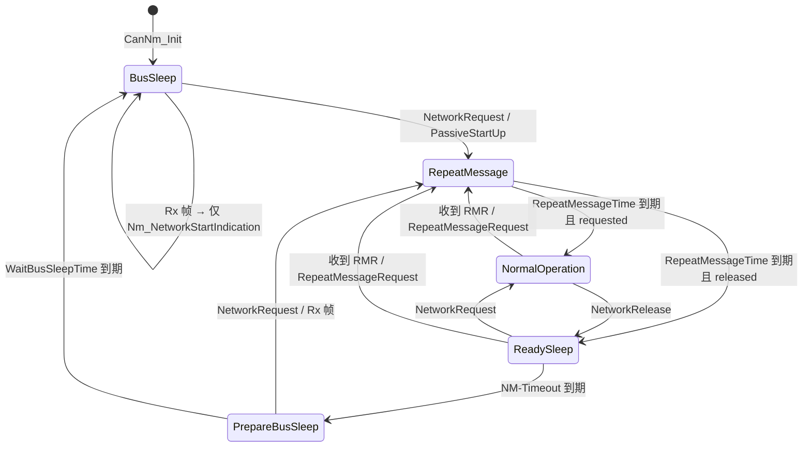

# CanNm D3：主状态转移逻辑

> [!info] 导航
> 上级：[[CanNm_调用逻辑总览]] ｜ 依赖：[[CanNm_D4_状态转换表]] ｜ 依据：[[CanNm_AUTOSAR标准需求表_R21-11#SWS_CanNm_000xx|需求表]]

> 适用版本：AUTOSAR CP R21-11　依据：SWS_CanNm 7.2、7.3、7.4、7.9.6、7.15
> 最后更新：2026-10-21　关联：[[CanNm_调用逻辑总览]]、[[CanNm_D4_状态转换表]]、[[CanNm_MainFunction调用逻辑]]

## 1. 状态模型

CanNm 对外可见 **3 个运行模式（Operational Modes）**，Network Mode 内部又分 **3 个状态**，合计 5 个状态：

```text
Operational Modes:
├─ Network Mode
│   ├─ Repeat Message State      （重复报文：保证切换可见、节点检测）
│   ├─ Normal Operation State    （正常运行：保持网络唤醒）
│   └─ Ready Sleep State         （就绪睡眠：自己不要求通信，等别人）
├─ Prepare Bus-Sleep Mode        （准备睡眠：总线安静、清空 Tx 缓冲）
└─ Bus-Sleep Mode                （总线睡眠：低功耗）
```

并行于状态机的 **网络状态（Network States）**：`requested` / `released`，由 `CanNm_NetworkRequest` / `CanNm_NetworkRelease` 改变，影响"状态离开 Repeat Message 后去哪"。



## 2. 进入各状态的动作

| 进入状态 | 执行动作 | 依据 |
|---|---|---|
| Repeat Message State | 启动/重启 NM PDU 发送（除非 passive 或通信禁用）；启动 Repeat Message Timer；若从 Bus-Sleep/Prepare Bus-Sleep 且由 NetworkRequest 进入，按 `ImmediateNmTransmissions` 决定立即突发；进入时**停用**总线负载降低 | SWS_CanNm_00100、00102、00156、00334 |
| Normal Operation State | 启动 NM PDU 发送（若从 Ready Sleep 进入，立即开始）；启用总线负载降低（若配置） | SWS_CanNm_00116、00157 |
| Ready Sleep State | 停止 NM PDU 发送（PN shutdown 等特例除外） | SWS_CanNm_00108 |
| Prepare Bus-Sleep Mode | 停止发送；回调 `Nm_PrepareBusSleepMode`；启动 Wait Bus-Sleep Timer | SWS_CanNm_00114、00115 |
| Bus-Sleep Mode | 回调 `Nm_BusSleepMode`（初始化时除外） | SWS_CanNm_00126 |
| Network Mode（整体） | 启动 NM-Timeout Timer；回调 `Nm_NetworkMode` | SWS_CanNm_00096、00097 |

## 3. 迁移事件与处理时机

| 触发 | 由谁检测 | 处理位置 |
|---|---|---|
| `CanNm_NetworkRequest` / `NetworkRelease` | API 调用 | 立即改网络状态；状态迁移在下一个主函数 |
| `CanNm_PassiveStartUp` | API 调用 | 置启动请求；下一个主函数迁移 |
| NM-Timeout 到期 | 主函数定时器 | 主函数状态机处理 |
| Repeat Message Timer 到期 | 主函数定时器 | 主函数状态机处理 |
| Wait Bus-Sleep Timer 到期 | 主函数定时器 | 主函数状态机处理 |
| 收到 NM 帧（RxIndication） | CanIf 回调 | 回调内处理 + 主函数后续效果 |
| RMR 位 / `CanNm_RepeatMessageRequest` | 回调 / API | 进入或重启 Repeat Message |
| `CanNm_DisableCommunication` | API 调用 | 停止发送与超时监控，但**状态不迁移** |
| `CanNm_EnableCommunication` | API 调用 | 最迟下一个主函数恢复发送 |

> 标准说明：状态跃迁最迟在**下一个主函数**完成（SWS 7.1 Note），因此 API 调用与状态变化之间最多有 1 个周期延迟。

## 4. 错误与异常路径

| 场景 | 行为 | 依据 |
|---|---|---|
| NM-Timeout 在 Repeat Message / Normal Operation 到期 | 重启定时器 + DET 上报 `CANNM_E_NETWORK_TIMEOUT` | SWS_CanNm_00101、00117、00193、00194 |
| NM-Timeout 在 Ready Sleep 到期 | 进入 Prepare Bus-Sleep（正常休眠路径） | SWS_CanNm_00109 |
| Bus-Sleep 收到 NM 帧 | 仅回调 `Nm_NetworkStartIndication` + DET `CANNM_E_NET_START_IND` | SWS_CanNm_00127、00336 |
| Bus-Sleep/Prepare 调用 `CanNm_DeInit` | DET 报 `CANNM_E_NOT_IN_BUS_SLEEP` | SWS_CanNm_00352 |
| 未初始化调用 API | DET `CANNM_E_UNINIT`，返回 E_NOT_OK | SWS_CanNm_00189、00316 |

## 5. 状态查询与观测

- `CanNm_GetState(ch, &state, &mode)`：返回 NM 状态与模式（SWS_CanNm_00091）；
- `Nm_StateChangeNotification`：`CanNmStateChangeIndEnabled=TRUE` 时每次状态变化通知上层（SWS_CanNm_00166）；
- 抓总线：Repeat Message 阶段帧较密，Normal Operation 按 `MsgCycleTime`（降载时按 `MsgReducedTime` 交替），Ready Sleep 停发。

## 6. 需求依据

SWS_CanNm_00087~00094、00096~00129、00141~00144、00156、00157、00166、00193、00194、00202、00203、00206、00314、00315、00316、00317。

## 7. 与其他方向的关系

- 进入 Network Mode 的两条路径：[[CanNm_D1_主动唤醒调用逻辑]]、[[CanNm_D2_被动唤醒调用逻辑]]；
- 状态内的周期发送：[[CanNm_D5_周期发送与降载调用逻辑]]；
- 通信控制对状态机的影响：[[CanNm_D6_通信控制调用逻辑]]；
- 查表版本：[[CanNm_D4_状态转换表]]。

## 实现对应（代码）

- 唯一迁移入口：`CanNm_StateTransition`（L1838），按目标状态执行进入动作（BusSleep/Prepare/Ready/Normal/Repeat）；
- 迁移触发：`BusCommunicationHandling`（L940）、6 个 timer handler（Timeout/Repeat/WaitBusSleep/Msg/MsgTimeout/RemoteSleep）；
- 状态存放：`CanNm_NmState[ch]`（`CanNm_GetNmState`），通信请求状态：`CanNm_CommState[ch]`；
- 相关文档：[[CanNm_函数调用层级]]。
