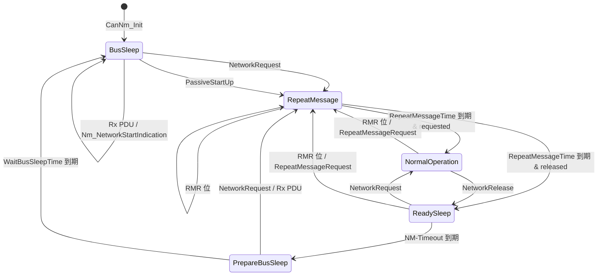

# CanNm D4：状态转换表

> [!info] 导航
> 上级：[[CanNm_调用逻辑总览]] ｜ 依赖：[[CanNm_D3_主状态转移逻辑]] ｜ 依据：[[CanNm_AUTOSAR标准需求表_R21-11#SWS_CanNm_001xx|需求表]]

> 适用版本：AUTOSAR CP R21-11　依据：SWS_CanNm 7.2、7.3
> 最后更新：2026-10-21

## 1. 状态清单

| 编号 | 状态 | 所属模式 | 含义 | 进入动作 | 退出动作 |
|---|---|---|---|---|---|
| S1 | Bus-Sleep Mode | Bus-Sleep | 总线睡眠，低功耗 | 回调 `Nm_BusSleepMode`（初始化除外）；停发送 | 进入 Network Mode 前启动定时器 |
| S2 | Prepare Bus-Sleep Mode | Prepare Bus-Sleep | 总线安静期，清空发送 | 回调 `Nm_PrepareBusSleepMode`；启动 Wait Bus-Sleep Timer | — |
| S3 | Repeat Message State | Network Mode | 重复报文，保证网络切换可见/节点检测 | 启动发送；启动 Repeat Message Timer；停用降载 | 离开时清 RMR 位（节点检测开启时） |
| S4 | Normal Operation State | Network Mode | 正常运行，保持网络唤醒 | 启动发送；启用降载（若配置） | — |
| S5 | Ready Sleep State | Network Mode | 本节点不要求通信，等待其它节点 | 停止发送 | — |

网络状态（并行）：`R` = requested，`X` = released。

## 2. 状态转换表（查表用）

### 从 Bus-Sleep 出发

| 编号 | 当前状态 | 触发事件 / 条件 | 下一状态 | 执行动作 | 需求号 |
|---|---|---|---|---|---|
| T-01 | S1 Bus-Sleep | `CanNm_NetworkRequest` | S3 Repeat Message | 网络状态=requested；进 Network Mode；启动 NM-Timeout；回调 `Nm_NetworkMode`；启动发送（含立即发送规则） | 00104、00129、00314、00096、00097 |
| T-02 | S1 Bus-Sleep | `CanNm_PassiveStartUp` | S3 Repeat Message | 进 Network Mode；启动 NM-Timeout；回调 `Nm_NetworkMode`；启动发送 | 00128、00314、00096、00097 |
| T-03 | S1 Bus-Sleep | 收到 NM PDU | S1（不变） | 缓存帧；回调 `Nm_NetworkStartIndication`；DET `CANNM_E_NET_START_IND`（不自动唤醒） | 00127、00336 |

### 从 Prepare Bus-Sleep 出发

| 编号 | 当前状态 | 触发事件 / 条件 | 下一状态 | 执行动作 | 需求号 |
|---|---|---|---|---|---|
| T-04 | S2 Prepare Bus-Sleep | `CanNm_NetworkRequest` | S3 Repeat Message | 进 Network Mode；`ImmediateRestartEnabled` 时立即发一帧 | 00123、00122 |
| T-05 | S2 Prepare Bus-Sleep | 收到 NM PDU | S3 Repeat Message | 进 Network Mode，默认 Repeat Message | 00124、00315 |
| T-06 | S2 Prepare Bus-Sleep | Wait Bus-Sleep Timer 到期（`StayInPbs=false`） | S1 Bus-Sleep | 回调 `Nm_BusSleepMode` | 00115、00126 |

### 从 Repeat Message 出发

| 编号 | 当前状态 | 触发事件 / 条件 | 下一状态 | 执行动作 | 需求号 |
|---|---|---|---|---|---|
| T-07 | S3 Repeat Message | Repeat Message Timer 到期 且 网络 requested | S4 Normal Operation | 进入 Normal；启用降载；继续周期发送 | 00102、00103、00157 |
| T-08 | S3 Repeat Message | Repeat Message Timer 到期 且 网络 released | S5 Ready Sleep | 停止发送 | 00102、00106、00108 |
| T-09 | S3 Repeat Message | 再次收到 RMR 位 / `CanNm_RepeatMessageRequest` | S3（重启） | 重启 Repeat Message Timer | 00111、00112、00119、00120 |
| T-10 | S3 Repeat Message | NM-Timeout Timer 到期 | S3（重启定时器） | DET `CANNM_E_NETWORK_TIMEOUT` | 00101、00193 |

### 从 Normal Operation 出发

| 编号 | 当前状态 | 触发事件 / 条件 | 下一状态 | 执行动作 | 需求号 |
|---|---|---|---|---|---|
| T-11 | S4 Normal Operation | `CanNm_NetworkRelease` | S5 Ready Sleep | 网络状态=released；停止发送 | 00105、00118、00108 |
| T-12 | S4 Normal Operation | NM-Timeout Timer 到期 | S4（重启定时器） | DET `CANNM_E_NETWORK_TIMEOUT` | 00117、00194 |
| T-13 | S4 Normal Operation | 收到 RMR 位 / `CanNm_RepeatMessageRequest` | S3 Repeat Message | 置 RMR 位；进/重启 Repeat Message | 00119、00120、00121 |

### 从 Ready Sleep 出发

| 编号 | 当前状态 | 触发事件 / 条件 | 下一状态 | 执行动作 | 需求号 |
|---|---|---|---|---|---|
| T-14 | S5 Ready Sleep | `CanNm_NetworkRequest` | S4 Normal Operation | 网络状态=requested；立即开始发送 | 00110、00116、00006 |
| T-15 | S5 Ready Sleep | NM-Timeout Timer 到期 | S2 Prepare Bus-Sleep | 进入 Prepare Bus-Sleep；回调 `Nm_PrepareBusSleepMode`；启动 Wait Bus-Sleep Timer | 00109、00114、00115 |
| T-16 | S5 Ready Sleep | 收到 RMR 位 / `CanNm_RepeatMessageRequest` | S3 Repeat Message | 进/重启 Repeat Message | 00111、00112、00113 |

### 任意状态（通信控制 / 关闭）

| 编号 | 当前状态 | 触发事件 / 条件 | 下一状态 | 执行动作 | 需求号 |
|---|---|---|---|---|---|
| T-17 | 任意 | `CanNm_DisableCommunication` | 状态不变 | 停 Message Cycle Timer / NM-Timeout / 远程睡眠检测 | 00170、00173、00174、00175 |
| T-18 | 任意 | `CanNm_EnableCommunication` | 状态不变 | 最迟下一个主函数恢复发送；重启 NM-Timeout | 00176、00178、00179、00180 |
| T-19 | 任意 | `CanNm_DeInit` 且非全 Bus-Sleep | 状态不变（拒绝） | DET `CANNM_E_NOT_IN_BUS_SLEEP` | 00352 |

## 3. 状态图

## 4. 与代码/配置的对应

| 状态 | 代码枚举（实现相关） | 处理位置 | 关键配置参数 |
|---|---|---|---|
| Bus-Sleep | `CANNM_STATE_BUS_SLEEP`（示例） | 主函数状态机 | `CanNmWaitBusSleepTime` |
| Prepare Bus-Sleep | `CANNM_STATE_PREPARE_BUS_SLEEP` | 主函数状态机 | `CanNmWaitBusSleepTime`、`CanNmStayInPbsEnabled` |
| Repeat Message | `CANNM_STATE_REPEAT_MESSAGE` | 主函数状态机 | `CanNmRepeatMessageTime`、`CanNmMsgCycleOffset`、`CanNmImmediateNmTransmissions` |
| Normal Operation | `CANNM_STATE_NORMAL_OPERATION` | 主函数状态机 | `CanNmMsgCycleTime`、`CanNmBusLoadReduction*` |
| Ready Sleep | `CANNM_STATE_READY_SLEEP` | 主函数状态机 | `CanNmTimeoutTime` |

> 枚举名以实际供应商生成代码为准（Vector/ETAS 等命名不同），这里只表达状态含义。

## 5. 特殊说明

- **初始状态**：`CanNm_Init` 成功后进入 Bus-Sleep、网络状态 released、CBV=0x00（SWS_CanNm_00141、00143、00144、00085）。
- **RMR 位只在节点检测开启时生效**（`CanNmNodeDetectionEnabled=TRUE`）。
- **任何状态都可以被 0x28 禁用发送**，但状态机不迁移（只有发送与超时监控被停）。
- **Prepare Bus-Sleep 中不应有总线活动**（除极短的重启路径）。
- **异常路径**：超时/发送失败会触发 DET 或 `Nm_TxTimeoutException`，见 [[CanNm_D7_扩展特性调用逻辑]]。

## 6. 关联

- 状态机叙述：[[CanNm_D3_主状态转移逻辑]]
- 发送行为：[[CanNm_D5_周期发送与降载调用逻辑]]
- 主函数执行：[[CanNm_MainFunction调用逻辑]]

## 实现对应（代码）

- 表中迁移在代码中由 `CanNm_StateTransition(ch, nextState)`（`CanNm.c` L1838）统一执行；
- 触发点：`CanNm_TimeoutTimerHandling`、`CanNm_RepeatMessageTimerHandling`、`CanNm_WaitBusSleepTimerHandling`、`CanNm_BusCommunicationHandling`；
- 状态变量：`CanNm_NmState[ch]`。
