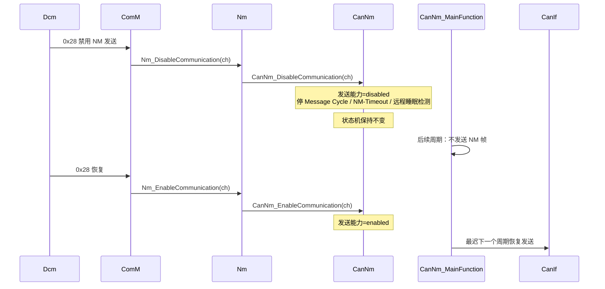

# CanNm D6：通信控制调用逻辑（0x28）

> [!info] 导航
> 上级：[[CanNm_调用逻辑总览]] ｜ 依赖：[[CanNm_D3_主状态转移逻辑]] ｜ 依据：[[CanNm_AUTOSAR标准需求表_R21-11#SWS_CanNm_001xx|需求表]]

> 适用版本：AUTOSAR CP R21-11　依据：SWS_CanNm 7.9.6、8.3.6、8.3.7；SWS_Nm 8.3.2
> 最后更新：2026-10-21　关联：[[CanNm_调用逻辑总览]]、[[CanNm_D3_主状态转移逻辑]]、[[CanNm_D5_周期发送与降载调用逻辑]]

## 1. 场景

诊断仪执行 ISO 14229 的 **0x28 CommunicationControl**（禁止/恢复某类报文的发送与接收），Dcm 通过 ComM/Nm 链路把"禁用 NM PDU 发送"的要求传到 CanNm：
`CanNm_DisableCommunication` / `CanNm_EnableCommunication`。前提：`CanNmComControlEnabled=TRUE`。

> 注意：0x28 只控制"NM PDU 的发送能力"，**不改变 NM 状态机**（不跳状态、不影响 Repeat Message 时长）。这是现场最容易误判的点。

## 2. 调用链（从上到下）

```text
【诊断请求】
诊断仪 → CanTp/CanIf → Dcm（0x28 服务）
    └─ Dcm 通信控制 → ComM（通信模式/网络控制）
        └─ Nm_DisableCommunication(networkHandle)           [Nm 通用接口]
            └─ CanNm_DisableCommunication(nmChannelHandle)  [CanNm API]
                ├─ 检查：当前是否 Network Mode（否则 E_NOT_OK，SWS_CanNm_00172）
                ├─ 置"发送能力 = disabled"
                ├─ 停 Message Cycle Timer        （00173）
                ├─ 停 NM-Timeout Timer           （00174）
                └─ 停 Remote Sleep 检测          （00175）

【恢复】
Dcm → ComM → Nm_EnableCommunication → CanNm_EnableCommunication
    ├─ 检查：当前是否 Network Mode（否则 E_NOT_OK，00295）
    ├─ 置"发送能力 = enabled"
    ├─ 最迟下一个主函数恢复 NM 发送      （00178）
    ├─ 重启 NM-Timeout Timer            （00179）
    └─ 重启 Remote Sleep 检测（若配置）   （00180）
```

## 3. 时序



## 4. 影响范围（看到 disable 后哪些行为变了）

| 行为 | 禁用后 | 依据 |
|---|---|---|
| NM PDU 周期发送 | 停止 | 00170、00173 |
| NM-Timeout | 停止（不会再因超时进 Prepare Bus-Sleep） | 00174 |
| 远程睡眠检测 | 停止 | 00175 |
| NM 状态机 | **不变**（仍在 Repeat Message/Normal/Ready Sleep） | 7.9.6 Note |
| `CanNm_RequestBusSynchronization` | 返回 E_NOT_OK | 00181 |
| 恢复后的发送 | 最迟下一个主函数 | 00178 |
| 恢复后的 NM-Timeout | 重启 | 00179 |
| 恢复后的远程睡眠检测 | 重启 | 00180 |

## 5. 返回值与错误

| 调用 | 条件 | 返回 | 依据 |
|---|---|---|---|
| `CanNm_DisableCommunication` | 非 Network Mode | E_NOT_OK | 00172 |
| `CanNm_DisableCommunication` | 未初始化 | E_NOT_OK + DET `CANNM_E_UNINIT` | 00261、00316 |
| `CanNm_EnableCommunication` | 发送能力已使能 | E_NOT_OK | 00177 |
| `CanNm_EnableCommunication` | 非 Network Mode | E_NOT_OK | 00295 |
| 配置未开 `CanNmComControlEnabled` | API 不可用（生成代码不提供） | — | 00262、00264 |

## 6. 与 BswM/ComM 的关系

- 0x28 的"禁用正常通信"在 **BswM** 场景里还可能触发 PDU 组开关、`Nm_DisableCommunication` 等动作；CanNm 层面只看到"发送能力"被关。
- 若项目里由 BswM 动作直接控制 NM 通信，排查时要区分：是 BswM 动作（应用层策略）还是 Dcm 0x28（诊断）触发的禁用。
- 链路：`Dcm → ComM → Nm → CanNm`；BswM 通常经 ComM 动作间接影响。

## 7. 需求依据

SWS_CanNm_00072、00170、00172、00173、00174、00175、00176、00177、00178、00179、00180、00181、00262、00264、00295。

## 8. 观测点 / 排障

1. 禁用后总线确实没有 NM 帧：说明链路生效；
2. 若"状态机没动"——这是标准行为，不要误判为故障；
3. 若恢复后不发送：检查是否仍处于禁用（`CanNm_GetState` 只看状态，需看内部发送能力标志/实现提供的查询）；
4. 若 0x28 无反应：先查 `CanNmComControlEnabled`、ComM/Nm 的通信控制支持、Dcm 的 CommunicationControl 配置。

## 实现对应（代码）

- `CanNm_DisableCommunication`（L2280）/ `CanNm_EnableCommunication`（L2342）：写 `CanNm_TxControlStateRequest`；
- `CanNm_CommunicationControlHandling`（L2409）：主函数中把 Request 落到 `CanNm_TxControlState`，停/启发送；
- 变量：`CanNm_TxControlState[ch]`、`CanNm_TxControlStateRequest[ch]`；
- 本项目 `CANNM_COM_CONTROL_ENABLED=STD_ON`，0x28 链路可用。
