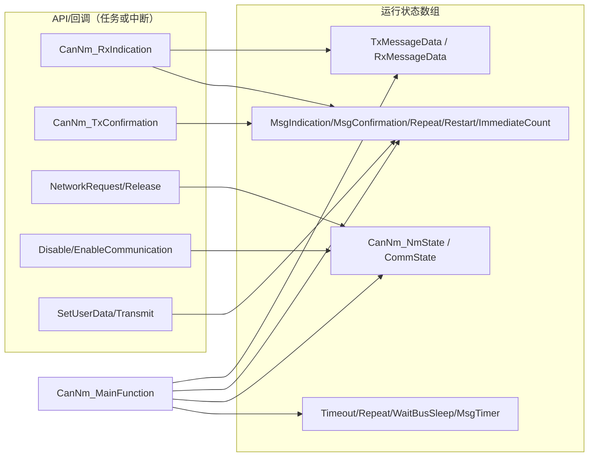

# CanNm 全局变量说明（基于本项目生成代码）

> [!info] 导航
> 上级：[[CanNm_调用逻辑总览]] ｜ 依赖：[[CanNm_函数调用层级]]、[[CanNm_MainFunction调用逻辑]] ｜ 依据：[[CanNm_配置参数表_R21-11]]

> 适用文档：AUTOSAR CP R21-11　**实现基线**：AUTOSAR 4.2.2 / NeuSAR CanNm 3.14.0（Neusoft Reach）
> 代码位置：`AUTOSAR/AUTOSAT使用NEUSAR生成的代码/002_BSW/Bsw_Src/Autosar_Src/src_CanNm/Source/`
> 最后更新：2026-10-21

> 重要：之前按 R21-11 概念名去找变量会“找不到”。本项目代码是 **NeuSAR 3.14.0 基于 AUTOSAR 4.2.2** 生成的，变量由 `CanNm_Cfg.c` 的全局数组 + `CanNm.c` 的文件内静态变量组成，访问一律通过 `CanNm_Cfg.h` 的 `CanNm_Get*/Set*` 宏。本页以代码为准。

## 0. 代码基线（先看）

| 项目 | 值 | 来源 |
|---|---|---|
| 软件版本 | CanNm 3.14.0（`CANNM_SW_MAJOR/MINOR/PATCH`） | `CanNm.h` L177~179 |
| AUTOSAR 版本 | 4.2.2（`CANNM_AR_RELEASE_*`） | `CanNm.h` L182~184 |
| NM 通道数 | **2**（`CANNM_NUMBER_OF_CANNM_CHANNELS = 2U`） | `CanNm_Cfg.h` L70 |
| ComM 通道数 | 7（`CANNM_MAX_NUMBER_OF_COMM_CHANNELS`） | `CanNm_Cfg.h` L69 |
| 通道映射 | ch0→ChannelId 6 / NodeId 39；ch1→ChannelId 2 / NodeId 35 | `CanNm_Cfg.c` L166~295 |
| 生成文件 | `CanNm.c`（3720 行）、`CanNm_Cfg.c`（319 行）、`CanNm_Cfg.h`（520 行）、`CanNm_Cbk.h`、`SchM_CanNm.h` | — |

功能开关（`CanNm_Cfg.h` L72~106）：

| 开启 | 关闭 |
|---|---|
| BUS_LOAD_REDUCTION、BUS_SYNCHRONIZATION、COM_CONTROL、COM_USER_DATA_SUPPORT、IMMEDIATE_RESTART、NODE_DETECTION、NODE_ID、PDU_RX_INDICATION、REPEAT_MSG_IND、RETRY_FIRST_MESSAGE_REQUEST、RMR_FAST_TRANSITION、AWB_RSS_UPDATE、BOTH_WAKEUP_AND_SLEEP、NM_USER_ENABLE、VERSION_INFO_API | PASSIVE_MODE、PN_FEATURE、PN_EIRA/ERA、REMOTE_SLEEP_IND、STATE_CHANGE_IND、COORDINATOR_SYNC、CAR_WUP_RX/FILTER、USER_DATA、IMMEDIATE_TXCONF、ALL_MSG_KEEP_AWAKE |

> 注意：`CANNM_PN_INFO_LENGTH = 0U`，PN 相关数组仍存在但长度仅 1；PN 功能整体关闭。

## 1. 配置数据（ROM，`CanNm_Cfg.c` 定义）

### 1.1 `CanNm_ChannelConfig[2]`（类型 `CanNm_ConfigType`，`CanNm_Cfg.h` L351~384）

| 成员 | 本项目值（ch0 / ch1） | 作用 |
|---|---|---|
| `TimeoutTime` | 380 / 380 | NM-Timeout（ms） |
| `WaitBusSleepTime` | 401 / 401 | Prepare Bus-Sleep 静默期（ms） |
| `NodeDetectionEnabled` | TRUE / TRUE | 节点检测开关 |
| `NodeIdEnabled` | TRUE / TRUE | SNI 开关 |
| `PnCallTxTimeoutException` | TRUE / TRUE | 发送超时是否调 `CanSM_TxTimeoutException` |
| `ChannelId` | 6 / 2 | 对应 ComM 通道 |
| `ImmediateNmCycleTime` | 4 / 4 | 立即发送周期（ms） |
| `ImmediateNmTransmissions` | 10 / 10 | 唤醒立即发送帧数 |
| `MsgCycleTime` | 100 / 100 | NM 报文周期（ms） |
| `MsgTimeoutTime` | 16 / 16 | 发送超时（ms） |
| `PduCbvPosition` | BYTE_1 / BYTE_1 | CBV 位置 |
| `PduNidPosition` | BYTE_0 / BYTE_0 | SNI 位置 |
| `RemoteSleepIndTime` | 380 / 380 | 远程睡眠判定 |
| `RepeatMessageTime` | 320 / 320 | Repeat Message 停留 |
| `PnEraCalcEnabled` | FALSE / FALSE | PN ERA 计算 |
| `PnEraRxPduId` | 0xFFFF / 0xFFFF | PN ERA 接收 PDU |
| `ActiveWakeupBitEnabled` | TRUE / TRUE | CBV Active Wakeup 位 |
| `AllMessagesKeepAwakeEnabled` | FALSE / FALSE | PN 下保留所有帧 |
| `BusLoadReductionActive` | **FALSE / FALSE** | 本通道是否启用降载 |
| `MsgReducedTime` | 56 / 56 | 降载缩短周期（ms） |
| `CarWakeUpBitMask/BytePosition/FilterNodeId` | 0 / 255 / 0 | CWU 位信息（功能关闭） |
| `CarWakeUpRxEnabled/FilterEnabled` | FALSE / FALSE | CWU 接收/过滤 |
| `RetryFirstMessageRequestEnabled` | TRUE / TRUE | 首帧失败重试 |

> 代码里 `BusLoadReductionActive` 配置为 FALSE（全局 `CANNM_BUS_LOAD_REDUCTION_ENABLED` 为 ON）→ 生成代码中 `CanNm_BusLoadReductionActive[ch]` 初始化为 FALSE；降载**当前未启用**。

### 1.2 `CanNm_PbChannelConfig[2]`（类型 `CanNm_PbChannelConfigType`，`CanNm_Cfg.h` L387~436）

含 PN 索引、节点 ID、PDU 索引映射与 PDU 句柄：

| 成员 | ch0 / ch1 | 作用 |
|---|---|---|
| `PnEnabled` / `PnHandleMultipleNetworkRequest` | FALSE / FALSE | PN 关闭 |
| `MsgCycleOffset` | 0 / 0 | 发送偏移 |
| `NodeId` | 39 / 35 | SNI 值 |
| `RxMsgData*` / `TxMsgData*` | 起始/长度/索引 | 缓冲区布局（CBV=Byte1、NID=Byte0、用户数据 2~7） |
| `TxPduId` | 1 / 0 | CanIf 发送句柄 |
| `TxPduRef` | 176 / 94 | CanIf 发送 PDU 引用 |
| `TxUserDataPduId` | 311 / 312 | Com 用户数据句柄 |
| `PnInfo` | NULL_PTR | PN 信息指针（PN 关闭） |

### 1.3 其他常量表

| 变量 | 定义 | 作用 |
|---|---|---|
| `CanNm_SysToNmChInd[7]` | `CanNm_Cfg.c` L300 | ComM 通道 → NM 通道索引（idx2→ch1，idx6→ch0，其余 0xFF） |
| `CanNm_ChToRxPduId[2]` | L310 | 每 NM 通道的 Rx PDU 列表（ch0 `{1,{78}}`；ch1 `{2,{11,19}}`） |
| `CanNm_PnFilterMask[1]` | L153/L160 | PN 过滤掩码（PN 关闭时为 0） |

## 2. 运行状态变量（RAM，`CanNm_Cfg.c` L103~135 定义，`CanNm_Cfg.h` L447~489 声明）

所有数组均以 NM 通道为下标（0/1），访问通过 `CanNm_Cfg.h` 的宏（L148~330）。

### 2.1 状态类

| 变量 | 类型/维度 | 读写宏 | 作用 | 初始值/写者 |
|---|---|---|---|---|
| `CanNm_NmState[2]` | `Nm_StateType[2]` | `CanNm_GetNmState/SetNmState`（L329/330） | 当前 NM 状态（NM_STATE_*） | `CanNm_LocalInit` 置 `NM_STATE_BUS_SLEEP`；`CanNm_StateTransition` 更新 |
| `CanNm_CommState[2]` | `uint8[2]` | `CanNm_GetCommState/Set/Inc/Dec` | 通信请求状态（`COMM_READY_SLEEP` / `COMM_NORMAL_OPERATION`） | Init 置 `COMM_READY_SLEEP`；`NetworkRequest/Release` 修改 |
| `CanNm_CoordReadyToSleepState[2]` | `uint8[2]` | `CanNm_GetCoordReadyToSleepState/Set` | 协调器睡眠就绪状态 | 协调器同步功能关闭时基本不用 |
| `CanNm_TxControlState[2]` | `uint8[2]` | `CanNm_GetTxControlState/Set` | 当前发送控制状态（`MSG_TX_ENABLED/DISABLED`） | Init 置 ENABLED；`Disable/EnableCommunication` 修改 |
| `CanNm_TxControlStateRequest[2]` | `uint8[2]` | `CanNm_GetTxControlStateRequest/Set` | 发送控制请求值 | 同上 |
| `CanNm_MsgRequest[2]` | `uint8[2]` | `CanNm_GetMsgRequest/Set` | Com 用户数据发送请求（`CANNM_TRANSMIT_REQUEST/NO_TRANSMIT_REQUEST`） | `CanNm_Transmit` 置位；`TriggerTransmission` 清零 |

### 2.2 定时器类（单位：主函数周期，本项 `CanNm_MainFunction` 周期需按集成配置确认）

| 变量 | 类型 | 读写宏 | 作用 / 到期行为 |
|---|---|---|---|
| `CanNm_TimeoutTimer[2]` | `uint16[2]` | `CanNm_Get/Set/DecTimeoutTimer` | NM-Timeout；到期：Ready Sleep→Prepare Bus-Sleep；其他状态重装并报 `CANNM_E_NETWORK_TIMEOUT`（`CanNm.c` L976~1017） |
| `CanNm_RepeatMsgTimer[2]` | `uint16[2]` | `CanNm_Get/Set/DecRepeatMsgTimer` | Repeat Message 停留；到期→`COMM_NORMAL_OPERATION` 则 Normal Operation，否则 Ready Sleep（L1031~1054） |
| `CanNm_WaitBusSleepTimer[2]` | `uint16[2]` | `CanNm_Get/Set/DecWaitBusSleepTimer` | Prepare Bus-Sleep 静默期；到期→Bus-Sleep（L1068~1086） |
| `CanNm_MsgTimer[2]` | `uint16[2]` | `CanNm_Get/Set/DecMsgTimer` | 发送周期定时器；到期触发 `CanNm_TriggerTransmission`（L1137~1220） |
| `CanNm_MsgTimeoutTimer[2]` | `uint16[2]` | `CanNm_Get/Set/DecMsgTimeoutTimer` | 发送确认超时（非立即确认配置时） |
| `CanNm_RemoteSleepTimer[2]` | `uint16[2]` | `CanNm_Get/Set/DecRemoteSleepTimer` | 远程睡眠判定（功能关闭，不处理） |

### 2.3 标志/计数类

| 变量 | 类型 | 作用 |
|---|---|---|
| `CanNm_NetworkRestartFlag[2]` | `uint8[2]` | 网络重启请求：`CANNM_NO_RESTART` / `CANNM_PASSIVE_RESTART` / `CANNM_ACTIVE_RESTART`；主函数据此 `StateTransition(REPEAT_MESSAGE)` |
| `CanNm_MsgConfirmationFlag[2]` | `boolean[2]` | 立即确认模式下由 `TriggerTransmission` 置 TRUE，`MainRxTxConfHandling` 消费 |
| `CanNm_MsgIndicationFlag[2]` | `boolean[2]` | 收到 NM 帧的指示标志，`CanNm_RxIndication` 置位、主函数消费 |
| `CanNm_RepeatMsgBitIndFlag[2]` | `boolean[2]` | 收到 RMR 位标志 |
| `CanNm_RepeatMsgReqFlag[2]` | `boolean[2]` | 主动请求 Repeat Message 标志 |
| `CanNm_ImmediateNmMsgCount[2]` | `uint8[2]` | 立即发送剩余帧数；发送成功后递减，为 0 后回到 `MsgCycleTime` |
| `CanNm_ImmediateRestartFailed[2]` | `boolean[2]` | 立即重启首帧失败标志（重试时用 `MsgCycleOffset` 重装） |
| `CanNm_BusLoadReductionActive[2]` | `boolean[2]` | 运行时降载是否激活（由配置 `BusLoadReductionActive` 与状态切换决定） |
| `CanNm_RemoteSleepState[2]` | `boolean[2]` | 远程睡眠状态（功能关闭） |
| `CanNm_PnMessageFilterEnabled[2]` | `boolean[2]` | PN 过滤使能（PN 关闭） |
| `CanNm_PnMessageFilterDeactived[2]` | `boolean[2]` | PN 过滤停用（PN 关闭） |
| `CanNm_RetryFirstMessageRequestFlag[2]` | `boolean[2]` | 首帧重试标志（`CANNM_RETRY_FIRST_MESSAGE_REQUEST` 开启） |

### 2.4 数据缓冲

| 变量 | 类型 | 作用 |
|---|---|---|
| `CanNm_TxMessageData[2][8]` | `uint8` | 发送缓冲：SNI/CBV/PNC/用户数据；`TriggerTransmission` 交给 `CanIf_Transmit` |
| `CanNm_RxMessageData[2][8]` | `uint8` | 接收缓冲：`CanNm_RxIndication` 拷贝最近帧，供 `GetPduData/GetNodeIdentifier` 等使用 |
| `CanNm_PnClusterReq[N+1]`、`CanNm_PnClusterReqNew[N+1]`、`CanNm_PnClusterResetTimer[N+1]` | 见类型 | PN 请求位图与计时（`N=0`，PN 关闭） |
| `CanNm_PnClusterReqExt[2][N+1]`、`CanNm_PnClusterReqExtNew[2][N+1]`、`CanNm_PnClusterResetTimerExt[2][N+1]` | 见类型 | 外部 PNC 请求（PN 关闭） |

## 3. 文件内静态变量（CanNm.c）

| 变量 | 类型 | 位置 | 作用 |
|---|---|---|---|
| `CanNm_ModuleInitState` | `uint8`（`CANNM_UNINIT` / `CANNM_INIT`） | `CanNm.c` L345 | 模块初始化标志；主函数/API 用它判断未初始化 |
| `CanNM_Message_Receive` | `boolean` | `CanNm.c` L347 | 收到 NM 帧事件标志；`CanNm_GetMessageReceive()` 读取并清零（L3593~3601） |

> 其余“变量”多为函数内局部变量（如 `pnClusterRequestByte`、`commState`、`immediateTxRequested` 等），不是全局变量，调试时不要按模块级变量去找。

## 4. 状态/模式取值（`NmStack_Types.h`）

| 宏 | 值 | 含义 |
|---|---|---|
| `NM_STATE_UNINIT` | 0x00 | 未初始化 |
| `NM_STATE_BUS_SLEEP` | 0x01 | 总线睡眠 |
| `NM_STATE_PREPARE_BUS_SLEEP` | 0x02 | 准备睡眠 |
| `NM_STATE_READY_SLEEP` | 0x03 | 就绪睡眠 |
| `NM_STATE_NORMAL_OPERATION` | 0x04 | 正常运行 |
| `NM_STATE_REPEAT_MESSAGE` | 0x05 | 重复报文 |
| `NM_MODE_BUS_SLEEP/PREPARE/NETWORK` | 0~3 | 对外模式（`GetState` 返回） |

## 5. 读写关系（谁改、谁读）

要点：

- `CanNm_MsgIndicationFlag`/`MsgConfirmationFlag` 是**中断与主函数之间的交接标志**：回调置位，`CanNm_MainRxTxConfHandling` 消费；
- `CanNm_MsgTimer` 由 `CanNm_MessageTimerHandling` 递减，`TriggerTransmission` 成功后按 `MsgCycleTime` 或 `ImmediateNmCycleTime` 重装；
- `CanNm_BusLoadReductionActive` 运行时值来自配置初值 + 状态切换（Repeat Message 停用、Normal Operation 启用），**不是**直接改配置数组。

## 6. 之前“找不到变量”的对照表

| 文档里常用的概念名 | 本代码中的实际变量/宏 |
|---|---|
| NM 状态 / 模式 | `CanNm_NmState[ch]`（`CanNm_GetNmState`） |
| 通信请求状态（requested/released） | `CanNm_CommState[ch]`（`COMM_NORMAL_OPERATION`/`COMM_READY_SLEEP`） |
| NM-Timeout 定时器 | `CanNm_TimeoutTimer[ch]` |
| Repeat Message 定时器 | `CanNm_RepeatMsgTimer[ch]` |
| 等待睡眠定时器 | `CanNm_WaitBusSleepTimer[ch]` |
| 报文周期定时器 | `CanNm_MsgTimer[ch]` |
| 发送超时定时器 | `CanNm_MsgTimeoutTimer[ch]` |
| 立即发送剩余帧数 | `CanNm_ImmediateNmMsgCount[ch]` |
| 接收指示标志 | `CanNm_MsgIndicationFlag[ch]` |
| 发送确认标志 | `CanNm_MsgConfirmationFlag[ch]` |
| 网络重启标志 | `CanNm_NetworkRestartFlag[ch]` |
| 发送控制状态（0x28） | `CanNm_TxControlState[ch]` / `CanNm_TxControlStateRequest[ch]` |
| 降载是否激活 | `CanNm_BusLoadReductionActive[ch]`（配置项同名成员在 `CanNm_ChannelConfig[ch].BusLoadReductionActive`） |
| 发送缓冲/接收缓冲 | `CanNm_TxMessageData[ch][8]` / `CanNm_RxMessageData[ch][8]` |
| 初始化标志 | `CanNm_ModuleInitState`（`CanNm.c` 静态） |
| 收到帧事件（给应用） | `CanNM_Message_Receive`（`CanNm_GetMessageReceive`） |
| ComM 通道→NM 通道 | `CanNm_SysToNmChInd[7]` |
| Rx PDU 映射 | `CanNm_ChToRxPduId[2]` |

## 7. 观察/断点建议

1. 状态：watch `CanNm_NmState[0..1]`（`Nm_StateType`），或调用 `CanNm_GetState`；
2. 定时器：watch `CanNm_TimeoutTimer/MsgTimer/RepeatMsgTimer/WaitBusSleepTimer`，核对主函数周期；
3. 收发：`CanNm_MsgIndicationFlag/MsgConfirmationFlag`、`CanNm_TxMessageData/RxMessageData`；
4. 通信控制：`CanNm_TxControlState` 与 `TxControlStateRequest`；
5. 降载：`CanNm_BusLoadReductionActive` 与配置 `CanNm_ChannelConfig[ch].BusLoadReductionActive`（本项目为 FALSE）。

## 8. 与 R21-11 文档的差异提示

- **版本**：代码为 AUTOSAR 4.2.2 / NeuSAR 3.14，文档基准为 R21-11；R21-11 新增的 SoAd/同步 PNC 关闭/动作等在本代码中不存在或不可用。
- **变量组织**：R21-11 文档用 `BswM`/`CanNm` 概念结构描述，本实现用“按通道数组 + 访问宏”，不存在 `CanNm_ChannelState` 这样的结构体实例。
- **PN**：`CANNM_PN_FEATURE_ENABLED = STD_OFF`、`CANNM_PN_INFO_LENGTH = 0`，PN 相关变量虽然存在但无实际作用；不要按 PN 文档去找 `CanNm_PnInfo` 结构。
- **厂商扩展**：`CANNM_RMR_FAST_TRANSITION`、`CANNM_AWB_RSS_UPDATE_SUPPORTED`、`CANNM_BOTH_WAKEUP_AND_SLEEP_SUPPORTED`、`CANNM_NM_USER_ENABLE_SUPPORTED`、`Can_NM_UserData_Fill()`、`CanNm_GetTxUserNMEnable()` 为 NeuSAR/项目定制，SWS 无对应章节。

## 9. 关联

- 函数层级（实际函数名/行号）：[[CanNm_函数调用层级]]
- 主函数执行顺序：[[CanNm_MainFunction调用逻辑]]
- 配置参数：[[CanNm_配置参数表_R21-11]]
- 需求对照：[[CanNm_AUTOSAR标准需求表_R21-11]]
