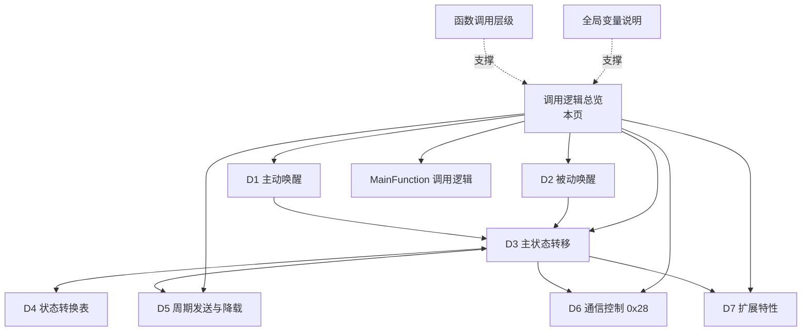
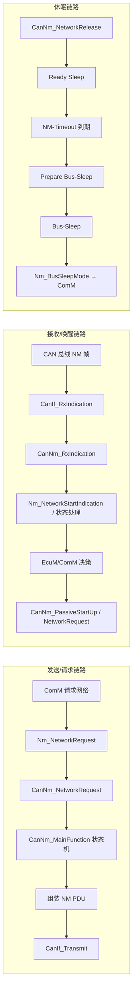

# CanNm 调用逻辑总览

> [!info] 导航
> 上级：[[CanNm]] ｜ 下级：[[CanNm_D1_主动唤醒调用逻辑]]、[[CanNm_D2_被动唤醒调用逻辑]]、[[CanNm_D3_主状态转移逻辑]]、[[CanNm_D4_状态转换表]]、[[CanNm_D5_周期发送与降载调用逻辑]]、[[CanNm_D6_通信控制调用逻辑]]、[[CanNm_D7_扩展特性调用逻辑]]

> 适用版本：AUTOSAR CP R21-11　依据：AUTOSAR_SWS_CANNetworkManagement（Document ID 13）
> 最后更新：2026-10-21
> 说明：本目录按"业务大方向"组织，每个方向一条独立调用主线；文件之间用 Obsidian 双链互相引用（引用规范见工作区 README）。

## 1. 方向清单

| 编号 | 方向 | 回答的问题 | 主要入口 | 详细文档 |
|---|---|---|---|---|
| D1 | 主动唤醒调用逻辑 | 本地有通信需求时，从请求网络到开始发帧、通知上层的完整链路 | `CanNm_NetworkRequest` | [[CanNm_D1_主动唤醒调用逻辑]] |
| D2 | 被动唤醒调用逻辑 | 总线上先出现 NM 帧时，ECU 如何被"告知"以及上层如何决策唤醒 | `CanNm_RxIndication`、`CanNm_PassiveStartUp` | [[CanNm_D2_被动唤醒调用逻辑]] |
| D3 | 主状态转移逻辑 | 5 个状态之间如何迁移、迁移时执行什么动作 | `CanNm_MainFunction` + 定时器 | [[CanNm_D3_主状态转移逻辑]] |
| D4 | 状态转换表 | 状态 × 事件 → 下一状态 / 动作 / 需求号（查表用） | — | [[CanNm_D4_状态转换表]] |
| D5 | 周期发送与降载调用逻辑 | 周期帧怎么发、负载降低怎么重装周期、立即发送与 PN shutdown 怎么发 | `CanNm_MainFunction` 发送段 | [[CanNm_D5_周期发送与降载调用逻辑]] |
| D6 | 通信控制调用逻辑 | 诊断 0x28 禁用/恢复 NM 发送的链路与影响 | `CanNm_DisableCommunication` / `CanNm_EnableCommunication` | [[CanNm_D6_通信控制调用逻辑]] |
| D7 | 扩展特性调用逻辑 | PNC、CarWakeup、远程睡眠、协调器同步、用户数据、发送错误处理 | 接收/发送处理 + 回调 | [[CanNm_D7_扩展特性调用逻辑]] |

配套文档：

- 函数层级：[[CanNm_函数调用层级]]
- 全局变量：[[CanNm_全局变量说明]]
- 主函数调用逻辑：[[CanNm_MainFunction调用逻辑]]
- 标准需求：[[CanNm_AUTOSAR标准需求表_R21-11]]
- 配置项：[[CanNm_DaVinci配置项]]

## 2. 调用逻辑层级（L2）

- **入口（D1/D2）→ 状态机（D3/D4）→ 运行服务（D5/D6/D7）→ 执行层（MainFunction）**；
- 函数层级与全局变量为所有方向提供支撑，不单独成主线。

## 3. 全局视角（三条链路）

## 4. 阅读顺序

1. 本文件（建立方向图）
2. [[CanNm_D1_主动唤醒调用逻辑]]、[[CanNm_D2_被动唤醒调用逻辑]]（两条唤醒主线）
3. [[CanNm_D3_主状态转移逻辑]] + [[CanNm_D4_状态转换表]]（状态机）
4. [[CanNm_D5_周期发送与降载调用逻辑]]、[[CanNm_D6_通信控制调用逻辑]]、[[CanNm_D7_扩展特性调用逻辑]]
5. [[CanNm_函数调用层级]]、[[CanNm_全局变量说明]]
6. [[CanNm_MainFunction调用逻辑]]（按方向映射到主函数）

## 5. 本文档的结构约定

- 每条主线：**触发 → 调用链（从上到下）→ 状态/数据变化 → 输出 → 依据需求号**；
- 函数名：SWS 规定的 API 用标准名；模块内部处理函数用"逻辑名 +（实现相关）"标注；
- 需求号：形如 `SWS_CanNm_xxxxx`，与 [[CanNm_AUTOSAR标准需求表_R21-11]] 对应；
## 6. 实现代码导航（NeuSAR 3.14 / AR 4.2.2）

| 文件 | 内容 |
|---|---|
| `src_CanNm/Source/CanNm.c` | 主函数、API、回调、内部 static 函数（3720 行） |
| `src_CanNm/Source/CanNm_Cfg.c` | 配置表 `CanNm_ChannelConfig[]`、`CanNm_PbChannelConfig[]`、运行状态数组定义（319 行） |
| `src_CanNm/Source/CanNm_Cfg.h` | 配置结构体、运行变量 extern、`CanNm_Get*/Set*` 访问宏（520 行） |
| `src_CanNm/Source/CanNm.h` | 公开 API 声明、版本宏 |
| `src_Rte/Source/SchM_CanNm.h` | `CanNm_MainFunction` 调度声明 |
| `src_Nm/Source/NmStack_Types.h` | `NM_STATE_*` / `NM_MODE_*` 定义 |

- 变量对照：[[CanNm_全局变量说明]]
- 函数与行号：[[CanNm_函数调用层级]]
- 主函数顺序：[[CanNm_MainFunction调用逻辑]]
