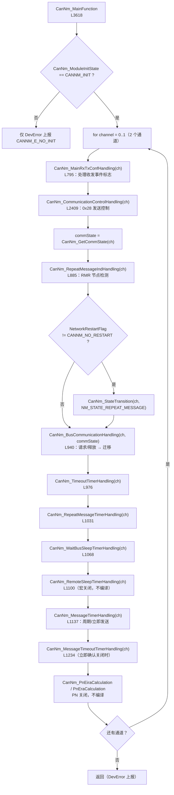

# CanNm_MainFunction 调用逻辑（基于本项目生成代码）

> [!info] 导航
> 上级：[[CanNm]] ｜ 依赖：[[CanNm_调用逻辑总览]]、[[CanNm_函数调用层级]] ｜ 依据：[[CanNm_D4_状态转换表]]

> 适用文档：AUTOSAR CP R21-11　**实现基线**：AUTOSAR 4.2.2 / NeuSAR CanNm 3.14.0
> 代码：`CanNm.c` 的 `CanNm_MainFunction`（L3618~3716）
> 最后更新：2026-10-21

## 1. 调度与配置

| 项目 | 内容 |
|---|---|
| 调度者 | SchM / OS 周期任务（`SchM_CanNm.h` 声明 `CanNm_MainFunction`） |
| 函数 | `FUNC(void, CANNM_CODE) CanNm_MainFunction(void)`（L3618），不可重入 |
| 周期 | 由集成侧任务决定；对应 ECU 配置项 `CanNmMainFunctionPeriod`，本代码内不含该值（需在 OS/SchM 配置确认） |
| 上下文 | 任务上下文 |
| 通道数 | 2（`CANNM_NUMBER_OF_CANNM_CHANNELS`），一次调用处理所有通道 |
| 未初始化 | 若 `CanNm_ModuleInitState != CANNM_INIT`：不处理，仅按 DevError 配置上报 `CANNM_E_NO_INIT` |

> 注：本代码存在测试宏 `VCU_Test_Code_YXP`（L3614、L3626），若开启会在主函数开头调用 `Test_IO_Turn_LS10()`；量产应关闭。

## 2. 实际执行顺序（L3640~3704）



## 3. 各段代码行为

### 3.1 收发事件处理（`CanNm_MainRxTxConfHandling`，L795）

- 消费 `CanNm_MsgIndicationFlag` / `CanNm_MsgConfirmationFlag`；
- 收到帧（Rx）时：更新 `CanNm_TimeoutTimer`（若发送能力使能）、处理降载重装（`CanNm_MsgTimer = MsgReducedTime`）、PN/RMR/CWU 副作用；
- 发送确认（TxConf）：重启 `CanNm_TimeoutTimer`、处理发送失败/重试标志；
- 中断只负责置标志，主函数统一处理，避免临界区过长。

### 3.2 通信控制（`CanNm_CommunicationControlHandling`，L2409）

- 比较 `CanNm_TxControlStateRequest` 与 `CanNm_TxControlState`；
- 禁用时停发送相关定时器/标志；恢复时按需重装；
- 对应 0x28（`CanNm_DisableCommunication` / `EnableCommunication`），实现里通过 `CanNm_TxControlStateRequest` 传递。

### 3.3 重启请求（`NetworkRestartFlag`）

- `NetworkRequest`/`PassiveStartUp` 等置 `CANNM_ACTIVE_RESTART` / `CANNM_PASSIVE_RESTART`；
- 主函数检测到非 `CANNM_NO_RESTART` → `CanNm_StateTransition(ch, NM_STATE_REPEAT_MESSAGE)`；
- `StateTransition` 内清除标志。

### 3.4 通信请求/释放（`CanNm_BusCommunicationHandling`，L940）

- 根据 `CanNm_CommState`（`COMM_NORMAL_OPERATION` / `COMM_READY_SLEEP`）驱动：
  - Repeat Message 到期 → Normal Operation 或 Ready Sleep；
  - Normal Operation 下释放 → Ready Sleep；
  - Ready Sleep 下请求 → Normal Operation（并触发首帧）；
- 是“状态机迁移的主要决策点”之一。

### 3.5 定时器 handler（每个 handler = 递减 + 到期处理）

| 函数 | 定时器变量 | 到期行为 |
|---|---|---|
| `CanNm_TimeoutTimerHandling` | `CanNm_TimeoutTimer` | 非 Ready Sleep：重装 `TimeoutTime` + DET `CANNM_E_NETWORK_TIMEOUT`；Ready Sleep：→ `PREPARE_BUS_SLEEP` |
| `CanNm_RepeatMessageTimerHandling` | `CanNm_RepeatMsgTimer` | `CommState == COMM_NORMAL_OPERATION` → `NORMAL_OPERATION`，否则 `READY_SLEEP` |
| `CanNm_WaitBusSleepTimerHandling` | `CanNm_WaitBusSleepTimer` | → `BUS_SLEEP` |
| `CanNm_MessageTimerHandling` | `CanNm_MsgTimer` | 到期或 `MsgRequest` 置位 → `CanNm_TriggerTransmission` |
| `CanNm_MessageTimeoutTimerHandling` | `CanNm_MsgTimeoutTimer` | 发送超时→`Nm_TxTimeoutException`/`CanSM_TxTimeoutException`（按配置） |
| `CanNm_RemoteSleepTimerHandling` | `CanNm_RemoteSleepTimer` | 远程睡眠上报（本项功能关闭，不编译） |

### 3.6 发送调度（`CanNm_MessageTimerHandling` → `CanNm_TriggerTransmission`）

`CanNm_TriggerTransmission`（L1611）实际做的事：

1. 若 `CANNM_COM_USER_DATA_SUPPORT=ON`：调用 `PduR_CanNmTriggerTransmit(TxUserDataPduId, &nmPduInfo)` 填充用户数据区；
2. 组包指针：`nmPduInfo.SduDataPtr = &CanNm_TxMessageData[ch][TxMsgDataStartIdx]`；
3. 若配置 `CANNM_NM_USER_ENABLE_SUPPORTED`：调用项目扩展 `CanNm_GetTxUserNMEnable()`，不允许则跳过发送；
4. 调 `CanIf_Transmit(CanNm_GetTxPduRef(ch), &nmPduInfo)`；
5. 成功后（非立即确认模式）：启动 `CanNm_MsgTimeoutTimer = MsgTimeoutTime + 1`；
6. 若 `ImmediateNmMsgCount != 0`：成功后递减，并按 `ImmediateNmCycleTime` 重装 `MsgTimer`；失败则重装 1（下周期重试）；
7. 否则按 `MsgCycleTime` 重装。

> 本项目额外调用 `Can_NM_UserData_Fill()`（L1673，项目定制）填充用户数据；这不在 AUTOSAR SWS 中。

### 3.7 同步/PN

- `PN_FEATURE_ENABLED = STD_OFF`：PN 计算函数不编译；
- `COORDINATOR_SYNC_SUPPORT = STD_OFF`：协调器睡眠位不处理。

## 4. 伪代码（按实际函数）

```c
void CanNm_MainFunction(void)
{
    uint8 errorId = CANNM_E_NO_ERROR;

    if (CanNm_ModuleInitState != CANNM_INIT) {
        errorId = CANNM_E_NO_INIT;                 /* DevError */
    } else {
        for (channel = 0; channel < 2U; channel++) {
            CanNm_MainRxTxConfHandling(channel);   /* 收发事件 */
            CanNm_CommunicationControlHandling(channel);
            commState = CanNm_GetCommState(channel);
            CanNm_RepeatMessageIndHandling(channel);
            if (CanNm_GetNetworkRestartFlag(channel) != CANNM_NO_RESTART)
                CanNm_StateTransition(channel, NM_STATE_REPEAT_MESSAGE);
            CanNm_BusCommunicationHandling(channel, commState);
            CanNm_TimeoutTimerHandling(channel);
            CanNm_RepeatMessageTimerHandling(channel);
            CanNm_WaitBusSleepTimerHandling(channel);
            CanNm_MessageTimerHandling(channel);       /* → TriggerTransmission */
            CanNm_MessageTimeoutTimerHandling(channel);
        }
    }
    if (errorId != CANNM_E_NO_ERROR) CANNM_REPORT_DEV_ERROR(CANNM_SID_MAINFUNCTION, errorId);
}
```

## 5. 本项目配置值对主函数行为的影响

| 配置 | 值 | 主函数中的表现 |
|---|---|---|
| `MsgCycleTime` | 100 ms | 正常周期帧间隔 |
| `ImmediateNmCycleTime` / `ImmediateNmTransmissions` | 4 ms / 10 帧 | 主动唤醒后先发 10 帧（4ms 间隔） |
| `RepeatMessageTime` | 320 ms | Repeat Message 约 3 个 100ms 周期 |
| `TimeoutTime` | 380 ms | Ready Sleep 静默约 3.8 个周期后进 Prepare |
| `WaitBusSleepTime` | 401 ms | Prepare 停留约 4 个周期后 Bus-Sleep |
| `MsgTimeoutTime` | 16 ms | 发送确认超时监控 |
| `BusLoadReductionActive` | FALSE（配置） | 主函数不启用降载重装，始终按 100ms |
| `NodeDetectionEnabled` / `RepeatMsgIndEnabled` | TRUE / ON | 主函数每周期处理 RMR |
| `ComControlEnabled` | ON | 主函数每周期处理 0x28 状态 |
| `RemoteSleepIndEnabled` | OFF | 不处理远程睡眠 |
| `PnFeature` | OFF | 不处理 PN |

## 6. 排障要点（结合代码）

1. **主函数不执行**：先看 `CanNm_ModuleInitState` 是否 `CANNM_INIT`（`CanNm_Init` 是否被调用、是否在 CanIf 之后）；
2. **不发帧**：看 `CanNm_MsgTimer` 是否为 0 且未被重装、`CanNm_TxControlState` 是否 DISABLED、`ImmediateNmMsgCount` 是否卡住、`CanIf_Transmit` 返回值；
3. **状态不迁移**：看 `CanNm_CommState`、`NetworkRestartFlag` 与对应定时器是否递减；
4. **收帧没反应**：看 `CanNm_MsgIndicationFlag` 是否置位、`CanNm_RxIndication` 是否被 CanIf 调用（PDU ID 配置）；
5. **周期不对**：核对集成任务周期与 `CanNmMainFunctionPeriod`（代码内没有该值，必须在 OS/SchM 配置里确认）；
6. **测试代码残留**：检查 `VCU_Test_Code_YXP` 是否被定义（会调用 `Test_IO_Turn_LS10`，影响时序）。

## 7. 关联

- 变量与宏：[[CanNm_全局变量说明]]
- 函数清单与行号：[[CanNm_函数调用层级]]
- 状态迁移表：[[CanNm_D4_状态转换表]]
- 发送/降载细节：[[CanNm_D5_周期发送与降载调用逻辑]]
