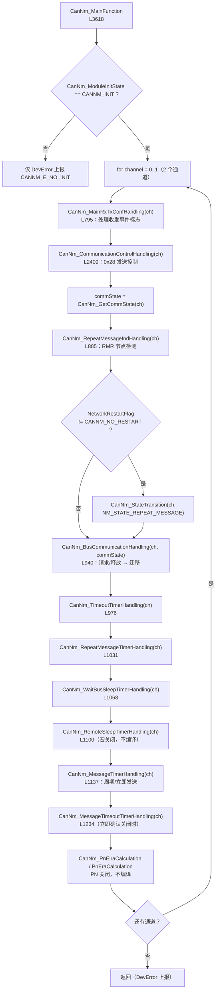

# CanNm_MainFunction 调用逻辑（基于本项目生成代码）

> [!info] 导航
> 上级：[[CanNm]] ｜ 依赖：CanNm_调用逻辑总览、CanNm_函数调用层级 ｜ 依据：CanNm_D4_状态转换表

> 适用文档：AUTOSAR CP R21-11　**实现基线**：AUTOSAR 4.2.2 / NeuSAR CanNm 3.14.0
> 代码：`CanNm.c` 的 `CanNm_MainFunction`（L3618~3716）
> 最后更新：2026-10-21

## 1. 调度与配置

| 项目 | 内容 |
|---|---|
| 调度者 | SchM / OS 周期任务（`SchM_CanNm.h` 声明 `CanNm_MainFunction`） |
| 函数 | `FUNC(void, CANNM_CODE) CanNm_MainFunction(void)`（L3618），不可重入 |
| 周期 | 由集成侧任务决定；对应 ECU 配置项 `CanNmMainFunctionPeriod`，本代码内不含该值（需在 OS/SchM 配置确认） |
| 上下文 | 任务上下文 |
| 通道数 | 2（`CANNM_NUMBER_OF_CANNM_CHANNELS`），一次调用处理所有通道 |
| 未初始化 | 若 `CanNm_ModuleInitState != CANNM_INIT`：不处理，仅按 DevError 配置上报 `CANNM_E_NO_INIT` |

> 注：本代码存在测试宏 `VCU_Test_Code_YXP`（L3614、L3626），若开启会在主函数开头调用 `Test_IO_Turn_LS10()`；量产应关闭。

## 2. 实际执行顺序（L3640~3704）



## 3. 各段代码行为

### 3.1 收发事件处理（`CanNm_MainRxTxConfHandling`，L795）

- 消费 `CanNm_MsgIndicationFlag` / `CanNm_MsgConfirmationFlag`；
- 收到帧（Rx）时：更新 `CanNm_TimeoutTimer`（若发送能力使能）、处理降载重装（`CanNm_MsgTimer = MsgReducedTime`）、PN/RMR/CWU 副作用；
- 发送确认（TxConf）：重启 `CanNm_TimeoutTimer`、处理发送失败/重试标志；
- 中断只负责置标志，主函数统一处理，避免临界区过长。

### 3.2 通信控制（`CanNm_CommunicationControlHandling`，L2409）

- 比较 `CanNm_TxControlStateRequest` 与 `CanNm_TxControlState`；
- 禁用时停发送相关定时器/标志；恢复时按需重装；
- 对应 0x28（`CanNm_DisableCommunication` / `EnableCommunication`），实现里通过 `CanNm_TxControlStateRequest` 传递。

### 3.3 重启请求（`NetworkRestartFlag`）

- `NetworkRequest`/`PassiveStartUp` 等置 `CANNM_ACTIVE_RESTART` / `CANNM_PASSIVE_RESTART`；
- 主函数检测到非 `CANNM_NO_RESTART` → `CanNm_StateTransition(ch, NM_STATE_REPEAT_MESSAGE)`；
- `StateTransition` 内清除标志。

### 3.4 通信请求/释放（`CanNm_BusCommunicationHandling`，L940）

- 根据 `CanNm_CommState`（`COMM_NORMAL_OPERATION` / `COMM_READY_SLEEP`）驱动：
  - Repeat Message 到期 → Normal Operation 或 Ready Sleep；
  - Normal Operation 下释放 → Ready Sleep；
  - Ready Sleep 下请求 → Normal Operation（并触发首帧）；
- 是“状态机迁移的主要决策点”之一。

### 3.5 定时器 handler（每个 handler = 递减 + 到期处理）

| 函数 | 定时器变量 | 到期行为 |
|---|---|---|
| `CanNm_TimeoutTimerHandling` | `CanNm_TimeoutTimer` | 非 Ready Sleep：重装 `TimeoutTime` + DET `CANNM_E_NETWORK_TIMEOUT`；Ready Sleep：→ `PREPARE_BUS_SLEEP` |
| `CanNm_RepeatMessageTimerHandling` | `CanNm_RepeatMsgTimer` | `CommState == COMM_NORMAL_OPERATION` → `NORMAL_OPERATION`，否则 `READY_SLEEP` |
| `CanNm_WaitBusSleepTimerHandling` | `CanNm_WaitBusSleepTimer` | → `BUS_SLEEP` |
| `CanNm_MessageTimerHandling` | `CanNm_MsgTimer` | 到期或 `MsgRequest` 置位 → `CanNm_TriggerTransmission` |
| `CanNm_MessageTimeoutTimerHandling` | `CanNm_MsgTimeoutTimer` | 发送超时→`Nm_TxTimeoutException`/`CanSM_TxTimeoutException`（按配置） |
| `CanNm_RemoteSleepTimerHandling` | `CanNm_RemoteSleepTimer` | 远程睡眠上报（本项功能关闭，不编译） |

### 3.6 发送调度（`CanNm_MessageTimerHandling` → `CanNm_TriggerTransmission`）

`CanNm_TriggerTransmission`（L1611）实际做的事：

1. 若 `CANNM_COM_USER_DATA_SUPPORT=ON`：调用 `PduR_CanNmTriggerTransmit(TxUserDataPduId, &nmPduInfo)` 填充用户数据区；
2. 组包指针：`nmPduInfo.SduDataPtr = &CanNm_TxMessageData[ch][TxMsgDataStartIdx]`；
3. 若配置 `CANNM_NM_USER_ENABLE_SUPPORTED`：调用项目扩展 `CanNm_GetTxUserNMEnable()`，不允许则跳过发送；
4. 调 `CanIf_Transmit(CanNm_GetTxPduRef(ch), &nmPduInfo)`；
5. 成功后（非立即确认模式）：启动 `CanNm_MsgTimeoutTimer = MsgTimeoutTime + 1`；
6. 若 `ImmediateNmMsgCount != 0`：成功后递减，并按 `ImmediateNmCycleTime` 重装 `MsgTimer`；失败则重装 1（下周期重试）；
7. 否则按 `MsgCycleTime` 重装。

> 本项目额外调用 `Can_NM_UserData_Fill()`（L1673，项目定制）填充用户数据；这不在 AUTOSAR SWS 中。

### 3.7 同步/PN

- `PN_FEATURE_ENABLED = STD_OFF`：PN 计算函数不编译；
- `COORDINATOR_SYNC_SUPPORT = STD_OFF`：协调器睡眠位不处理。

## 4. 伪代码（按实际函数）

```c
void CanNm_MainFunction(void)
{
    uint8 errorId = CANNM_E_NO_ERROR;

    if (CanNm_ModuleInitState != CANNM_INIT) {
        errorId = CANNM_E_NO_INIT;                 /* DevError */
    } else {
        for (channel = 0; channel < 2U; channel++) {
            CanNm_MainRxTxConfHandling(channel);   /* 收发事件 */
            CanNm_CommunicationControlHandling(channel);
            commState = CanNm_GetCommState(channel);
            CanNm_RepeatMessageIndHandling(channel);
            if (CanNm_GetNetworkRestartFlag(channel) != CANNM_NO_RESTART)
                CanNm_StateTransition(channel, NM_STATE_REPEAT_MESSAGE);
            CanNm_BusCommunicationHandling(channel, commState);
            CanNm_TimeoutTimerHandling(channel);
            CanNm_RepeatMessageTimerHandling(channel);
            CanNm_WaitBusSleepTimerHandling(channel);
            CanNm_MessageTimerHandling(channel);       /* → TriggerTransmission */
            CanNm_MessageTimeoutTimerHandling(channel);
        }
    }
    if (errorId != CANNM_E_NO_ERROR) CANNM_REPORT_DEV_ERROR(CANNM_SID_MAINFUNCTION, errorId);
}
```

## 5. 函数逐级拆解（深度 3，代码注释版）

> 保留 C 代码风格，只在关键判断后加 `/* 判断：... */` 备注；与本判断无关的语句用 `...` 省略。
> 深度：**L1 主函数 → L2 每通道函数 → L3 内部再调用/判断**；行号对应 `CanNm.c`。
> 全局变量用 `==高亮==` 标出；每个函数末尾附 `代码跳转` 链接（`vscode://` 协议，VS Code 可直接定位到行）。

### 5.1 L1：`CanNm_MainFunction`（L3618）

> **函数作用**：CanNm 的周期调度入口：按通道处理收发事件、通信控制、重启/请求、状态迁移、定时器与发送，是模块唯一的状态机驱动。

```c
FUNC(void, CANNM_CODE) CanNm_MainFunction(void)
{
    uint8 errorId = CANNM_E_NO_ERROR;
    NetworkHandleType channel;
    uint8 commState;

    if (CanNm_ModuleInitState != CANNM_INIT) {                 /* 判断：未初始化 → 只报 DET，不跑状态机 */
        errorId = CANNM_E_NO_INIT;
    } else {
        for (channel = 0; channel < CanNm_GetSizeOfChannelConfig(); channel++) {  /* 2 个 NM 通道共用同一套逻辑 */
            CanNm_MainRxTxConfHandling(channel);               /* 先消费上一周期的收发事件（中断只置标志） */
            CanNm_CommunicationControlHandling(channel);       /* 0x28 请求 → 生效，停/启发送 */
            commState = CanNm_GetCommState(channel);
            CanNm_RepeatMessageIndHandling(channel);           /* RMR 请求/指示 → 置位或迁移 */

            if (CanNm_GetNetworkRestartFlag(channel) != CANNM_NO_RESTART) {  /* 判断：有主动/被动重启请求 */
                CanNm_StateTransition(channel, NM_STATE_REPEAT_MESSAGE);     /* 统一在主循环迁移，不在 API 里跑状态机 */
            }

            CanNm_BusCommunicationHandling(channel, commState); /* 判断：请求/释放 → Normal ↔ Ready Sleep */
            CanNm_TimeoutTimerHandling(channel);               /* 到期：Ready Sleep → Prepare；其他状态 → 重装 + DET */
            CanNm_RepeatMessageTimerHandling(channel);         /* 到期：CommState=Normal ? Normal : Ready Sleep */
            CanNm_WaitBusSleepTimerHandling(channel);          /* 到期 → Bus-Sleep */
            CanNm_MessageTimerHandling(channel);               /* 周期/快发/重试 → TriggerTransmission */
            CanNm_MessageTimeoutTimerHandling(channel);        /* 发送确认超时 → Nm/CanSM 异常通知 */

            /* PN_EIRA / PN_ERA 宏关闭，不编译 */
        }
    }

    if (errorId != CANNM_E_NO_ERROR) {                          /* 汇总错误：一次主函数只报一个 DevError */
        (void)CANNM_REPORT_DEV_ERROR(CANNM_SID_MAINFUNCTION, errorId);
    }
}
```

> **全局变量**：==CanNm_ModuleInitState==、==CanNm_NetworkRestartFlag==、==CanNm_CommState==　**代码跳转**：[CanNm.c:3618](vscode://file/C:/Users/11401/Desktop/学习/AUTOSAR/AUTOSAT使用NEUSAR生成的代码/002_BSW/Bsw_Src/Autosar_Src/src_CanNm/Source/CanNm.c:3618)

### 5.2 L2：每通道函数

#### 5.2.1 `CanNm_MainRxTxConfHandling`（L795）

> **函数作用**：消费 CanIf 的发送确认与接收指示标志：确认时重置 NM-Timeout；接收时按当前 NM 状态决定唤醒、取消睡眠、重置超时或降载补帧。

```c
static FUNC(void, CANNM_CODE) CanNm_MainRxTxConfHandling(NetworkHandleType channel)
{
    if (TRUE == CanNm_IsMsgConfirmationFlag(channel)) {        /* 判断：CanIf 已确认上一帧 → 网络仍活跃 */
        CanNm_SetMsgConfirmationFlag(channel, FALSE);
        CanNm_SetTimeoutTimer(channel, TimeoutTime + CANNM_ONE); /* 重置 NM-Timeout */
        CanNm_SetMsgTimeoutTimer(channel, CANNM_ZERO);          /* 已确认，停止发送超时计时 */
    }

    if (TRUE == CanNm_IsMsgIndicationFlag(channel)) {          /* 判断：收到一帧 NM 报文（中断只置标志） */
        CanNm_SetMsgIndicationFlag(channel, FALSE);

        switch (CanNm_GetNmState(channel)) {
            case NM_STATE_BUS_SLEEP:                            /* 判断：睡眠中收到帧 → 请求网络启动，由 Nm/ComM 决策 */
                (void)Nm_NetworkStartIndication(CanNm_GetChannelId(channel));
                break;

            case NM_STATE_PREPARE_BUS_SLEEP:                    /* 判断：静默期收到帧 → 有人活动，取消睡眠 */
                CanNm_StateTransition(channel, NM_STATE_REPEAT_MESSAGE);
                break;

            case NM_STATE_NORMAL_OPERATION:                     /* 判断：正常运行中收到帧 → 维持活跃 */
                if (MSG_TX_ENABLED == CanNm_GetTxControlState(channel)) {
                    if (TRUE == CanNm_IsBusLoadReductionActive(channel)) {
                        CanNm_SetMsgTimer(channel, MsgReduceTime + CANNM_ONE); /* 降载：收到帧后快速补一帧 */
                    }
                }
                /* 故意不 break：继续落到 READY_SLEEP/default 重置 Timeout */

            case NM_STATE_READY_SLEEP:                          /* 判断：就绪睡眠收到帧 → 取消远程睡眠 */
                if (TRUE == CanNm_IsRemoteSleepIndState(channel)) {
                    CanNm_SetRemoteSleepIndState(channel, FALSE);
                    Nm_RemoteSleepCancellation(CanNm_GetChannelId(channel));
                }
                /* fall through */

            default:                                            /* 其它状态收到帧 → 刷新 NM-Timeout，证明网络还在 */
                CanNm_SetTimeoutTimer(channel, TimeoutTime + CANNM_ONE);
                break;
        }
    }
}
```

> **全局变量**：==CanNm_MsgConfirmationFlag==、==CanNm_MsgIndicationFlag==、==CanNm_NmState==、==CanNm_TxControlState==、==CanNm_BusLoadReductionActive==、==CanNm_MsgTimer==、==CanNm_TimeoutTimer==　**代码跳转**：[CanNm.c:795](vscode://file/C:/Users/11401/Desktop/学习/AUTOSAR/AUTOSAT使用NEUSAR生成的代码/002_BSW/Bsw_Src/Autosar_Src/src_CanNm/Source/CanNm.c:795)

#### 5.2.2 `CanNm_CommunicationControlHandling`（L2409）

> **函数作用**：把 0x28 的发送控制请求落到当前状态：禁止发送时清发送相关定时器，恢复时重装 NM-Timeout 并在 Normal/Repeat 下补发首帧。

```c
static FUNC(void, CANNM_CODE) CanNm_CommunicationControlHandling(NetworkHandleType channel)
{
    uint8 txCtlSta = CanNm_GetTxControlStateRequest(channel);

    if (CanNm_GetTxControlState(channel) != txCtlSta) {          /* 判断：0x28 请求值变化才动作，避免每周期重复操作 */
        CanNm_SetTxControlState(channel, txCtlSta);

        if (MSG_TX_DISABLED == txCtlSta) {                       /* 判断：禁止发送 → 定时器必须清零 */
            CanNm_SetTimeoutTimer(channel, CANNM_ZERO);
            CanNm_SetMsgTimer(channel, CANNM_ZERO);
            ...
        } else {                                                 /* 判断：恢复发送 → 重新给 NM-Timeout */
            CanNm_SetTimeoutTimer(channel, TimeoutTime + CANNM_ONE);
            if ((NM_STATE_NORMAL_OPERATION == CanNm_GetNmState(channel)) ||
                (NM_STATE_REPEAT_MESSAGE == CanNm_GetNmState(channel))) {  /* Normal/Repeat 下补发一帧 */
                CanNm_SetMsgTimer(channel, MsgCycleOffset + CANNM_ONE);
            }
            ...
        }
    }
}
```

> **全局变量**：==CanNm_TxControlState==、==CanNm_TxControlStateRequest==、==CanNm_TimeoutTimer==、==CanNm_MsgTimer==、==CanNm_NmState==　**代码跳转**：[CanNm.c:2409](vscode://file/C:/Users/11401/Desktop/学习/AUTOSAR/AUTOSAT使用NEUSAR生成的代码/002_BSW/Bsw_Src/Autosar_Src/src_CanNm/Source/CanNm.c:2409)

#### 5.2.3 `CanNm_RepeatMessageIndHandling`（L885）

> **函数作用**：处理 RMR 的内部请求与收到指示：在 CBV 中置 Repeat Message 位，并驱动状态迁移到 Repeat Message，让其它节点重新检测。

```c
static FUNC(void, CANNM_CODE) CanNm_RepeatMessageIndHandling(NetworkHandleType channel)
{
    if (TRUE == CanNm_IsRepeatMsgReqFlag(channel)) {             /* 判断：内部/上层请求 RMR */
        CanNm_SetRepeatMsgBitIndFlag(channel, TRUE);
        if (CanNm_GetTxMsgData_CBVIdx(channel) != CANNM_PDU_OFF) {  /* 判断：CBV 位置有效才写 RMR 位 */
            CanNm_SetTxMessageData(channel, CBVIdx, ... | CANNM_REPEAT_MSG_BIT_MASK);
        }
    }

    if (TRUE == CanNm_IsRepeatMsgBitIndFlag(channel)) {          /* 判断：收到/内部已置 RMR → 必须重新广播节点信息 */
        ...
        CanNm_StateTransition(channel, NM_STATE_REPEAT_MESSAGE);
        CanNm_SetRepeatMsgReqFlag(channel, FALSE);
    }
}
```

> **全局变量**：==CanNm_RepeatMsgReqFlag==、==CanNm_RepeatMsgBitIndFlag==、==CanNm_TxMessageData==　**代码跳转**：[CanNm.c:885](vscode://file/C:/Users/11401/Desktop/学习/AUTOSAR/AUTOSAT使用NEUSAR生成的代码/002_BSW/Bsw_Src/Autosar_Src/src_CanNm/Source/CanNm.c:885)

#### 5.2.4 `CanNm_BusCommunicationHandling`（L940）

> **函数作用**：根据通信请求/释放状态，在 Normal Operation 与 Ready Sleep 之间迁移：请求则进入 Normal，释放则回到 Ready Sleep。

```c
static FUNC(void, CANNM_CODE) CanNm_BusCommunicationHandling(NetworkHandleType channel, uint8 commState)
{
    if (COMM_NORMAL_OPERATION == commState) {                   /* 判断：网络被请求 → 应向 Normal 迁移 */
        if (NM_STATE_READY_SLEEP == CanNm_GetNmState(channel)) {
            CanNm_StateTransition(channel, NM_STATE_NORMAL_OPERATION);
        }
    } else {                                                    /* 判断：网络被释放 → 应向 Ready Sleep 迁移 */
        if (NM_STATE_NORMAL_OPERATION == CanNm_GetNmState(channel)) {
            CanNm_StateTransition(channel, NM_STATE_READY_SLEEP);
        }
    }
}
```

> **全局变量**：==CanNm_CommState==、==CanNm_NmState==　**代码跳转**：[CanNm.c:940](vscode://file/C:/Users/11401/Desktop/学习/AUTOSAR/AUTOSAT使用NEUSAR生成的代码/002_BSW/Bsw_Src/Autosar_Src/src_CanNm/Source/CanNm.c:940)

#### 5.2.5 `CanNm_TimeoutTimerHandling`（L976）

> **函数作用**：递减 NM-Timeout：Ready Sleep 到期表示可以睡眠，进入 Prepare Bus-Sleep；其他状态到期表示网络长时间静默，重装并报网络超时。

```c
static FUNC(void, CANNM_CODE) CanNm_TimeoutTimerHandling(NetworkHandleType channel)
{
    if (CANNM_ZERO != CanNm_GetTimeoutTimer(channel)) {         /* 判断：定时器运行中才递减 */
        CanNm_DecTimeoutTimer(channel);

        if (CANNM_ZERO == CanNm_GetTimeoutTimer(channel)) {     /* 判断：到期 */
            if (NM_STATE_READY_SLEEP != CanNm_GetNmState(channel)) {
                /* 非 Ready Sleep 到期 = 网络模式长期收不到帧，属于异常 */
                CanNm_SetTimeoutTimer(channel, TimeoutTime);
                errorId = CANNM_E_NETWORK_TIMEOUT;
            } else {
                /* Ready Sleep 到期 = 没有通信需求且网络静默，正常睡眠路径 */
                CanNm_StateTransition(channel, NM_STATE_PREPARE_BUS_SLEEP);
            }
        }
    }
}
```

> **全局变量**：==CanNm_TimeoutTimer==、==CanNm_NmState==　**代码跳转**：[CanNm.c:976](vscode://file/C:/Users/11401/Desktop/学习/AUTOSAR/AUTOSAT使用NEUSAR生成的代码/002_BSW/Bsw_Src/Autosar_Src/src_CanNm/Source/CanNm.c:976)

#### 5.2.6 `CanNm_RepeatMessageTimerHandling`（L1031）

> **函数作用**：计时 Repeat Message 的停留时间，到期后按当前通信请求回到 Normal Operation 或 Ready Sleep。

```c
static FUNC(void, CANNM_CODE) CanNm_RepeatMessageTimerHandling(NetworkHandleType channel)
{
    if (CANNM_ZERO != CanNm_GetRepeatMsgTimer(channel)) {       /* 判断：Repeat Message 计时中 */
        CanNm_DecRepeatMsgTimer(channel);
        if (CANNM_ZERO == CanNm_GetRepeatMsgTimer(channel)) {    /* 判断：到期 → 回到“当前是否有通信请求”的状态 */
            CanNm_StateTransition(channel,
                (COMM_NORMAL_OPERATION == CanNm_GetCommState(channel))
                    ? NM_STATE_NORMAL_OPERATION : NM_STATE_READY_SLEEP);
        }
    }
}
```

> **全局变量**：==CanNm_RepeatMsgTimer==、==CanNm_CommState==　**代码跳转**：[CanNm.c:1031](vscode://file/C:/Users/11401/Desktop/学习/AUTOSAR/AUTOSAT使用NEUSAR生成的代码/002_BSW/Bsw_Src/Autosar_Src/src_CanNm/Source/CanNm.c:1031)

#### 5.2.7 `CanNm_WaitBusSleepTimerHandling`（L1068）

> **函数作用**：计时 Prepare Bus-Sleep 的静默期，到期后进入 Bus-Sleep 并通知 Nm。

```c
static FUNC(void, CANNM_CODE) CanNm_WaitBusSleepTimerHandling(NetworkHandleType channel)
{
    if (CANNM_ZERO != CanNm_GetWaitBusSleepTimer(channel)) {     /* 判断：Prepare Bus-Sleep 静默计时中 */
        CanNm_DecWaitBusSleepTimer(channel);
        if (CANNM_ZERO == CanNm_GetWaitBusSleepTimer(channel)) { /* 判断：静默期结束 → 真正睡眠 */
            CanNm_StateTransition(channel, NM_STATE_BUS_SLEEP);
        }
    }
}
```

> **全局变量**：==CanNm_WaitBusSleepTimer==　**代码跳转**：[CanNm.c:1068](vscode://file/C:/Users/11401/Desktop/学习/AUTOSAR/AUTOSAT使用NEUSAR生成的代码/002_BSW/Bsw_Src/Autosar_Src/src_CanNm/Source/CanNm.c:1068)

#### 5.2.8 `CanNm_MessageTimerHandling`（L1137）

> **函数作用**：发送调度核心：按 MsgTimer 到期或用户数据请求触发 TriggerTransmission，并根据快发/正常/首帧重试/失败重试重装定时器。

```c
static FUNC(void, CANNM_CODE) CanNm_MessageTimerHandling(NetworkHandleType channel)
{
    if (CANNM_ZERO != CanNm_GetMsgTimer(channel)) {              /* 判断：发送定时器运行中 */
        CanNm_DecMsgTimer(channel);

        if ((CANNM_ZERO == CanNm_GetMsgTimer(channel))           /* 判断：周期到 */
            || (CANNM_ZERO != CanNm_GetMsgRequest(channel))) {   /* 判断：Com 用户数据有发送请求（优先发送） */
            success = CanNm_TriggerTransmission(channel);

            if (CANNM_ZERO != CanNm_GetImmediateNmMsgCount(channel)) {  /* 判断：主动唤醒快发阶段 */
                if (E_OK == success) {
                    CanNm_DecImmediateNmMsgCount(channel);
                    CanNm_SetMsgTimer(channel, ImmediateNmCycleTime);   /* 快发：4 个主函数周期（tick） */
                } else {
                    CanNm_SetMsgTimer(channel, CANNM_ONE);              /* 失败：下周期重试 */
                }
            } else {
                if (TRUE == CanNm_IsRetryFirstMessageRequestFlag(channel)) {  /* 判断：首帧需要重试 */
                    if (E_OK == success) {
                        CanNm_SetRetryFirstMessageRequestFlag(channel, FALSE);
                        if (TRUE == CanNm_IsImmediateRestartFailed(channel)) {
                            CanNm_SetMsgTimer(channel, MsgCycleOffset);     /* 重启失败过 → 回到原偏移 */
                        } else {
                            CanNm_SetMsgTimer(channel, MsgCycleTime);       /* 正常：100 个主函数周期（tick） */
                        }
                    } else {
                        CanNm_SetMsgTimer(channel, CANNM_ONE);              /* 失败：下周期重试 */
                    }
                } else {
                    CanNm_SetMsgTimer(channel, MsgCycleTime);               /* 普通周期 */
                }
            }
        }
    }
}
```

> **全局变量**：==CanNm_MsgTimer==、==CanNm_MsgRequest==、==CanNm_ImmediateNmMsgCount==、==CanNm_RetryFirstMessageRequestFlag==、==CanNm_ImmediateRestartFailed==　**代码跳转**：[CanNm.c:1137](vscode://file/C:/Users/11401/Desktop/学习/AUTOSAR/AUTOSAT使用NEUSAR生成的代码/002_BSW/Bsw_Src/Autosar_Src/src_CanNm/Source/CanNm.c:1137)

#### 5.2.9 `CanNm_MessageTimeoutTimerHandling`（L1234）

> **函数作用**：监控发送确认超时：超时后通知 Nm（TxTimeoutException），PN 场景再通知 CanSM，用于发现总线/驱动异常。

```c
static FUNC(void, CANNM_CODE) CanNm_MessageTimeoutTimerHandling(NetworkHandleType channel)
{
    if (CANNM_ZERO != CanNm_GetMsgTimeoutTimer(channel)) {       /* 判断：发送确认超时监控中 */
        CanNm_DecMsgTimeoutTimer(channel);
        if (CANNM_ZERO == CanNm_GetMsgTimeoutTimer(channel)) {   /* 判断：超时 → 发送链路异常 */
            Nm_TxTimeoutException(CanNm_GetChannelId(channel));
            if ((TRUE == CanNm_IsPnEnabled(channel)) &&
                (TRUE == CanNm_IsPnCallTxTimeoutException(channel))) {  /* 判断：PN 场景且配置要求 */
                CanSM_TxTimeoutException(CanNm_GetChannelId(channel));
            }
        }
    }
}
```

> **全局变量**：==CanNm_MsgTimeoutTimer==　**代码跳转**：[CanNm.c:1234](vscode://file/C:/Users/11401/Desktop/学习/AUTOSAR/AUTOSAT使用NEUSAR生成的代码/002_BSW/Bsw_Src/Autosar_Src/src_CanNm/Source/CanNm.c:1234)

### 5.3 L3：被多个 L2 调用的公共函数

#### 5.3.1 `CanNm_StateTransition`（L1838）

> **函数作用**：所有状态迁移的统一入口：更新 NmState 并按目标状态执行进入动作（通知 Nm、启停定时器、置/清 CBV 位、首帧补发）。

```c
static FUNC(void, CANNM_CODE) CanNm_StateTransition(NetworkHandleType channel, Nm_StateType nextNmState)
{
    Nm_StateType lastNmState = CanNm_GetNmState(channel);
    CanNm_SetNmState(channel, nextNmState);                      /* 先更新状态，再执行进入动作 */

    switch (nextNmState) {
        case NM_STATE_BUS_SLEEP:                                 /* 判断：进入睡眠 → 通知 Nm，停用 PN 过滤 */
            Nm_BusSleepMode(CanNm_GetChannelId(channel));
            ...
            break;

        case NM_STATE_PREPARE_BUS_SLEEP:                         /* 判断：进入准备睡眠 → 启动静默计时 */
            Nm_PrepareBusSleepMode(CanNm_GetChannelId(channel));
            CanNm_SetWaitBusSleepTimer(channel, WaitBusSleepTime);
            ...
            break;

        case NM_STATE_READY_SLEEP:                               /* 判断：进入就绪睡眠 → 停发，等 Timeout */
            CanNm_SetMsgTimer(channel, CANNM_ZERO);
            CanNm_SetImmediateNmMsgCount(channel, CANNM_ZERO);
            ...
            break;

        case NM_STATE_NORMAL_OPERATION:                          /* 判断：进入正常运行 */
            if (NM_STATE_READY_SLEEP == lastNmState) {           /* 从 Ready 恢复：立即补发首帧 */
                if (MSG_TX_ENABLED == CanNm_GetTxControlState(channel)) {
                    CanNm_SetMsgTimer(channel, CANNM_ONE);
                }
                ...
            } else {                                             /* 其它来源：清 RMR 位 */
                ...
            }
            break;

        default:                                                 /* 判断：进入 Repeat Message */
            CanNm_TransitionToRepeatMessage(channel);
            CanNm_TransitionToNetworkMode(channel, lastNmState);
            ...
            CanNm_SetNetworkRestartFlag(channel, CANNM_NO_RESTART);
            break;
    }

    if (lastNmState != nextNmState) { ... }                      /* 判断：状态确实变化才通知 Nm */
    if (TRUE == additionalTransmissionRequired) {                /* 判断：立即重启需要补发首帧 */
        retVal = CanNm_TriggerTransmission(channel);
        ...
    }
}
```

> **全局变量**：==CanNm_NmState==、==CanNm_TimeoutTimer==、==CanNm_MsgTimer==、==CanNm_WaitBusSleepTimer==、==CanNm_ImmediateNmMsgCount==、==CanNm_NetworkRestartFlag==、==CanNm_TxMessageData==　**代码跳转**：[CanNm.c:1838](vscode://file/C:/Users/11401/Desktop/学习/AUTOSAR/AUTOSAT使用NEUSAR生成的代码/002_BSW/Bsw_Src/Autosar_Src/src_CanNm/Source/CanNm.c:1838)

#### 5.3.2 `CanNm_TriggerTransmission`（L1611）

> **函数作用**：组包与发送：填充 Com 用户数据/PNC 信息，校验 PDU 与用户使能，调用 CanIf_Transmit，并根据发送结果设置确认标志或启动发送超时。

```c
static FUNC(Std_ReturnType, CANNM_CODE) CanNm_TriggerTransmission(NetworkHandleType channel)
{
    ...
    if (CANNM_COM_USER_DATA_SUPPORT == STD_ON) {                 /* 判断：Com 用户数据 → 先 PduR 触发填充 */
        PduR_CanNmTriggerTransmit(TxUserDataPduId, &nmPduInfo);
        if (nmPduInfo.SduLength != TxMsgData_UserDataLength) {   /* 判断：长度不一致 → 配置错误 */
            Det_ReportError(... CANNM_E_PDUR_TRIGGERTX_ERROR);
        }
    }

    if (CANNM_0XFFFF != CanNm_GetTxPduRef(channel)) {            /* 判断：发送 PDU 有效才调 CanIf */
        Can_NM_UserData_Fill();                                  /* 项目扩展：发送前填充用户数据 */
        if (E_NOT_OK == CanNm_GetTxUserNMEnable()) {             /* 判断：用户层禁止 NM 发送 → 不发送，不算错 */
            retVal = E_OK;
        } else {
            retVal = CanIf_Transmit(CanNm_GetTxPduRef(channel), &nmPduInfo);
        }

        if (E_OK == retVal) {                                    /* 判断：发送成功 */
            if (CANNM_IMMEDIATE_TXCONF_ENABLED == STD_ON) {      /* 判断：立即确认 → 标志交接给主函数 */
                CanNm_SetMsgConfirmationFlag(channel, TRUE);
            } else {                                             /* 判断：非立即确认 → 启动发送超时监控 */
                CanNm_SetMsgTimeoutTimer(channel, MsgTimeoutTime + CANNM_ONE);
            }
        }
    }
    return retVal;
}
```

> **全局变量**：==CanNm_TxMessageData==、==CanNm_MsgTimeoutTimer==、==CanNm_MsgConfirmationFlag==　**代码跳转**：[CanNm.c:1611](vscode://file/C:/Users/11401/Desktop/学习/AUTOSAR/AUTOSAT使用NEUSAR生成的代码/002_BSW/Bsw_Src/Autosar_Src/src_CanNm/Source/CanNm.c:1611)

### 5.4 代码文件入口与备注

- 源码文件：`AUTOSAR/AUTOSAT使用NEUSAR生成的代码/002_BSW/Bsw_Src/Autosar_Src/src_CanNm/Source/CanNm.c`
- 若 `vscode://` 链接未打开：直接打开 [CanNm.c](<file:///C:/Users/11401/Desktop/学习/AUTOSAR/AUTOSAT使用NEUSAR生成的代码/002_BSW/Bsw_Src/Autosar_Src/src_CanNm/Source/CanNm.c>) 后按行号定位。


- **状态判断**决定“当前处于哪里”，**请求判断**决定“要去哪里”，**定时器判断**决定“什么时候去”；
- 所有回调只置标志/写端口，真正判断集中在主函数与 `StateTransition`，便于观测和排障；
- 代码里很多 `#if` 是编译期裁剪，运行期看不到分支，读代码时先看宏再判断。

## 6. 本项目配置值对主函数行为的影响

> 下表的时间值都是 **主函数周期数（tick）**，不是 ms/秒。实际时间 = 计数值 × `CanNmMainFunctionPeriod`；`CanNm_MainFunction` 每调用一次，这些计数器减 1。`CanNmMainFunctionPeriod` 不在生成代码里，由集成侧 SchM/OS 任务周期决定（需在集成配置确认）。 代码重装定时器常写 `X + CANNM_ONE`，因为设置后到下一周期才第一次递减，实际约 `(X+1)` 个主函数周期。

| 配置 | 值（tick） | 主函数中的表现 |
|---|---|---|
| `MsgCycleTime` | 100 | 正常周期帧间隔（100 个主函数周期） |
| `ImmediateNmCycleTime` / `ImmediateNmTransmissions` | 4 / 10 帧 | 主动唤醒后先发 10 帧，每 4 个周期一帧 |
| `RepeatMessageTime` | 320 | Repeat Message 约 3.2 个 `MsgCycleTime` |
| `TimeoutTime` | 380 | Ready Sleep 静默约 3.8 个 `MsgCycleTime` 后进 Prepare |
| `WaitBusSleepTime` | 401 | Prepare 停留约 4 个 `MsgCycleTime` 后 Bus-Sleep |
| `MsgTimeoutTime` | 16 | 发送确认超时监控（16 个主函数周期） |
| `BusLoadReductionActive` | FALSE（配置） | 主函数不启用降载重装，始终按 100 tick |
| `NodeDetectionEnabled` / `RepeatMsgIndEnabled` | TRUE / ON | 主函数每周期处理 RMR |
| `ComControlEnabled` | ON | 主函数每周期处理 0x28 状态 |
| `RemoteSleepIndEnabled` | OFF | 不处理远程睡眠 |
| `PnFeature` | OFF | 不处理 PN |

## 7. 排障要点（结合代码）

1. **主函数不执行**：先看 `CanNm_ModuleInitState` 是否 `CANNM_INIT`（`CanNm_Init` 是否被调用、是否在 CanIf 之后）；
2. **不发帧**：看 `CanNm_MsgTimer` 是否为 0 且未被重装、`CanNm_TxControlState` 是否 DISABLED、`ImmediateNmMsgCount` 是否卡住、`CanIf_Transmit` 返回值；
3. **状态不迁移**：看 `CanNm_CommState`、`NetworkRestartFlag` 与对应定时器是否递减；
4. **收帧没反应**：看 `CanNm_MsgIndicationFlag` 是否置位、`CanNm_RxIndication` 是否被 CanIf 调用（PDU ID 配置）；
5. **周期不对**：核对集成任务周期与 `CanNmMainFunctionPeriod`（代码内没有该值，必须在 OS/SchM 配置里确认）；
6. **测试代码残留**：检查 `VCU_Test_Code_YXP` 是否被定义（会调用 `Test_IO_Turn_LS10`，影响时序）。

## 8. 关联

- 变量与宏：CanNm_全局变量说明
- 函数清单与行号：CanNm_函数调用层级
- 状态迁移表：CanNm_D4_状态转换表
- 发送/降载细节：CanNm_D5_周期发送与降载调用逻辑
