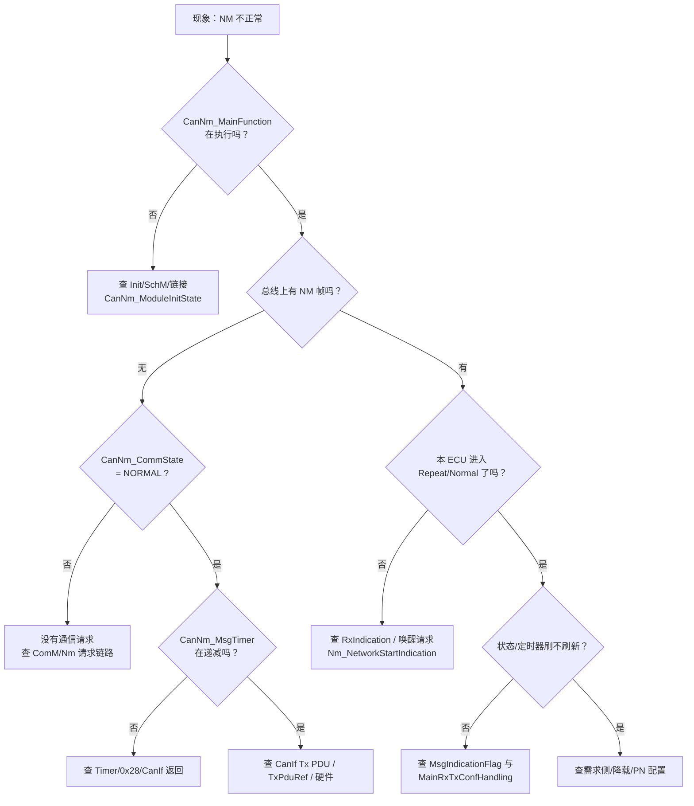

# CanNm 快速问题定位（现场排查手册）

> [!info] 导航
> 上级：[[CanNm]]

> 适用实现：NeuSAR CanNm 3.14.0 / AUTOSAR 4.2.2，2 个 NM 通道（ch0 ChannelId 6 / NodeId 39，ch1 ChannelId 2 / NodeId 35）
> 代码：`AUTOSAR/AUTOSAT使用NEUSAR生成的代码/002_BSW/Bsw_Src/Autosar_Src/src_CanNm/Source/CanNm.c`
> 最后更新：2026-10-22

> 定位原则：**先证调度、再证状态、再证收发、最后查配置**；任何时间参数都是 **tick（主函数周期数）**，先换算成实际时间再判断快慢。

## 1. 第一时间看什么（按优先级）

| 优先级 | 看什么     | 怎么快速确认                                                                         | 异常说明 / 范围                                  |
| --- | ------- | ------------------------------------------------------------------------------ | ------------------------------------------ |
| P0  | 主函数是否在跑 | `CanNm_ModuleInitState == CANNM_INIT`；SchM/OS 任务里 `CanNm_MainFunction` 是否有执行时间 | 不跑 → 初始化/调度/链接问题，不用查总线                     |
| P1  | 主函数周期   | 实测任务周期 × `CanNmMainFunctionPeriod` 配置                                          | 周期错 → 所有 timer/快发/超时全部错，先修周期               |
| P2  | NM 状态   | `CanNm_NmState[0..1]`                                                          | 停在 Bus-Sleep / 异常状态 → 查请求与迁移，不查发送          |
| P3  | 通信请求状态  | `CanNm_CommState[0..1]`                                                        | `COMM_READY_SLEEP` 时本来就不该周期发帧              |
| P4  | 发送控制    | `CanNm_TxControlState` / `TxControlStateRequest`                               | DISABLED（0x28）时所有发送定时器被清零                  |
| P5  | 发送定时器   | `CanNm_MsgTimer`、`ImmediateNmMsgCount`、`MsgTimeoutTimer`                       | 为 0/卡住 → 查 `MessageTimerHandling`、CanIf 返回 |
| P6  | 收发事件标志  | `CanNm_MsgIndicationFlag`、`CanNm_MsgConfirmationFlag`                          | 一直为 1 不消费 → 主函数没跑/中断上下文问题                  |
| P7  | 配置/映射   | `TxPduRef`、CanIf Tx/Rx PDU、ChannelId、PDU 布局                                    | 映射错 → 总线看得见但模块“不知道”                        |

## 2. 先看什么：一张决策图

## 3. 现象 → 首先看什么

| 现象             | 第一时间看                                                                             | 快速判定                                                                             | 范围收敛                                                           |
| -------------- | --------------------------------------------------------------------------------- | -------------------------------------------------------------------------------- | -------------------------------------------------------------- |
| 总线上完全没有 NM 帧   | `CanNm_CommState`、`CanNm_TxControlState`、`CanNm_MsgTimer`、`CanIf_Transmit` 返回值    | CommState=READY_SLEEP → 不应发；TxControl=DISABLED → 0x28 禁发；MsgTimer 卡住 → 查 handler | 先分“不该发 / 不发 / 发不出去”                                            |
| 有请求但只发一帧/不周期   | `CanNm_MsgTimer` 重装值、`CanNm_ImmediateNmMsgCount`、`CanNm_MsgTimeoutTimer`、CanIf 确认 | MsgTimer 变 1 或 0 不重装 → 发送失败路径；ImmediateCount 不为 0 → 还在快发                         | 查 `MessageTimerHandling` + `TriggerTransmission`               |
| 主动唤醒不进入 Repeat | `CanNm_NetworkRestartFlag`、`CanNm_NmState`、`CanNm_RepeatMsgTimer`                 | Flag 一直非 NO_RESTART → StateTransition 未执行；进入后 RepeatTimer 不递减 → 主函数/timer        | 查 NetworkRequest/主函数重启判断                                       |
| 被动唤醒无反应        | `CanNm_MsgIndicationFlag`、`CanNm_RxMessageData`、`CanNm_NmState`                   | 标志不置位 → CanIf 没回调；置位但状态不变 → 唤醒源/ComM 配置                                          | 先证 CanIf→CanNm，再证 Nm/ComM                                      |
| 该睡不睡           | `CanNm_CommState`、`CanNm_TimeoutTimer`、`CanNm_NmState`                            | CommState 仍 NORMAL → 还有请求；Timeout 一直被重置 → 持续收到帧                                  | 查请求方/总线是否有持续 NM 帧                                              |
| 睡眠慢/提前睡        | `TimeoutTime`/`WaitBusSleepTime` 的 tick 值、`CanNmMainFunctionPeriod`               | tick × 周期换算后对不上 → 配置/周期问题                                                        | 先算时间，再查 timer                                                  |
| 周期抖动/发送超时      | `CanNm_MsgTimer`、`CanNm_MsgTimeoutTimer`、`CanIf_Transmit` 返回、DET                  | MsgTimeoutTimer 到 0 → 发送链路异常；MsgTimer 重装 1 → 失败重试                                | 查 CanIf/驱动/总线负载                                                |
| 0x28 不生效       | `CanNm_TxControlStateRequest`、`CanNm_TxControlState`                              | Request 变了、State 没变 → 主函数没跑或宏关闭                                                  | 查 `CommunicationControlHandling` + `CANNM_COM_CONTROL_ENABLED` |
| 降载不生效          | `CanNm_BusLoadReductionActive[ch]`、配置 `BusLoadReductionActive`、`MsgReducedTime`   | 配置 FALSE → 本来就不降；为 TRUE 但周期不变 → 状态不在 Normal                                      | 本工程配置为 **FALSE**，不要按降载查                                        |
| RMR 不生效        | `CanNm_RepeatMsgReqFlag`、`CanNm_RepeatMsgBitIndFlag`、CBV 字节                       | Flag 置了但未迁移 → 主函数/RMR 分支；CBV 位置 OFF → 不置位                                        | 查节点检测宏 + CBV 配置                                                |
| 多通道互串          | `CanNm_NmState[0/1]`、`CanNm_ChToRxPduId[2]`、`CanNm_SysToNmChInd[7]`               | 通道索引错 → 状态/收发全串                                                                  | 核对 ChannelId / ComM 通道映射                                       |
| 总线错误帧/发送失败     | CanIf/Can 控制器错误计数、`CanNm_MsgTimeoutTimer`、DET                                     | 物理层/驱动问题，不是 CanNm 逻辑                                                             | 先看 CanIf/Can 控制器                                               |
| 复位后状态异常        | `CanNm_ModuleInitState`、`CanNm_Init` 是否被调用、Init 调用顺序                              | Init 前有 API 调用 → DET；重复 Init → ALREADY_INITIALIZED                               | 查 EcuM 初始化序列                                                   |

## 4. 重点观测变量（调试时 watch 这些）

| 变量                                                  | 正常/关键值                                       | 作用                | 异常提示                                          |
| --------------------------------------------------- | -------------------------------------------- | ----------------- | --------------------------------------------- |
| `CanNm_ModuleInitState`                             | `CANNM_INIT`                                 | 模块是否初始化           | 非 INIT → 主函数空转，所有现象都可能是假象                     |
| `CanNm_NmState[2]`                                  | 1~5（Bus-Sleep/Prepare/Ready/Normal/Repeat）   | 当前 NM 状态          | 卡在 Sleep/Prepare → 查请求；频繁跳变 → 查 timer/请求抖动    |
| `CanNm_CommState[2]`                                | `COMM_NORMAL_OPERATION` / `COMM_READY_SLEEP` | 通信请求状态            | 该发不发：是否 READY_SLEEP；该睡不睡：是否一直 NORMAL          |
| `CanNm_TxControlState[2]` / `TxControlStateRequest` | `MSG_TX_ENABLED`                             | 0x28 发送控制当前值/请求值  | Request 变 State 不变 → 主函数没跑/宏关闭                |
| `CanNm_TimeoutTimer[2]`                             | 递减到 0 后按状态处理                                 | NM-Timeout        | 一直重装 → 持续收到帧；到 0 不迁移 → 主函数/状态分支               |
| `CanNm_RepeatMsgTimer[2]`                           | 进入 Repeat 后递减                                | Repeat Message 停留 | 不递减 → 主函数；到 0 不迁移 → CommState/分支              |
| `CanNm_WaitBusSleepTimer[2]`                        | Prepare 后递减                                  | 睡眠静默期             | 到 0 不进 Sleep → StateTransition/主函数            |
| `CanNm_MsgTimer[2]`                                 | 到期后重装周期值                                     | 发送周期/快发/重试        | 为 1 → 发送失败重试；不重装 → TriggerTransmission 失败/分支错 |
| `CanNm_MsgTimeoutTimer[2]`                          | 发帧后 = MsgTimeoutTime+1                       | 发送确认超时            | 到 0 → 发送异常，查 CanIf/驱动                         |
| `CanNm_MsgConfirmationFlag[2]`                      | 立即确认模式下由发送置 1                                | 发送确认交接            | 一直 1 → 主函数没消费；一直 0 → 未发送/未确认                  |
| `CanNm_MsgIndicationFlag[2]`                        | 收到帧后置 1、主函数清 0                               | 接收事件交接            | 一直 1 → 主函数没跑；一直 0 → CanIf 未回调                 |
| `CanNm_NetworkRestartFlag[2]`                       | `CANNM_NO_RESTART`                           | 重启请求              | 非 NO_RESTART 且不迁移 → 主函数重启分支/StateTransition   |
| `CanNm_MsgRequest[2]`                               | `CANNM_NO_TRANSMIT_REQUEST`                  | Com 用户数据发送请求      | 一直请求 → 上层反复调 Transmit；与周期发送叠加                 |
| `CanNm_ImmediateNmMsgCount[2]`                      | 0（正常）/ 非 0（快发中）                              | 主动唤醒剩余快发帧数        | 卡非 0 → 发送失败或一直重试                              |
| `CanNm_RepeatMsgReqFlag[2]` / `RepeatMsgBitIndFlag` | 0 / 收到 RMR 时置位                               | RMR 请求/指示         | 置位但状态不迁 → 主函数/RMR 处理                          |
| `CanNm_BusLoadReductionActive[2]`                   | 本工程 FALSE                                    | 运行时降载激活           | 期望降载却为 FALSE → 配置 `BusLoadReductionActive` 未开 |
| `CanNm_TxMessageData[2][8]`                         | SNI/CBV/用户数据                                 | 发送帧内容             | 总线帧内容错 → 查 PDU 布局/NodeId/CBV 位置               |
| `CanNm_RxMessageData[2][8]`                         | 最近一帧                                         | 接收帧内容             | 内容不对 → CanIf Rx PDU / 总线                      |
| `CanNM_Message_Receive`（`CanNm_GetMessageReceive`）  | 收到过帧后置 TRUE 并被读取清零                           | “是否收到过 NM 帧”事件    | 一直 FALSE → 接收链路/映射                            |

## 5. 分层定位（先证明每一层）

| 层 | 先证明什么 | 手段 | 不通过时范围 |
|---|---|---|---|
| 总线 | 物理层有 NM 帧、ID/周期正确 | CANoe/CANalyzer trace | 收发器/终端电阻/波特率/过滤器 |
| CanIf | 收到指定 Rx PDU 并回调 `CanNm_RxIndication`；`CanIf_Transmit` 返回 E_OK | CanIf 配置、断点、DET | PDU 映射/HOH/控制器模式 |
| CanNm | 标志、状态、定时器按代码变化 | watch 第 4 节变量 | 主函数/状态机/定时器 |
| Nm | `Nm_NetworkStartIndication`/`Nm_BusSleepMode` 等回调是否发生 | Nm 回调断点/日志 | Nm 配置/ComM 通道 |
| ComM | 网络请求/释放是否到达 | ComM 状态、请求方日志 | 应用/诊断/唤醒源 |
| 应用 | 谁在请求/释放、是否误发 0x28 | 代码/诊断日志 | 上层逻辑 |

## 6. 断点与抓包

| 目的 | 位置 |
|---|---|
| 看主函数处理 | `CanNm_MainFunction`（`CanNm.c` L3618） |
| 看状态迁移 | `CanNm_StateTransition`（L1838） |
| 看发送 | `CanNm_TriggerTransmission`（L1611）、`CanIf_Transmit`（L1685） |
| 看接收 | `CanNm_RxIndication`（L3362） |
| 看确认 | `CanNm_TxConfirmation`（L3301） |
| 看发送调度 | `CanNm_MessageTimerHandling`（L1137） |
| 看超时 | `CanNm_MessageTimeoutTimerHandling`（L1234） |
| 看 0x28 | `CanNm_CommunicationControlHandling`（L2409） |

抓包要点：

1. 过滤该网络的 NM 报文 ID（由 `TxPduRef` 对应的 CanIf PDU 决定）；
2. 看**周期**、**方向**（谁发）、**CBV 的 RMR/AWB 位**、**SNI（NodeId）**；
3. 对照 `CanNm_TxMessageData` 看帧内容是否由本 ECU 构造；
4. 同时记录 `SchM` 任务周期，否则所有“快慢”判断都不成立。

## 7. 本项目配置坑（高频误判）

| 坑 | 说明 |
|---|---|
| **tick 不是 ms** | `CanNm_ChannelConfig[]` 的值是主函数周期数；实际时间 = tick × `CanNmMainFunctionPeriod`。`CanNm_Cfg.h` 注释里的 `[ms]` 是原 ECUC 说明，运行期按 tick 递减。 |
| 2 个通道 | 本项目有 ch0/ch1，ChannelId 6/2，NodeId 39/35；调试必须指定通道索引，不要只看 `[0]`。 |
| `BusLoadReductionActive` | 本工程两个通道都配成 **FALSE**；即使全局 `BUS_LOAD_REDUCTION_ENABLED=ON`，也不会降载。 |
| PN / CWU / 远程睡眠 / 协调器同步 | 全部 OFF，相关变量存在但无实际作用；不要按这些特性排查。 |
| `ConfigPtr` / `BswM_ConfigPtr` | `CanNm_Init` 的 `ConfigPtr` 实际未使用（`CANNM_DUMMY_STATEMENT`），配置直接取 `CanNm_ChannelConfig[]`。 |
| 测试钩子 | `VCU_Test_Code_YXP` 打开会在主函数开头调用 `Test_IO_Turn_LS10()`，影响时序，量产必须关闭。 |
| 发送 PDU | `TxPduRef` 为 176/94（ch0/ch1），必须与 CanIf Tx PDU 配置一致；不一致时总线看不到帧但代码“发送成功”。 |
| PDU 布局 | CBV=Byte1、NID=Byte0；改布局后 `CanNm_Cfg.c` 与 CanIf PDU DLC/字节不匹配会导致帧内容异常。 |

## 8. 30 分钟范围锁定流程

1. **复现**：记录现象、通道、周期、总线 trace、软件版本（CanNm 3.14.0/AR4.2.2）、`CanNmMainFunctionPeriod`；
2. **分层**：按第 5 节从总线→CanIf→CanNm 逐层证明，先确定“死”在哪一层；
3. **变量快照**：停住 CPU，抓第 4 节变量（至少状态/CommState/TxControl/5 个 timer/2 个标志）；
4. **配置核对**：第 7 节逐项核对 tick、通道、TxPduRef、PDU 布局、功能宏；
5. **最小化**：只保留一个通道/一个请求源，关闭降载/PN/测试钩子，再复现；
6. **结论**：给出“层 + 变量证据 + 配置项 + 复现条件”，写入问题记录（Q-xxx）。

## 9. 提交问题时带上的证据

- 现象与复现条件（冷启动/唤醒/诊断/复位后）；
- 总线 trace（NM ID、周期、CBV/SNI 位）与通道号；
- 第 4 节变量的实时值（至少 `NmState`、`CommState`、`TxControlState`、`MsgTimer`、`ImmediateNmMsgCount`、`MsgTimeoutTimer`、两个事件标志）；
- 配置值：`CanNmMainFunctionPeriod`、`ChannelId`、`NodeId`、`TxPduRef`、`PduCbvPosition`、`PduNidPosition`；
- 软件版本、编译器、是否定义 `VCU_Test_Code_YXP`；
- DET 记录（如 `CANNM_E_NETWORK_TIMEOUT`、`CANNM_E_PDUR_TRIGGERTX_ERROR`）。

> 问题记录格式见 `CanNm_问题排查记录.md`（Q-xxx）；本页只负责“快速定位”，不重复记录历史问题。
> 上下电/状态转换/首帧等**时间超时**问题，见同目录 `CanNm_时间类问题排查.md`。
