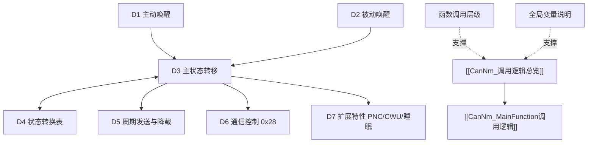

# CanNm 模块总览

> [!info] 导航
> 上级：[[AUTOSAR]] ｜ 同级：[[AUTOSAR#2. 模块地图]]
> 本页是 CanNm 的唯一入口：**模块 → 主题 → 方向 → 细节**。

## 1. 一句话定位

CanNm（CAN Network Management）位于 **Nm 通用网络管理接口** 与 **CanIf** 之间，用周期 NM 报文协调 CAN 网络的唤醒与睡眠，并支持节点检测、降载、用户数据、被动模式、部分网络（PNC）、Car Wakeup 等功能。

- 适用版本：AUTOSAR CP R21-11（SWS_CanNm，Document ID 13）
- **实现基线**：本项目生成代码为 NeuSAR CanNm **3.14.0 / AUTOSAR 4.2.2**（`AUTOSAT使用NEUSAR生成的代码/src_CanNm`），2 个 NM 通道；变量与函数以代码为准，见 [[CanNm_全局变量说明]]、[[CanNm_函数调用层级]]
- 模块边界：唯一上层 Nm，唯一通信下层 CanIf；不做 ECU 电源决策，不直接操作控制器。

## 2. 快速入口（5 个主题）

| 主题 | 入口 | 包含内容 |
|---|---|---|
| 学习总结 | [[CanNm_模块作用与架构定位]] | 架构定位、状态机、定时参数、PDU 结构、功能特性；另见 [[CanNm_DaVinci配置项]]、[[CanNm_BusLoadReductionActive说明]]、[[CanNm_一页纸复盘]] |
| 调用逻辑 | [[CanNm_调用逻辑总览]] | D1 主动唤醒、D2 被动唤醒、D3 主状态转移、D4 状态转换表、D5 周期发送与降载、D6 通信控制、D7 扩展特性 |
| 主函数 | [[CanNm_MainFunction调用逻辑]] | 调度、方向→处理段映射、伪代码、排障点 |
| 标准表格 | [[CanNm_AUTOSAR标准需求表_R21-11]] | 273 条中文需求（按需求号分组锚点）；另见 [[CanNm_配置参数表_R21-11]]、[[CanNm_需求追溯与覆盖度]] |
| 问题排查 | [[CanNm_问题排查记录]] | 非 AUTOSAR 标准问题（工具/集成/硬件/供应商差异），持续更新 |

## 3. 调用逻辑层次（L2 → L3）

- 入口两条：[[CanNm_D1_主动唤醒调用逻辑]] / [[CanNm_D2_被动唤醒调用逻辑]]
- 状态机中枢：[[CanNm_D3_主状态转移逻辑]] ↔ [[CanNm_D4_状态转换表]]
- 运行服务：[[CanNm_D5_周期发送与降载调用逻辑]]、[[CanNm_D6_通信控制调用逻辑]]、[[CanNm_D7_扩展特性调用逻辑]]
- 支撑：[[CanNm_函数调用层级]]、[[CanNm_全局变量说明]]

## 4. 交付物状态

- [x] 官方文档：[[CanNm_来源清单]]
- [x] 作用/DaVinci/降载专题/复盘
- [x] 调用逻辑（D1~D7 + 层级 + 全局变量 + 状态表）
- [x] MainFunction 调用逻辑
- [x] 标准需求表（273 需求 / 72 配置 / 45 追溯）
- [x] 问题排查记录（模板就绪，持续补充）

## 5. 更新记录

| 日期 | 内容 |
|---|---|
| 2026-10-20 | 初版学习包 |
| 2026-10-21 | 升级 v2：调用逻辑按方向拆分、标准需求表、问题排查 |
| 2026-10-21 | 升级 v3：L1 模块总览（本页）+ 层级引用（上级 [[AUTOSAR]]） |
