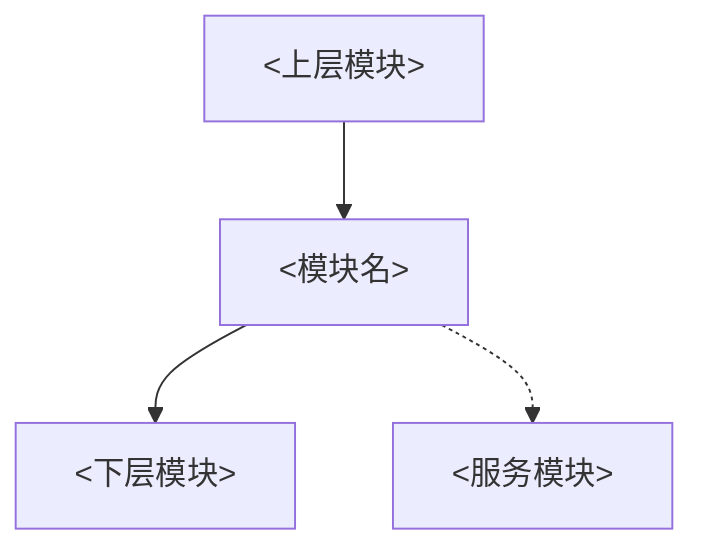

# <模块名> 模块作用与架构定位（模板）

> [!info] 导航
> 上级：<模块名>（复制后改成真实链接）

> 适用版本：AUTOSAR CP R21-11　**实现基线**：<工具链/版本> / AUTOSAR <版本>
> 最后更新：YYYY-MM-DD

## 1. 在 AUTOSAR 分层中的位置

| 项目 | 内容 |
|---|---|
| 所属层 | <BSW Services / ECU Abstraction / MCAL …> |
| 上层 | <谁调用本模块> |
| 下层 | <本模块调用谁> |
| 横向依赖 | <Det/Dem/OS/…> |
| 不负责 | <明确边界> |

## 2. 模块解决什么问题

- 核心职责 1：……
- 核心职责 2：……
- 核心职责 3：……

## 3. 核心机制

| 机制 | 说明 | 相关 SWS 章节 |
|---|---|---|
| 状态机 | | |
| 定时器 | | |
| 收发/调度 | | |
| 配置/模式 | | |

## 4. 关键数据流

## 5. 实现基线（必填）

| 项目 | 内容 |
|---|---|
| 供应商/工具链 | <NeuSAR/Vector/…> <版本> |
| AUTOSAR 版本 | <4.2.2/R21-11/…> |
| 生成代码路径 | `AUTOSAR/.../src_<模块名>/Source/` |
| 通道/分区/规模 | <...> |
| 时间单位 | <tick（主函数周期数）/ms>；换算：实际时间 = tick × <周期> |
| 与文档差异 | <标准版本差异/配置裁剪/厂商扩展> |

## 6. 关联

- DaVinci 配置：<模块名>_DaVinci配置项
- 调用逻辑：<模块名>_调用逻辑总览
- 需求：<模块名>_AUTOSAR标准需求表_R21-11
- 问题：<模块名>_快速问题定位
