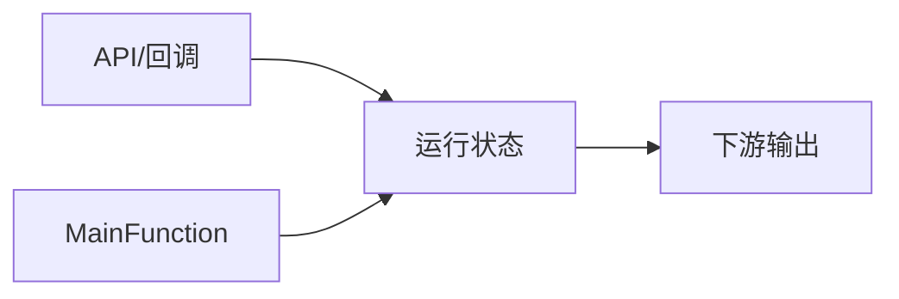

# <模块名> 全局变量说明（模板）

> [!info] 导航
> 上级：<模块名>_调用逻辑总览（复制后改成真实链接）

> 适用版本 / 实现基线 / 最后更新
> 要求：**先写实现基线，再按“配置 / 运行状态 / 静态变量”分类**；写实际变量名、类型、读写宏。
> 时间参数若是 tick，必须写明 `实际时间 = tick × <周期>`。

## 0. 代码基线

| 项目 | 值 |
|---|---|
| 供应商/版本 | |
| AUTOSAR 版本 | |
| 代码路径 | |
| 通道/分区/规模 | |
| 时间单位 | tick / ms；换算： |

## 1. 配置数据（ROM）

| 变量/结构 | 类型/维度 | 定义位置 | 作用 | 写者 | 读者 |
|---|---|---|---|---|---|
| `<Module>_ChannelConfig[]` | | `_Cfg.c` | | 生成时固定 | 所有处理 |
| | | | | | |

## 2. 运行状态（RAM）

| 变量 | 类型/维度 | 读写宏 | 作用 | 写者 | 读者 | 初值/备注 |
|---|---|---|---|---|---|---|
| `<Module>_State[]` | | `<Get/Set>` | | | | |
| `<Module>_TimerState[]` | | | | | | |

## 3. 文件内静态变量

| 变量 | 类型 | 位置 | 作用 |
|---|---|---|---|
| | | | |

## 4. 状态/模式取值

| 宏 | 值 | 含义 |
|---|---|---|
| | | |

## 5. 旧概念名 → 实际变量

| 标准/旧文档说法 | 实际变量/宏 |
|---|---|
| | |

## 6. 读写关系

## 7. 与 SWS 的差异/厂商扩展

- <配置裁剪、版本差异、vendor Hook>
