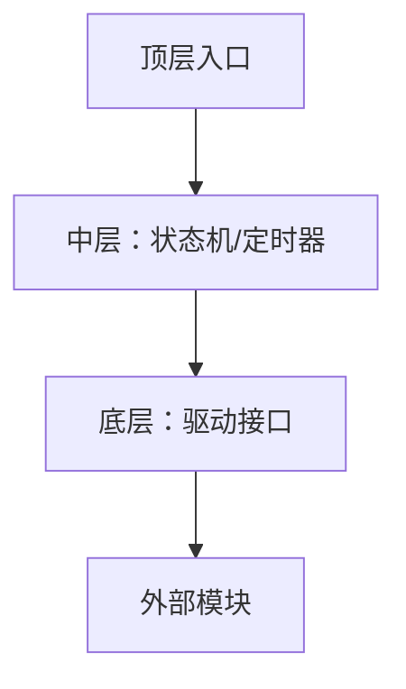

# <模块名> 函数调用层级与全局变量（模板）

> [!info] 导航
> 上级：<模块名>_调用逻辑总览 ｜ 依据：<模块名>_AUTOSAR标准需求表_R21-11


> 适用版本 / 依据文档 / 最后更新

## 一、函数调用层级（从上到下）

> 同一层按调用先后排列；标注执行上下文（任务/中断/API 上下文）。

```text
【顶层：调度与对外接口】
├─ Xxx_MainFunction()                [任务上下文, 周期 xxx ms]
├─ Xxx_Init() / Xxx_DeInit()         [初始化上下文]
├─ Xxx_<对外 API 1>()                [任务/调用者上下文]
├─ Xxx_RxIndication()                [中断或轮询上下文]
└─ Xxx_TxConfirmation()              [中断或轮询上下文]

【中层：业务处理】
├─ 状态机处理
│  ├─ <状态A 处理>()
│  └─ <状态B 处理>()
├─ 定时器处理
│  ├─ <定时器到期处理>()
│  └─ <定时器重装>()
├─ 报文组装/解析
│  ├─ <组包>()
│  └─ <解包>()
└─ 动作分发
   └─ <执行动作列表>()

【底层：驱动与接口】
├─ <驱动接口调用>（如 CanIf_Transmit / PduR_xxx）
├─ <回调上层>（如 Nm_xxx / ComM_xxx）
└─ Det_ReportError / Det_ReportRuntimeError
```

### 层级说明

| 层 | 职责 | 关键约束 |
|---|---|---|
| 顶层 | 被调度/被调用入口 | 上下文、可重入性、周期 |
| 中层 | 业务逻辑 | 不直接碰硬件；只操作模块内数据 |
| 底层 | 与外部交互 | 返回值/错误处理 |

## 二、全局变量（模块级数据）说明

| 变量/结构 | 定义位置 | 类型 | 作用 | 写者 | 读者 | 生命周期 |
|---|---|---|---|---|---|---|
| 例：`Xxx_ConfigPtr` | `Xxx.c` | `const Xxx_ConfigType*` | 指向当前配置集 | `Xxx_Init` | 所有函数 | 初始化后只读 |
| 例：`Xxx_ChannelState[]` | `Xxx.c` | 数组 | 每通道运行状态 | 状态机/回调 | 定时器/发送 | 运行期持续变化 |
| 例：`Xxx_Timer[]` | `Xxx.c` | 数组 | 各定时器剩余时间 | 主函数递减/事件重装 | 状态机 | 运行期 |
| … | | | | | | |

### 说明要点

- 区分 **配置数据（只读）** 与 **运行状态（可写）**；
- 标出多核/多分区下的可见性（是否有副本、是否需同步）；
- 标出中断上下文会写的变量（可能需要临界区）；
- 标出掉电/休眠时是否保留。

## 三、调用关系图（Mermaid 可选）


