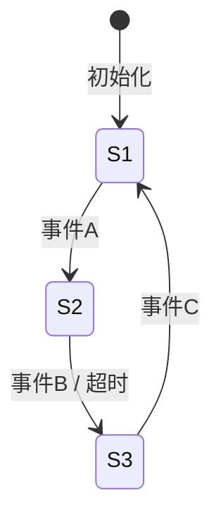

# <模块名> 状态转换表（模板）

> [!info] 导航
> 上级：<模块名>_调用逻辑总览
> 提示：按“源状态”分小节（如 `### 从 <状态> 出发`），便于其他文档用标题锚点引用。

> 适用版本 / 依据文档 / 最后更新

## 1. 状态清单

| 状态 | 含义 | 进入动作 | 退出动作 | 备注 |
|---|---|---|---|---|
| S1：<状态名> | | | | |
| S2：<状态名> | | | | |
| S3：<状态名> | | | | |

## 2. 状态转换表

| 编号 | 当前状态 | 触发事件 / 条件 | 下一状态 | 执行动作 | 需求号 | 备注 |
|---|---|---|---|---|---|---|
| T-01 | S1 | <事件> | S2 | <调用/动作> | SWS_XXX_xxxxx | |
| T-02 | S2 | <事件> | S3 | | | |
| T-03 | S2 | <超时> | S1 | | | |

## 3. 状态图（Mermaid）

## 4. 与代码/配置的对应

| 状态 | 代码枚举/宏 | 状态处理函数 | 关联配置参数 |
|---|---|---|---|
| S1 | 如 `XXX_STATE_S1` | `<处理函数>()` | `<Param>` |

## 5. 特殊说明

- **初始状态**：初始化后处于哪个状态；
- **未定义条件**：条件不满足/数据未就绪时如何处理；
- **异常路径**：错误、超时、通信失败时的状态处理；
- **不可达/不允许的转换**：以及如何校验。
