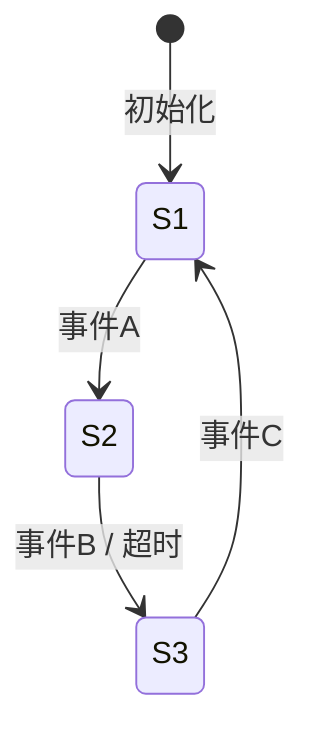

# <模块名> 状态转换表（模板）

> [!info] 导航
> 上级：<模块名>_调用逻辑总览（复制后改成真实链接）
> 提示：按“源状态”分小节（如 `### 从 <状态> 出发`），便于上级 Hub 用锚点引用。

> 适用版本 / 实现基线 / 最后更新

## 1. 状态清单

| 状态 | 含义 | 进入动作 | 退出动作 | 代码宏 |
|---|---|---|---|---|
| S1：<状态名> | | | | `<XXX_STATE_S1>` |
| S2：<状态名> | | | | |
| S3：<状态名> | | | | |

## 2. 状态转换表

| 编号 | 当前状态 | 触发事件 / 条件 | 下一状态 | 执行动作 | 需求号 | 备注 |
|---|---|---|---|---|---|---|
| T-01 | S1 | <事件> | S2 | <调用/动作> | SWS_XXX_xxxxx | |
| T-02 | S2 | <事件> | S3 | | | |
| T-03 | S2 | <超时> | S1 | | | |

## 3. 状态图（Mermaid）

## 4. 与代码/配置的对应

| 状态 | 代码枚举/宏 | 状态处理函数（行号） | 关联配置参数 |
|---|---|---|---|
| S1 | | `<函数>()` | |
| S2 | | | |

## 5. 条件判断说明

| 转换 | 判断条件 | 为什么这样判断 | 不满足时 |
|---|---|---|---|
| T-01 | | | |
| T-02 | | | |

## 6. 特殊说明

- **初始状态**：
- **未定义条件**：
- **异常路径**（超时/错误/通信失败）：
- **不可达/不允许的转换**：
