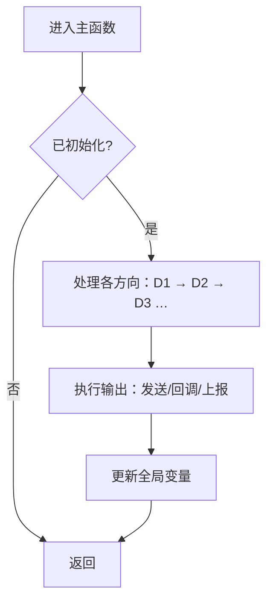

# <模块名>_MainFunction 调用逻辑（模板）

> [!info] 导航
> 上级：<模块名> ｜ 依赖：<模块名>_调用逻辑总览


> 适用版本 / 依据文档 / 最后更新
> 本文件由 `03_调用逻辑` 的方向（D1、D2…）生成，必须能指回方向编号。

## 1. 调度与配置

| 项目 | 内容 |
|---|---|
| 调度者 | 如 SchM / OS 任务 |
| 周期 | 如 `XxxMainFunctionPeriod` = 10 ms（须等于任务周期） |
| 上下文 | 任务上下文 |
| 可重入 | 不可重入 |
| 声明位置 | 如 `SchM_Xxx.h` |
| 未初始化行为 | 直接返回 |

## 2. 入口前已就绪的数据

- 接收缓冲/请求标志（由回调或 API 在上一次主函数后写入）；
- 各定时器剩余值；
- 全局状态变量。

## 3. 方向 → 主函数处理段映射

| 方向编号 | 方向名称 | 主函数中的处理段 | 进入条件 | 输出 |
|---|---|---|---|---|
| D1 | 例：主动唤醒 | 第 2 段：状态机唤醒处理 | 收到请求标志 | 进入网络状态、回调 |
| D2 | 例：被动唤醒 | 第 3 段：接收处理 | 收到帧 | 状态/定时器更新 |
| D3 | 例：主状态转移 | 第 4 段：定时器到期处理 | 定时器 = 0 | 状态迁移 |
| D5 | 例：周期发送 | 第 5 段：发送调度 | 周期定时器到期 | `CanIf_Transmit` |

## 4. 主流程



## 5. 分步解析

1. 步骤一：……
2. 步骤二：……
3. 步骤三：……

## 6. 伪代码

```c
void Xxx_MainFunction(void)
{
    if (!Xxx_Initialized) return;

    /* 方向 D1：主动唤醒 */
    /* 方向 D2：被动唤醒 */
    /* 方向 D3：状态机/定时器 */
    /* 方向 D5：发送调度 */
    /* 输出与错误上报 */
}
```

## 7. 全局变量的变化

| 变量 | 主函数中何时写 | 影响 |
|---|---|---|
| | | |

## 8. 输出与回调

| 输出 | 调用接口 | 触发条件 | 备注 |
|---|---|---|---|
| | | | |

## 9. 时序特性与排障点

- 周期精度影响哪些时序；
- 哪段可能耗时较长；
- 与中断/其他任务的竞争点；
- 常见异常现象与对应检查点。
