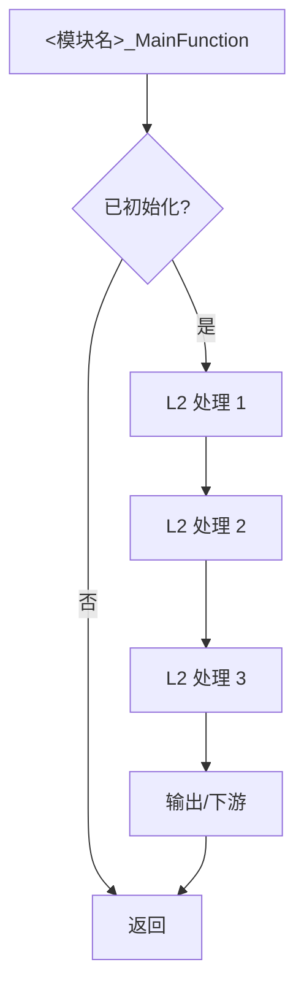

# <模块名>_MainFunction 调用逻辑（模板）

> [!info] 导航
> 上级：<模块名>（复制后改成真实链接）

> 适用版本 / 实现基线（供应商+版本 / AUTOSAR 版本）
> 代码：`<模块名>.c` 的 `<模块名>_MainFunction`（Lxxxx~Lyyyy）
> 最后更新：YYYY-MM-DD

## 1. 调度与配置

| 项目 | 内容 |
|---|---|
| 调度者 | SchM/OS 周期任务 |
| 函数 | `<模块名>_MainFunction(void)`，不可重入 |
| 周期 | `<MainFunctionPeriod>`；若生成宏/任务周期不同，写明实际值 |
| 上下文 | 任务 |
| 前置 | `<模块名>_Init` 已执行 |
| 分区/通道 | |
| 规模 | |

> **时间单位**：定时器值是 tick 还是 ms？实际时间 = tick × 周期。

## 2. 实际执行顺序



## 3. 分步解析

### 3.1 <步骤 1>
- 做什么：
- 条件：
- 输出/变量变化：

### 3.2 <步骤 2>
（同上）

## 4. 伪代码（按实际函数）

```c
void <模块名>_MainFunction(void)
{
    if (<模块名>_Initialized != TRUE) return;
    <L2 调用 1>();
    <L2 调用 2>();
    ...
}
```

## 5. 函数逐级拆解（深度 3，代码注释版）

> 保留 C 代码风格，只在关键判断后加 `/* 判断：... */`；与本判断无关的语句用 `...` 省略。
> 深度：L1 主函数 → L2 直接调用 → L3 规则/动作/定时器/下游函数。

### 5.1 调用树（L1 → L2 → L3）

```text
<模块名>_MainFunction（L1）
├─ <L2 函数 A>
│  ├─ <L3 函数>
│  └─ <L3 函数>
├─ <L2 函数 B>
│  └─ <L3 函数>
└─ <L2 函数 C>
```

### 5.2 L1：`<模块名>_MainFunction`（Lxxxx）

> **函数作用**：<一句话说明主函数职责>。

```c
FUNC(void, XXX_CODE) <模块名>_MainFunction(void)
{
    if (<初始化标志> != TRUE) {                 /* 判断：未初始化 → 不处理 */
        return;
    }
    <L2 调用 1>();                              /* 作用：... */
    <L2 调用 2>();                              /* 作用：... */
}
```

> **全局变量**：==<变量 1>==、==<变量 2>==　**代码跳转**：[<模块名>.c:Lxxxx](vscode://file/<绝对路径>:<行号>)

### 5.3 L2：主函数直接调用

#### 5.3.1 `<L2 函数 A>`（Lxxxx）

> **函数作用**：<...>。

```c
/* 保留实际代码结构，关键判断加注释 */
```

> **全局变量**：==...==　**代码跳转**：[<模块名>.c:Lxxxx](vscode://file/<绝对路径>:<行号>)

#### 5.3.2 `<L2 函数 B>`（Lxxxx）

（同上）

### 5.4 L3：规则/动作/定时器/下游函数

> 每个关键 L3 函数写：函数作用 + 简化代码 + 判断注释 + 变量高亮 + 代码跳转。

### 5.5 代码文件入口

- 主文件：`AUTOSAR/.../src_<模块名>/Source/<模块名>.c`
- 配置/生成文件：`<模块名>_Lcfg.c` / `<模块名>_Cfg.h`
- `vscode://` 链接无效时，打开文件后按行号定位。

## 6. 本项目配置对主函数的影响

> 如时间参数是 tick，写明换算；如配置裁剪，写明哪些分支不编译。

| 配置 | 值 | 主函数表现 |
|---|---|---|
| | | |

## 7. 排障要点

1. 主函数是否执行：
2. 关键状态：
3. 关键定时器：
4. 输入/输出：
5. 配置：

## 8. 与旧文档的差异

| 旧内容 | 实际代码 |
|---|---|
| | |
