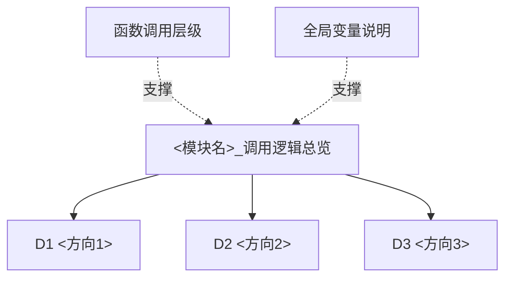

# <模块名> 模块总览

> [!info] 导航
> 上级：[[AUTOSAR]] ｜ 同级：[[AUTOSAR#2. 模块地图]]

## 1. 一句话定位

<模块名>：<一句话说明它解决什么问题、在架构中的位置>。

- 适用版本：AUTOSAR CP R21-11（SWS_XXX，Document ID xxx）
- 模块边界：<唯一上层/下层；不负责什么>

## 2. 快速入口（5 个主题）

| 主题 | 入口 | 包含内容 |
|---|---|---|
| 学习总结 | <模块名>_模块作用与架构定位 | 架构定位、核心机制；另见 <模块名>_DaVinci配置项、<模块名>_一页纸复盘 |
| 调用逻辑 | <模块名>_调用逻辑总览 | D1…Dn 方向清单 |
| 主函数 | <模块名>_MainFunction调用逻辑 | 调度、方向映射、伪代码、排障点 |
| 标准表格 | <模块名>_AUTOSAR标准需求表_R21-11 | 中文需求（按需求号分组锚点） |
| 问题排查 | <模块名>_问题排查记录 | 非标准问题，持续更新 |

## 3. 调用逻辑层次

## 4. 交付物状态

- [ ] 官方文档：<模块名>_来源清单
- [ ] 作用 / DaVinci 配置项 / 复盘
- [ ] 调用逻辑（D1~Dn + 层级 + 全局变量 + 状态表）
- [ ] MainFunction 调用逻辑
- [ ] 标准需求表 + 配置参数表 + 追溯
- [ ] 问题排查记录

## 5. 更新记录

| 日期 | 内容 |
|---|---|
| YYYY-MM-DD | 新建模块包 |
