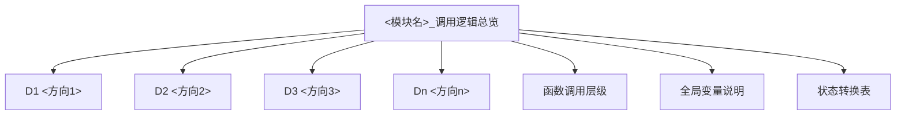

# <模块名> 模块总览

> [!info] 导航
> 上级：[[AUTOSAR]] ｜ 同级：[[AUTOSAR#2. 模块地图]]
> 本页是 <模块名> 的唯一入口：**模块 → 主题 → 方向 → 细节**。

## 1. 一句话定位

<模块名>：<一句话说明它解决什么问题、在 AUTOSAR 分层中的位置>。

- 适用版本：AUTOSAR CP R21-11（SWS_<模块名>，Document ID xxx）
- **实现基线**：<供应商/工具链> <版本> / AUTOSAR <版本>（代码路径：`<生成代码目录>`）；实际通道/分区/规模：<...>
- 模块边界：<唯一上层/下层；不负责什么>

## 2. 快速入口（5 个主题）

> 实际建库时把下列“入口”替换为真实双链。

| 主题 | 入口 | 包含内容 |
|---|---|---|
| 学习总结 | <模块名>_模块作用与架构定位 | 架构定位、核心机制、状态/定时器/数据流；另见 DaVinci 配置项、一页纸复盘 |
| 调用逻辑 | <模块名>_调用逻辑总览 | D1~Dn 方向、函数层级、全局变量、状态转换表 |
| 主函数 | <模块名>_MainFunction调用逻辑 | 调度、实际顺序、深度 3 拆解、伪代码、排障点 |
| 标准表格 | <模块名>_AUTOSAR标准需求表_R21-11 | 需求表（按百位分组锚点）、配置参数表、追溯与覆盖度 |
| 问题排查 | <模块名>_快速问题定位 | 现场快速定位；时间类排查；问题记录 Q-xxx |

## 3. 调用逻辑层次（L2 → L3）

> 链接规则：L3 只链 HUB，HUB 只链 L1；同级文档禁止互链（用纯文本/Mermaid）。

## 4. 9 项交付物状态

- [ ] 1. 模块目录 + 模块总览（本页）
- [ ] 2. 官方文档 + `<模块名>_来源清单.md`（含本地代码清单）
- [ ] 3. 学习总结：模块作用 / DaVinci 配置项 / 一页纸复盘
- [ ] 4. 调用逻辑：D1~Dn + 函数层级 + 全局变量 + 状态表
- [ ] 5. MainFunction 调用逻辑（深度 3、函数作用、变量高亮、代码跳转）
- [ ] 6. 标准表格：需求表 + 配置参数表 + 追溯与覆盖度
- [ ] 7. 问题排查记录（Q-xxx）
- [ ] 8. 06 问题排查：快速定位 + 时间类排查
- [ ] 9. 07 非标准实现清单

## 5. 更新记录

| 日期 | 内容 |
|---|---|
| YYYY-MM-DD | 新建模块包 |
